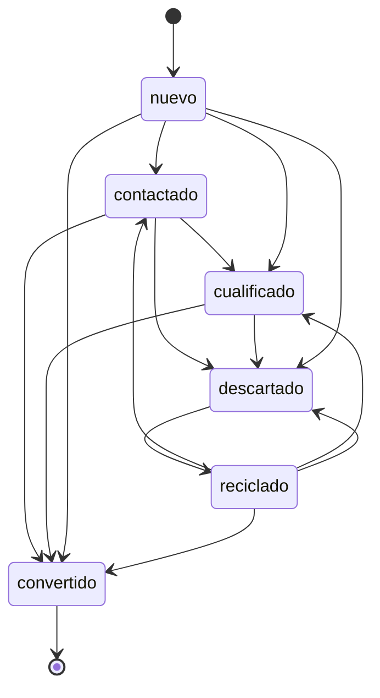
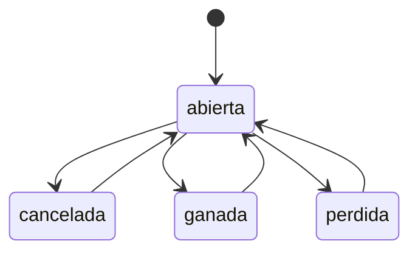

# Procesos, de extremo a extremo

> Generado por `scripts/gen_procesos.py`. **No se edita a mano**: cada
> pieza sale del contrato de cada servicio, del código que emite los
> eventos, de las suscripciones declaradas al arrancar y de las máquinas
> de estado registradas. Un documento de procesos escrito a mano dice lo
> que alguien creyó que pasaba el día que lo escribió.

Cada proceso se lee así: **qué se pide** (entrada), **qué contesta**
(salida), **qué dispara** (eventos) y **a quién despierta** (quién
reacciona). Una operación sin eventos no encadena nada: también es un
dato.

## Por qué estados pasa cada cosa

### lead

Empieza en **nuevo**. No se sale de: convertido.

### oportunidad

Empieza en **abierta**.

## Qué se puede hacer, y qué desencadena

### tenancy

| Operación | Qué hace | Entrada | Respuestas | Dispara → despierta a |
| --- | --- | --- | --- | --- |
| `POST /api/v1/aislamiento` | Declarar el aislamiento de un tenant | tenant_id*, modalidad*, instancia, base, esquema, pool_computo, infraestructura_del_cliente, notas | 201, 422 | — |
| `POST /api/v1/aislamiento/migraciones` | Planificar un cambio de modalidad (CRM-00.01.01.04, CRM-00.01.03.10) | tenant_id*, hacia*, ventana_minutos | 201, 422 | — |
| `PATCH /api/v1/aislamiento/migraciones/{migracion_aislamiento_id}` | Editar migraciones de aislamiento | migracion_aislamiento_id*, desde, hacia, estado, ventana_minutos, solo_lectura_desde, solo_lectura_hasta, recuento_origen, recuento_destino, diferencias, motivo_fin, terminada_at | 200, 422 | — |
| `POST /api/v1/aislamiento/migraciones/{migracion_aislamiento_id}/archivar` | Archivar migraciones de aislamiento | migracion_aislamiento_id* | 200, 422 | — |
| `POST /api/v1/aislamiento/migraciones/{migracion_id}/cerrar` | Cerrar la migración, solo si la verificación cuadró | migracion_id*, nueva_base, nuevo_esquema | 200, 422 | — |
| `POST /api/v1/aislamiento/migraciones/{migracion_id}/revertir` | Deshacer una migración que no cuadró | migracion_id*, motivo* | 200, 422 | — |
| `POST /api/v1/aislamiento/migraciones/{migracion_id}/ventana` | Abrir la ventana de solo lectura | migracion_id* | 200, 422 | — |
| `POST /api/v1/aislamiento/migraciones/{migracion_id}/verificar` | Comparar lo que había con lo que hay, tabla a tabla | migracion_id*, recuento_origen, recuento_destino | 200, 422 | — |
| `POST /api/v1/aislamiento/{tenant_id}/comprobar` | Comprobar que el tenant está donde se declaró (CRM-00.01.01.02, .03) | tenant_id* | 200, 422 | — |
| `PUT /api/v1/ajustes/{clave}` | Fijar un ajuste | clave*, valor*, ambito, ambito_id | 200, 422 | — |
| `POST /api/v1/calendarios` | Crear un calendario laboral | clave*, nombre*, zona_horaria, pais, horario, por_defecto | 201, 422 | — |
| `POST /api/v1/calendarios/{calendario_id}/festivos` | Añadir un festivo | calendario_id*, fecha*, nombre*, anual | 201, 422 | — |
| `POST /api/v1/claves-cifrado` | Aportar o rotar la clave del cliente | material_base64*, origen | 201, 422 | — |
| `POST /api/v1/claves-cifrado/generar` | Generar material de clave, para quien no quiera aportarlo | — | 200, 422 | — |
| `POST /api/v1/claves-cifrado/revocar` | Revocar la clave: borrado criptográfico irreversible | motivo*, confirmo_que_es_irreversible | 200, 422 | — |
| `PUT /api/v1/flags/{clave}` | Fijar un flag para el tenant | clave*, activo, porcentaje, descripcion | 200, 422 | — |
| `PUT /api/v1/grc/controles/{codigo}` | Crear o actualizar un control | codigo*, nombre*, descripcion, tipo, automatico, frecuencia, responsable_id, activo, capacidades, riesgos, marcos, fuente_evidencia | 200, 422 | — |
| `POST /api/v1/grc/controles/{codigo}/evaluaciones` | Evaluar un control | codigo*, resultado*, fecha, observaciones, plan_accion, evidencia | 201, 422 | — |
| `PUT /api/v1/grc/riesgos/{codigo}` | Registrar o actualizar un riesgo | codigo*, titulo*, descripcion, categoria, probabilidad, impacto, propietario_id, tratamiento, estado, residual_probabilidad, residual_impacto, revision_at | 200, 422 | — |
| `PUT /api/v1/monedas/cambios` | Fijar un tipo de cambio para una fecha | desde*, hasta*, tasa*, fecha, origen | 200, 422 | — |
| `POST /api/v1/plantillas` | Crear una plantilla | clave*, nombre*, tipo, idioma, asunto, cuerpo, variables | 201, 422 | — |
| `PATCH /api/v1/plantillas/{plantilla_id}` | Editar una plantilla | plantilla_id*, nombre, asunto, cuerpo, variables, activa, bloqueada | 200, 422 | — |
| `POST /api/v1/plantillas/{plantilla_id}/previsualizar` | Previsualizar una plantilla con datos de prueba | plantilla_id*, datos | 200, 422 | — |
| `POST /api/v1/residencia` | Declarar dónde vive un tipo de dato (CRM-00.01.05.01, .02) | tenant_id*, tipo_dato*, region*, proveedor, notas | 201, 422 | — |
| `POST /api/v1/residencia/subprocesadores` | Declarar un subprocesador (CRM-00.01.05.03) | tenant_id*, clave*, nombre*, trata, finalidad*, region, garantia, referencia_garantia | 201, 422 | — |
| `PATCH /api/v1/residencia/subprocesadores/{subprocesador_id}` | Editar subprocesadores | subprocesador_id*, clave, nombre, trata, finalidad, region, garantia, referencia_garantia, activo, comunicado_at | 200, 422 | — |
| `DELETE /api/v1/residencia/subprocesadores/{subprocesador_id}` | Borrar subprocesadores | subprocesador_id* | 204, 422 | — |
| `POST /api/v1/residencia/subprocesadores/{subprocesador_id}/archivar` | Archivar subprocesadores | subprocesador_id* | 200, 422 | — |
| `POST /api/v1/residencia/subprocesadores/{tenant_id}/{clave}/comunicado` | Marcar que se le ha comunicado al cliente | tenant_id*, clave* | 200, 422 | — |
| `POST /api/v1/residencia/transferencias` | Anotar una salida de datos fuera de su región | tenant_id*, tipo_dato, hacia_region*, desde_region, subprocesador, motivo | 201, 422 | — |
| `POST /api/v1/sandboxes/caducados` | Qué entornos hay que refrescar o apagar | sandboxes | 200, 422 | — |
| `POST /api/v1/sandboxes/plan` | Preparar una copia a un entorno que no es producción | proposito*, porcentaje, anonimizar, motivo_sin_anonimizar | 200, 422 | — |
| `POST /api/v1/sandboxes/reglas` | Comprobar que toda columna personal tiene decidido su tratamiento | campos_personales, reglas | 200, 422 | — |
| `POST /api/v1/suite/aplicar` | Aplicar la cola pendiente | herramienta, tope | 200, 422 | — |
| `POST /api/v1/suite/cerrar` | Dar de baja este tenant en todas las herramientas conectadas | — | 200, 422 | — |
| `POST /api/v1/suite/cuarentena/{sincronizacion_id}/reintentar` | Volver a intentar algo apartado | sincronizacion_id* | 200, 422 | — |
| `POST /api/v1/suite/herramientas` | Conectar una herramienta de la suite | nombre*, base_url*, credenciales, tipo, mapeo_roles, mapeo_campos, campos_fijos, objetos, identificador_externo | 201, 422 | — |
| `POST /api/v1/suite/provisionar/organizacion` | Replicar áreas y departamentos a las herramientas | — | 200, 422 | — |
| `POST /api/v1/suite/provisionar/tenant` | Dar de alta este tenant en las herramientas conectadas | — | 200, 422 | — |
| `POST /api/v1/suite/provisionar/usuario` | Alta, cambio o baja de un usuario en toda la suite | id*, email*, nombre, roles, unidad, activa, operacion | 200, 422 | — |
| `POST /api/v1/suite/reconciliar/{herramienta}/reparar` | Reencolar lo divergente | herramienta*, objeto_ids*, forzar | 200, 422 | — |
| `POST /api/v1/tenancy/papelera/purgar` | Destruir definitivamente lo que ya cumplió su plazo | motivo* | 200, 422 | — |
| `POST /api/v1/tenancy/papelera/{entrada_id}/restaurar` | Devolver un registro a la vida | entrada_id* | 200, 422 | — |
| `POST /api/v1/tenancy/restauracion` | Devolver registros concretos a como estaban | exportacion*, objeto*, ids*, desde, forzar_modificados | 200, 422 | — |
| `POST /api/v1/tenancy/restauracion/previsualizar` | Qué cambiaría, antes de cambiar nada | exportacion*, objeto*, ids*, desde | 200, 422 | — |
| `POST /api/v1/tenants` | Dar de alta un tenant | slug*, nombre*, plan, region, aislamiento, tenant_padre_id, idioma, zona_horaria, moneda | 201, 422 | `tenant.provisioned` |
| `PATCH /api/v1/tenants/{tenant_id}` | Editar un tenant | tenant_id*, nombre, plan, tier, idioma, zona_horaria, moneda, marca | 200, 422 | — |
| `POST /api/v1/tenants/{tenant_id}/destruir-datos` | Destruir los datos del tenant y emitir el certificado | tenant_id*, exportacion_id*, confirmacion* | 200, 422 | — |
| `POST /api/v1/tenants/{tenant_id}/estado` | Cambiar el estado del tenant | tenant_id*, estado*, motivo | 200, 422 | `tenant.reactivated`, `tenant.suspended` |
| `POST /api/v1/tenants/{tenant_id}/exportacion` | Exportar los datos del tenant | tenant_id*, motivo | 201, 422 | — |
| `POST /api/v1/tenants/{tenant_id}/exportacion/{exportacion_id}/verificar` | Verificar una exportación releyéndola del almacén | tenant_id*, exportacion_id* | 200, 422 | — |
| `POST /api/v1/tenants/{tenant_id}/unidades` | Crear una unidad de negocio | tenant_id*, codigo*, nombre*, padre_id | 201, 422 | — |

### identity

| Operación | Qué hace | Entrada | Respuestas | Dispara → despierta a |
| --- | --- | --- | --- | --- |
| `POST /api/v1/auth/login` | Iniciar sesión | email*, contrasena*, tenant*, codigo_mfa, huella_dispositivo, recordar_dispositivo | 200, 422 | — |
| `POST /api/v1/auth/logout` | Cerrar la sesión en curso | — | 204, 422 | — |
| `POST /api/v1/auth/mfa/activar` | Confirmar y activar el MFA | codigo* | 200, 422 | — |
| `POST /api/v1/auth/mfa/iniciar` | Empezar la configuración del doble factor | — | 200, 422 | — |
| `POST /api/v1/auth/passkeys` | Empezar a registrar una passkey | — | 200, 422 | — |
| `POST /api/v1/auth/passkeys/confirmar` | Guardar la passkey recién creada | respuesta*, nombre | 201, 422 | `user.passkey.registered` |
| `POST /api/v1/auth/passkeys/entrar` | Empezar a entrar con una passkey | tenant*, email | 200, 422 | — |
| `POST /api/v1/auth/passkeys/entrar/confirmar` | Entrar con la firma de la passkey | tenant*, respuesta* | 200, 422 | — |
| `DELETE /api/v1/auth/passkeys/{passkey_id}` | Quitar una passkey | passkey_id* | 204, 422 | `user.passkey.revoked` |
| `POST /api/v1/auth/refresh` | Renovar el token de acceso | refresh_token* | 200, 422 | — |
| `POST /api/v1/auth/restablecer` | Pedir un enlace para cambiar la contraseña | email*, tenant* | 200, 422 | `user.password.reset_requested` |
| `POST /api/v1/auth/restablecer/confirmar` | Cambiar la contraseña con el enlace recibido | token*, contrasena* | 200, 422 | — |
| `POST /api/v1/chat/conversaciones` | Abrir una conversación | tipo, clave, nombre, proposito, privada, objeto_tipo, objeto_id, miembros | 201, 422 | — |
| `POST /api/v1/chat/conversaciones/{conversacion_id}/leido` | Marcar hasta aquí como leído | conversacion_id* | 200, 422 | — |
| `POST /api/v1/chat/conversaciones/{conversacion_id}/mensajes` | Escribir en una conversación | conversacion_id*, cuerpo, responde_a_id, menciones, adjuntos | 201, 422 | — |
| `POST /api/v1/chat/conversaciones/{conversacion_id}/miembros` | Meter a alguien en la conversación | conversacion_id*, usuario_id* | 201, 422 | — |
| `PATCH /api/v1/chat/mensajes/{mensaje_id}` | Corregir un mensaje | mensaje_id*, cuerpo* | 200, 422 | — |
| `POST /api/v1/chat/mensajes/{mensaje_id}/reacciones` | Reaccionar, o quitar la reacción | mensaje_id*, emoji* | 200, 422 | — |
| `PUT /api/v1/chat/presencia` | Decir si estoy y hasta cuándo | estado, mensaje | 200, 422 | — |
| `POST /api/v1/claves-api` | Crear una clave de API | nombre*, scopes, rol, dias, ips_permitidas | 201, 422 | — |
| `DELETE /api/v1/claves-api/{clave_id}` | Revocar una clave | clave_id* | 204, 422 | — |
| `POST /api/v1/dispositivos-confianza/revocar-todos` | He perdido el portátil | — | 200, 422 | — |
| `DELETE /api/v1/dispositivos-confianza/{dispositivo_id}` | Dejar de confiar en un equipo | dispositivo_id* | 204, 422 | — |
| `POST /api/v1/factores/codigo` | Enviar un código de un solo uso | canal*, proposito, direccion | 202, 422 | — |
| `POST /api/v1/factores/comprobar` | Validar un código y elevar el nivel de esta sesión | codigo*, proposito | 200, 422 | — |
| `POST /api/v1/identity/papelera/purgar` | Destruir definitivamente lo que ya cumplió su plazo | motivo* | 200, 422 | — |
| `POST /api/v1/identity/papelera/{entrada_id}/restaurar` | Devolver un registro a la vida | entrada_id* | 200, 422 | — |
| `POST /api/v1/identity/restauracion` | Devolver registros concretos a como estaban | exportacion*, objeto*, ids*, desde, forzar_modificados | 200, 422 | — |
| `POST /api/v1/identity/restauracion/previsualizar` | Qué cambiaría, antes de cambiar nada | exportacion*, objeto*, ids*, desde | 200, 422 | — |
| `POST /api/v1/notificaciones/leidas` | Marcar como leídas | ids | 200, 422 | — |
| `PUT /api/v1/notificaciones/preferencias` | Fijar mis preferencias para un tipo de evento | tipo, canales*, agrupar_minutos, silencio_desde, silencio_hasta | 200, 422 | — |
| `POST /api/v1/politicas-acceso/simular` | Qué vería esta persona, antes de activar nada | usuario_id*, objeto*, accion*, registro, politica | 200, 422 | — |
| `PUT /api/v1/politicas-acceso/{nombre}` | Crear o cambiar una política | nombre*, nombre*, objeto*, acciones*, condiciones, combinacion, prioridad, alcance, campos, activa, descripcion | 200, 422 | — |
| `DELETE /api/v1/politicas-acceso/{nombre}` | Quitar una política | nombre* | 204, 422 | — |
| `POST /api/v1/proveedores-identidad` | Configurar un proveedor de identidad | nombre*, tipo*, dominio_email, config, mapeo_roles, jit_provisioning, activo | 201, 422 | — |
| `PATCH /api/v1/proveedores-identidad/{proveedor_id}` | Editar proveedores de identidad | proveedor_id*, nombre, tipo, activo, dominio_email, config, mapeo_roles, jit_provisioning, dominios, permite_idp_initiated, acr_con_mfa, certificados | 200, 422 | — |
| `DELETE /api/v1/proveedores-identidad/{proveedor_id}` | Borrar proveedores de identidad | proveedor_id* | 204, 422 | — |
| `POST /api/v1/proveedores-identidad/{proveedor_id}/archivar` | Archivar proveedores de identidad | proveedor_id* | 200, 422 | — |
| `POST /api/v1/proveedores-identidad/{proveedor_id}/comprobar` | Comprobar que el proveedor responde | proveedor_id* | 200, 422 | — |
| `POST /api/v1/roles` | Crear un rol propio del tenant | nombre*, descripcion, permisos, hereda_de | 201, 422 | — |
| `POST /api/v1/roles/explicar` | Por qué un usuario puede (o no) hacer algo | usuario_id*, objeto*, accion*, registro | 200, 422 | — |
| `PATCH /api/v1/scim/v2/Groups/{grupo_id}` | Añadir o quitar miembros de un grupo | grupo_id* | 200, 422 | — |
| `POST /api/v1/scim/v2/Users` | Alta de usuario | — | 201, 422 | `user.provisioned` |
| `PUT /api/v1/scim/v2/Users/{usuario_id}` | Reemplazar un usuario | usuario_id* | 200, 422 | `user.org.changed` |
| `PATCH /api/v1/scim/v2/Users/{usuario_id}` | Modificar un usuario (por aquí llega la baja) | usuario_id* | 200, 422 | `user.org.changed` |
| `DELETE /api/v1/scim/v2/Users/{usuario_id}` | Baja de usuario | usuario_id* | 204, 422 | `user.deprovisioned` |
| `PUT /api/v1/segregacion/reglas/{codigo}` | Declarar una incompatibilidad de permisos | codigo*, nombre*, descripcion, permisos_a*, permisos_b*, nivel, activa | 200, 422 | — |
| `POST /api/v1/segregacion/reglas/{codigo}/excepciones` | Aprobar un conflicto concreto | codigo*, usuario_id*, motivo*, caduca_at* | 201, 422 | — |
| `POST /api/v1/seguimientos` | Seguir un registro | objeto_tipo*, objeto_id*, motivo | 201, 422 | — |
| `DELETE /api/v1/seguimientos/{objeto_tipo}/{objeto_id}` | Dejar de seguir un registro | objeto_tipo*, objeto_id* | 200, 422 | — |
| `PATCH /api/v1/seguimientos/{seguimiento_id}` | Editar seguimientos | seguimiento_id*, usuario_id, objeto_tipo, motivo, silenciado | 200, 422 | — |
| `DELETE /api/v1/seguimientos/{seguimiento_id}` | Borrar seguimientos | seguimiento_id* | 204, 422 | — |
| `POST /api/v1/sesiones/suplantar` | Abrir sesión como otro usuario (soporte) | usuario_id*, motivo* | 200, 422 | — |
| `DELETE /api/v1/sesiones/{sesion_id}` | Cerrar una sesión | sesion_id* | 204, 422 | — |
| `POST /api/v1/sharing-rules` | Crear una regla de compartición por criterio | nombre*, objeto*, condiciones, combinacion, destino_tipo*, destino_id*, acceso, activa | 201, 422 | — |
| `POST /api/v1/sharing-rules/compartir` | Compartir un registro concreto con alguien | objeto*, registro_id*, usuario_id*, acceso, hasta, motivo | 201, 422 | — |
| `POST /api/v1/sharing-rules/explicar` | Por qué un usuario ve (o no ve) un registro | usuario_id*, objeto* | 200, 422 | — |
| `POST /api/v1/sso-gobierno/cierre-unico` | Aviso de cierre de sesión del proveedor | indice_idp, sujeto_idp | 200, 422 | — |
| `POST /api/v1/sso-gobierno/proveedores/{proveedor_id}/certificados` | Añadir un certificado sin retirar el anterior | proveedor_id*, huella*, caduca_at, pem | 201, 422 | — |
| `DELETE /api/v1/sso-gobierno/proveedores/{proveedor_id}/certificados/{huella}` | Retirar un certificado | proveedor_id*, huella* | 200, 422 | — |
| `POST /api/v1/sso-gobierno/salir` | Salir aquí y decir a quién hay que avisar | — | 200, 422 | — |
| `POST /api/v1/sso/iniciar` | Empezar un inicio de sesión externo | tenant_id*, email, proveedor, volver_a | 200, 422 | — |
| `POST /api/v1/sso/oidc/callback` | Vuelta del proveedor OIDC | code*, state* | 200, 422 | `user.org.changed` |
| `POST /api/v1/sso/saml/acs` | Vuelta del proveedor SAML | tenant_id*, proveedor | 200, 422 | `user.org.changed` |
| `POST /api/v1/usuarios` | Dar de alta un usuario en el tenant | email*, nombre*, roles, contrasena | 201, 422 | `user.org.changed`, `user.provisioned` |
| `DELETE /api/v1/usuarios/{usuario_id}` | Dar de baja a un usuario del tenant | usuario_id* | 204, 422 | `user.deprovisioned`, `user.org.changed` |
| `POST /api/v1/usuarios/{usuario_id}/desactivar` | Dar de baja a un usuario | usuario_id*, motivo*, transferir_a | 200, 422 | `user.deprovisioned`, `user.org.changed` |

### metadata

| Operación | Qué hace | Entrada | Respuestas | Dispara → despierta a |
| --- | --- | --- | --- | --- |
| `POST /api/v1/entornos/paquetes` | Empaquetar un conjunto de cambios de configuración | nombre*, contenido, origen_entorno, referencia_git, notas | 201, 422 | — |
| `POST /api/v1/entornos/{entorno}/desplegar` | Aplicar un paquete a un entorno | entorno*, paquete_id* | 200, 422 | — |
| `POST /api/v1/entornos/{entorno}/drift` | Qué se ha tocado fuera del pipeline | entorno*, estado_actual | 200, 422 | — |
| `POST /api/v1/entornos/{entorno}/simular` | Qué pasaría al promocionar, sin aplicar nada | entorno*, paquete_id*, estado_destino | 200, 422 | — |
| `POST /api/v1/entornos/{entorno}/volver-atras` | Reaplicar el paquete anterior | entorno*, motivo* | 200, 422 | — |
| `POST /api/v1/metadata/listas/{lista}` | Añadir un valor a una lista maestra | lista*, valor*, etiqueta*, orden, extra | 201, 422 | — |
| `DELETE /api/v1/metadata/listas/{lista}/{valor}` | Desactivar un valor de lista | lista*, valor* | 200, 422 | — |
| `POST /api/v1/metadata/modulos/actualizar` | Actualizar un módulo respetando lo que el cliente ajustó | manifiesto*, aplicar, forzar_fijos | 200, 422 | `module.updated` |
| `POST /api/v1/metadata/modulos/instalar` | Instalar un módulo vertical | manifiesto*, aplicar | 200, 422 | `module.installed` |
| `POST /api/v1/metadata/modulos/{clave}/desinstalar` | Quitar un módulo diciendo qué pasa con los datos | clave*, aplicar, borrar_datos | 200, 422 | `module.uninstalled` |
| `POST /api/v1/metadata/objetos` | Crear un objeto propio del tenant | nombre*, etiqueta*, etiqueta_plural, descripcion, icono, papelera, estados | 201, 422 | — |
| `POST /api/v1/metadata/objetos/{nombre}/campos` | Añadir un campo a un objeto | nombre*, nombre*, etiqueta*, tipo*, ayuda, obligatorio, unico, solo_lectura, valor_defecto, restricciones, sensibilidad, orden | 201, 422 | — |
| `DELETE /api/v1/metadata/objetos/{nombre}/campos/{campo}` | Deprecar un campo | nombre*, campo* | 200, 422 | — |
| `POST /api/v1/metadata/objetos/{nombre}/publicar` | Publicar el esquema a todos los servicios | nombre*, nota | 200, 422 | — |
| `POST /api/v1/metadata/objetos/{nombre}/reglas` | Crear una regla de validación | nombre*, nombre*, mensaje*, condiciones*, combinacion, momento, estado_desde, estado_hasta | 201, 422 | — |
| `POST /api/v1/metadata/objetos/{nombre}/renombrar-campo` | Empezar un renombrado compatible (CRM-00.04.01.10) | nombre*, desde*, hasta* | 200, 422 | — |
| `POST /api/v1/metadata/objetos/{nombre}/retirar-campo-viejo` | Retirar el nombre viejo, si de verdad ha dejado de usarse | nombre*, desde*, dias_sin_uso | 200, 422 | — |
| `PUT /api/v1/metadata/objetos/{nombre}/tipos/{clave}` | Crear o cambiar un tipo de registro | nombre*, clave*, nombre, layout, valores_lista, campos_ocultos, por_defecto | 200, 422 | — |
| `POST /api/v1/metadata/objetos/{nombre}/validar` | Validar un registro sin guardarlo | nombre*, datos*, parcial | 200, 422 | — |
| `PATCH /api/v1/metadata/objetos/{objeto_id}` | Editar objetos del modelo | objeto_id*, nombre, etiqueta, etiqueta_plural, descripcion, origen, icono, activo, papelera, estados | 200, 422 | — |
| `DELETE /api/v1/metadata/objetos/{objeto_id}` | Borrar objetos del modelo | objeto_id* | 204, 422 | — |
| `POST /api/v1/metadata/objetos/{objeto_id}/archivar` | Archivar objetos del modelo | objeto_id* | 200, 422 | — |
| `POST /api/v1/metadata/objetos/{objeto}/diseno` | Guardar un diseño de formulario | objeto*, nombre*, secciones, rol, es_defecto | 200, 422 | — |
| `POST /api/v1/metadata/objetos/{objeto}/diseno/comprobar` | Qué le pasa a este diseño, sin guardarlo | objeto*, nombre*, secciones, rol, es_defecto | 200, 422 | — |
| `POST /api/v1/metadata/objetos/{objeto}/lista/comprobar` | Comprobar las columnas de una vista de lista | objeto*, columnas | 200, 422 | — |
| `POST /api/v1/metadata/objetos/{objeto}/semantica` | Declarar qué significa un campo personalizado | objeto*, nombre*, descripcion*, rol*, valores, explotable | 200, 422 | — |
| `POST /api/v1/metadata/papelera/purgar` | Destruir definitivamente lo que ya cumplió su plazo | motivo* | 200, 422 | — |
| `POST /api/v1/metadata/papelera/{entrada_id}/restaurar` | Devolver un registro a la vida | entrada_id* | 200, 422 | — |
| `POST /api/v1/metadata/paquete/instalar` | Instalar un paquete de esquema | paquete*, aplicar | 200, 422 | — |
| `POST /api/v1/metadata/relaciones` | Declarar una relación entre objetos | nombre*, etiqueta*, nombre_inverso, descripcion, origen*, destino, destinos, tipo, cardinalidad, al_borrar, obligatoria, via, activa | 201, 422 | — |
| `POST /api/v1/metadata/relaciones/validar` | Comprobar una relación sin declararla | nombre*, etiqueta*, nombre_inverso, descripcion, origen*, destino, destinos, tipo, cardinalidad, al_borrar, obligatoria, via, activa | 200, 422 | — |
| `POST /api/v1/metadata/restauracion` | Devolver registros concretos a como estaban | exportacion*, objeto*, ids*, desde, forzar_modificados | 200, 422 | — |
| `POST /api/v1/metadata/restauracion/previsualizar` | Qué cambiaría, antes de cambiar nada | exportacion*, objeto*, ids*, desde | 200, 422 | — |

### orchestrator

| Operación | Qué hace | Entrada | Respuestas | Dispara → despierta a |
| --- | --- | --- | --- | --- |
| `POST /api/v1/aprobaciones` | Poner algo a aprobar | politica*, objeto*, objeto_id*, titulo, etapas*, contexto, campos_vigilados, umbral_automatico, instancia_id | 201, 422 | `approval.decided`, `approval.requested` |
| `POST /api/v1/aprobaciones/decidir-con-enlace` | Decidir canjeando el enlace del correo | token*, decision*, comentario | 200, 422 | `approval.stage.opened` |
| `POST /api/v1/aprobaciones/delegaciones` | Poner un suplente mientras alguien no está | titular_id*, suplente_id*, desde*, hasta*, motivo, politica | 201, 422 | — |
| `POST /api/v1/aprobaciones/enlaces` | Enlace para decidir desde el correo o el móvil | solicitud_id*, titular_id*, validez_horas | 201, 422 | — |
| `POST /api/v1/aprobaciones/revisar-plazos` | Avisar a los que van tarde y escalar a los que ya se pasaron | — | 200, 422 | `approval.due.soon`, `approval.escalated` |
| `POST /api/v1/aprobaciones/{aprobacion_id}/comprobar-vigencia` | ¿Lo aprobado sigue siendo lo que se aprobó? | aprobacion_id*, datos_actuales* | 200, 422 | `approval.reopened` |
| `POST /api/v1/aprobaciones/{aprobacion_id}/decidir` | Decidir sobre una aprobación | aprobacion_id*, decision*, comentario | 200, 422 | `approval.decided`, `approval.stage.opened` |
| `POST /api/v1/instancias` | Arrancar un proceso | clave*, variables, origen_tipo, origen_id | 201, 422 | — |
| `POST /api/v1/instancias/{instancia_id}/reintentar` | Reintentar una instancia fallida | instancia_id* | 200, 422 | — |
| `PATCH /api/v1/instancias/{instancia_id}/variables` | Corregir las variables de una instancia en marcha | instancia_id*, variables*, motivo* | 200, 422 | — |
| `POST /api/v1/orchestrator/papelera/purgar` | Destruir definitivamente lo que ya cumplió su plazo | motivo* | 200, 422 | — |
| `POST /api/v1/orchestrator/papelera/{entrada_id}/restaurar` | Devolver un registro a la vida | entrada_id* | 200, 422 | — |
| `POST /api/v1/orchestrator/restauracion` | Devolver registros concretos a como estaban | exportacion*, objeto*, ids*, desde, forzar_modificados | 200, 422 | — |
| `POST /api/v1/orchestrator/restauracion/previsualizar` | Qué cambiaría, antes de cambiar nada | exportacion*, objeto*, ids*, desde | 200, 422 | — |
| `POST /api/v1/procesos/definiciones` | Guardar una versión de un proceso, como borrador o publicada | clave*, nombre*, descripcion, definicion*, estado, disparadores | 201, 422 | — |
| `POST /api/v1/procesos/definiciones/simular` | Simular un proceso sin publicarlo (CRM-00.03.05.04) | definicion*, variables, respuestas_humanas | 200, 422 | — |
| `POST /api/v1/procesos/definiciones/validar` | Validar una definición sin publicarla | clave*, nombre*, descripcion, definicion*, estado, disparadores | 200, 422 | — |
| `POST /api/v1/procesos/definiciones/{clave}/{version}/estado` | Publicar o archivar una versión (CRM-00.03.05.05) | clave*, version*, estado* | 200, 422 | — |
| `POST /api/v1/tablas-decision/validar` | Validar y analizar una tabla sin guardarla | nombre, politica, entradas, salidas, reglas, activa | 200, 422 | — |
| `PUT /api/v1/tablas-decision/{clave}` | Crear o reemplazar una tabla de decisión | clave*, nombre, politica, entradas, salidas, reglas, activa | 200, 422 | — |
| `POST /api/v1/tablas-decision/{clave}/evaluar` | Evaluar la tabla con unas variables y ver por qué sale lo que sale | clave* | 200, 422 | — |
| `PATCH /api/v1/tareas/{tarea_id}` | Editar tareas | tarea_id*, paso, titulo, descripcion, asignada_a, asignada_rol, delegada_por, estado, opciones, respuesta, comentario, datos, vence_at, escalada_a, completada_at, completada_por | 200, 422 | — |
| `POST /api/v1/tareas/{tarea_id}/archivar` | Archivar tareas | tarea_id* | 200, 422 | — |
| `POST /api/v1/tareas/{tarea_id}/delegar` | Delegar una tarea en otra persona | tarea_id*, usuario_id* | 200, 422 | — |
| `POST /api/v1/tareas/{tarea_id}/responder` | Responder una tarea y reanudar el proceso | tarea_id*, respuesta*, comentario | 200, 422 | — |

### automation

| Operación | Qué hace | Entrada | Respuestas | Dispara → despierta a |
| --- | --- | --- | --- | --- |
| `POST /api/v1/automation/papelera/purgar` | Destruir definitivamente lo que ya cumplió su plazo | motivo* | 200, 422 | — |
| `POST /api/v1/automation/papelera/{entrada_id}/restaurar` | Devolver un registro a la vida | entrada_id* | 200, 422 | — |
| `POST /api/v1/automation/restauracion` | Devolver registros concretos a como estaban | exportacion*, objeto*, ids*, desde, forzar_modificados | 200, 422 | — |
| `POST /api/v1/automation/restauracion/previsualizar` | Qué cambiaría, antes de cambiar nada | exportacion*, objeto*, ids*, desde | 200, 422 | — |
| `POST /api/v1/automatizaciones` | Crear una automatización | nombre*, descripcion, disparador*, objetivo*, campos_vigilados, programacion, condiciones, combinacion, acciones*, prioridad, momento, activa | 201, 422 | — |
| `PATCH /api/v1/automatizaciones/{regla_id}` | Editar automatizaciones | regla_id*, nombre, descripcion, disparador, objetivo, campos_vigilados, programacion, condiciones, combinacion, acciones, activa, prioridad, momento, ejecuciones, fallos, ultima_ejecucion_at | 200, 422 | — |
| `DELETE /api/v1/automatizaciones/{regla_id}` | Borrar automatizaciones | regla_id* | 204, 422 | — |
| `POST /api/v1/automatizaciones/{regla_id}/activar` | Activar o desactivar una regla | regla_id*, activa* | 200, 422 | — |
| `POST /api/v1/automatizaciones/{regla_id}/archivar` | Archivar automatizaciones | regla_id* | 200, 422 | — |
| `POST /api/v1/automatizaciones/{regla_id}/probar` | Probar una regla sin ejecutarla | regla_id*, valores* | 200, 422 | — |

### integration

| Operación | Qué hace | Entrada | Respuestas | Dispara → despierta a |
| --- | --- | --- | --- | --- |
| `POST /api/v1/agentes-ia/exposiciones` | Crear un conjunto de herramientas para agentes | clave*, nombre, descripcion, cuota_hora | 201, 422 | — |
| `POST /api/v1/agentes-ia/exposiciones/{exposicion_id}/herramientas` | Publicar una herramienta | exposicion_id*, nombre*, permiso*, descripcion, tipo, parametros, destino, exige_confirmacion | 201, 422 | — |
| `PATCH /api/v1/agentes-ia/exposiciones/{exposicion_mcp_id}` | Editar exposiciones de agentes | exposicion_mcp_id*, clave, nombre, descripcion, activa, cuota_hora, detenida, motivo_detencion | 200, 422 | — |
| `DELETE /api/v1/agentes-ia/exposiciones/{exposicion_mcp_id}` | Borrar exposiciones de agentes | exposicion_mcp_id* | 204, 422 | — |
| `POST /api/v1/agentes-ia/exposiciones/{exposicion_mcp_id}/archivar` | Archivar exposiciones de agentes | exposicion_mcp_id* | 200, 422 | — |
| `PATCH /api/v1/agentes-ia/{exposicion_mcp_raiz_id}` | Editar agentes de ia expuestos | exposicion_mcp_raiz_id*, clave, nombre, descripcion, activa, cuota_hora, detenida, motivo_detencion | 200, 422 | — |
| `DELETE /api/v1/agentes-ia/{exposicion_mcp_raiz_id}` | Borrar agentes de ia expuestos | exposicion_mcp_raiz_id* | 204, 422 | — |
| `POST /api/v1/agentes-ia/{exposicion_mcp_raiz_id}/archivar` | Archivar agentes de ia expuestos | exposicion_mcp_raiz_id* | 200, 422 | — |
| `POST /api/v1/agentes-ia/{exposicion}/detener` | Interruptor de emergencia | exposicion*, motivo* | 200, 422 | — |
| `POST /api/v1/agentes-ia/{exposicion}/invocar` | Invocar una herramienta | exposicion*, herramienta*, argumentos, agente_id | 200, 422 | — |
| `POST /api/v1/buzones` | Conectar el correo o el calendario de una persona | usuario_id*, perfil*, direccion*, ambito, criterio, entrante, saliente | 201, 422 | — |
| `PATCH /api/v1/buzones/{buzon_id}` | Editar buzones conectados | buzon_id*, usuario_id, perfil, ambito, direccion, criterio, entrante, saliente, estado, motivo, marca_incremento, sincronizado_at | 200, 422 | — |
| `DELETE /api/v1/buzones/{buzon_id}` | Borrar buzones conectados | buzon_id* | 204, 422 | — |
| `POST /api/v1/buzones/{buzon_id}/archivar` | Archivar buzones conectados | buzon_id* | 200, 422 | — |
| `POST /api/v1/buzones/{buzon_id}/autorizado` | La persona ha autorizado el acceso | buzon_id* | 200, 422 | — |
| `POST /api/v1/buzones/{buzon_id}/pausar` | Dejar de sincronizar sin perder lo registrado | buzon_id*, motivo* | 200, 422 | — |
| `POST /api/v1/buzones/{buzon_id}/sincronizar` | Procesar lo que ha traído el proveedor (CRM-06.01.01.01, .04) | buzon_id*, elementos, marca_nueva, direcciones_conocidas | 200, 422 | — |
| `POST /api/v1/canales-chat` | Conectar un espacio de chat | clave*, url_entrante*, secreto*, perfil, cabecera_firma, ordenes | 201, 422 | — |
| `PATCH /api/v1/canales-chat/{canal_chat_id}` | Editar canales de chat | canal_chat_id*, clave, perfil, url_entrante, secreto, cabecera_firma, ordenes, activo | 200, 422 | — |
| `DELETE /api/v1/canales-chat/{canal_chat_id}` | Borrar canales de chat | canal_chat_id* | 204, 422 | — |
| `POST /api/v1/canales-chat/{canal_chat_id}/archivar` | Archivar canales de chat | canal_chat_id* | 200, 422 | — |
| `POST /api/v1/canales-chat/{clave}/orden` | Atender una orden que llega del chat | clave*, orden*, objeto, objeto_id, texto, usuario_externo | 200, 422 | — |
| `POST /api/v1/canales-entrada` | Declarar una vía de entrada sin interfaz | clave*, canal*, destino, nombre, produce, guardar_contenido | 201, 422 | — |
| `POST /api/v1/canales-entrada/interacciones` | Registrar una interacción llegada por un canal | canal*, id_externo*, interlocutor, asunto, contenido, ocurrido_at, duracion_s, direccion, clave_canal, contacto_id, cuenta_id, usuario_id, datos | 200, 422 | `interaction.recorded` |
| `PATCH /api/v1/canales-entrada/interacciones/{interaccion_id}` | Editar interacciones de canal | interaccion_id*, canal_id, canal, id_externo, direccion, interlocutor, asunto, contenido, huella, ocurrido_at, recibido_at, duracion_s, contacto_id, cuenta_id, usuario_id, atribuida, motivo_sin_atribuir, produjo, datos | 200, 422 | — |
| `POST /api/v1/canales-entrada/interacciones/{interaccion_id}/atribuir` | Atribuir a posteriori | interaccion_id*, contacto_id, cuenta_id | 200, 422 | — |
| `PATCH /api/v1/canales-entrada/{canal_entrada_id}` | Editar canales de entrada | canal_entrada_id*, clave, canal, nombre, destino, produce, guardar_contenido, activo | 200, 422 | — |
| `DELETE /api/v1/canales-entrada/{canal_entrada_id}` | Borrar canales de entrada | canal_entrada_id* | 204, 422 | — |
| `POST /api/v1/canales-entrada/{canal_entrada_id}/archivar` | Archivar canales de entrada | canal_entrada_id* | 200, 422 | — |
| `POST /api/v1/compensacion/conciliar` | Qué se mandó y no ha vuelto calculado | hechos_enviados, calculos_recibidos | 200, 422 | — |
| `POST /api/v1/compensacion/hecho` | Componer el hecho que se manda al motor de comisiones | tipo*, referencia*, fecha*, importe*, moneda, reparto, datos | 200, 422 | — |
| `POST /api/v1/conectores` | Publicar una versión de conector en el catálogo | clave*, nombre*, version*, operaciones*, categoria, descripcion, protocolo, credenciales, dominios, config_defecto, notas_version | 201, 422 | — |
| `POST /api/v1/conectores/instalar` | Instalar un conector en este tenant | clave*, version, config, credenciales_puestas | 201, 422 | `connector.installed` |
| `POST /api/v1/conectores/transportes/leer` | Interpretar un fichero plano o un mensaje EDI | tipo, contenido*, config | 200, 422 | — |
| `DELETE /api/v1/conectores/{clave}` | Desinstalar un conector | clave*, motivo | 200, 422 | — |
| `POST /api/v1/conectores/{clave}/actualizar` | Subir una instalación de versión | clave*, a_version | 200, 422 | — |
| `POST /api/v1/convivencia` | Declarar quién manda sobre un objeto | objeto*, dueno*, nombre, condiciones, prioridad, manda_en_empate, replicar_al_heredado | 201, 422 | — |
| `POST /api/v1/convivencia/medidas` | Anotar cuántos registros quedan en cada lado | objeto*, en_heredado*, en_nuevo*, nota | 200, 422 | — |
| `POST /api/v1/convivencia/{objeto}/migrado` | Cerrar la convivencia de un objeto | objeto*, forzar, motivo | 200, 422 | — |
| `PATCH /api/v1/convivencia/{regla_convivencia_id}` | Editar reglas de convivencia | regla_convivencia_id*, objeto, nombre, dueno, manda_en_empate, condiciones, prioridad, replicar_al_heredado, activa, migrado_at | 200, 422 | — |
| `DELETE /api/v1/convivencia/{regla_convivencia_id}` | Borrar reglas de convivencia | regla_convivencia_id* | 204, 422 | — |
| `POST /api/v1/convivencia/{regla_convivencia_id}/archivar` | Archivar reglas de convivencia | regla_convivencia_id* | 200, 422 | — |
| `POST /api/v1/dispositivos` | Dar de alta un dispositivo | identificador*, nombre, activo_id, cuenta_id, modelo, cadencia_min | 201, 422 | — |
| `POST /api/v1/dispositivos/lecturas` | Ingerir una lectura | identificador*, metrica, valor, datos, medido_at | 200, 422 | `device.alert` |
| `POST /api/v1/dispositivos/reglas` | Declarar cuándo una lectura merece abrir algo | clave*, condiciones*, accion, nombre, severidad, asunto, modelo, silencio_min, repeticiones | 201, 422 | — |
| `POST /api/v1/encargos` | Encargar algo a un tercero y empezar a seguirlo | proveedor, referencia_externa, objeto_origen, objeto_origen_id, cuenta_id, contacto_id, prometido_para, datos | 201, 422 | `order.tracked.created` |
| `POST /api/v1/encargos/conciliar` | Comparar lo facturado con lo entregado | proveedor*, lineas*, tolerancia | 200, 422 | — |
| `POST /api/v1/encargos/eventos` | Ingerir un evento del proveedor (webhook o sondeo) | proveedor*, referencia_externa, referencia_propia, estado_proveedor*, ocurrio_at, id_externo, descripcion, lugar, crudo | 200, 422 | `order.tracked.incident`, `order.tracked.updated` |
| `POST /api/v1/encargos/incidencias/{incidencia_id}/resolver` | Cerrar una incidencia | incidencia_id*, responsable, coste_asumido | 200, 422 | — |
| `POST /api/v1/encargos/revisar-silencios` | Marcar los encargos de los que el proveedor no dice nada | — | 200, 422 | `order.tracked.silent` |
| `POST /api/v1/encargos/{encargo_id}/incidencias` | Abrir una incidencia sobre el encargo | encargo_id*, tipo*, descripcion, responsable, caso_id | 201, 422 | `order.tracked.incident` |
| `POST /api/v1/federacion/embebidos` | Declarar dónde puede vivir el CRM embebido | clave*, anfitrion, origenes*, bloques*, contexto, nombre | 201, 422 | — |
| `POST /api/v1/federacion/embebidos/contexto` | Traducir el contexto que manda el anfitrión | clave*, origen*, parametros | 200, 422 | — |
| `POST /api/v1/federacion/vistas` | Declarar un bloque de datos externos sin replicar | clave*, objeto*, campos*, nombre, instalacion_clave, operacion, clave_registro, conexion_id, timeout_ms, cache_s | 201, 422 | — |
| `POST /api/v1/firma-presencial` | Capturar una firma hecha delante, en tableta (CRM-06.01.02.09) | trazo*, contenido_firmado_b64*, firmante_nombre*, consentimiento_biometrico, texto_consentimiento, documento_identidad, testigo_id, objeto, objeto_id, documento_id, dispositivo | 201, 422 | — |
| `POST /api/v1/firma-presencial/proveedores/migrar` | Cambiar de proveedor sin perder lo enviado (CRM-06.01.02.13) | desde*, hacia*, motivo | 200, 422 | — |
| `POST /api/v1/firma-presencial/proveedores/{clave}/probar` | Probar credenciales antes de mandar un contrato (CRM-06.01.02.14) | clave*, en_vacio | 200, 422 | — |
| `PATCH /api/v1/firma-presencial/{firma_presencial_id}` | Editar firmas presenciales | firma_presencial_id*, objeto, firmante_nombre, documento_identidad, testigo_id, trazo, puntos, duracion_ms, huella_documento, consentimiento_biometrico, texto_consentimiento, firmado_at, dispositivo | 200, 422 | — |
| `DELETE /api/v1/firma-presencial/{firma_presencial_id}` | Borrar firmas presenciales | firma_presencial_id* | 204, 422 | — |
| `POST /api/v1/firma/caducar-vencidos` | Marcar caducados los sobres que pasaron su plazo | — | 200, 422 | `signature.envelope.expired` |
| `POST /api/v1/firma/eventos` | Ingerir un aviso del proveedor (webhook o sondeo) | proveedor*, referencia_externa, referencia, estado_proveedor*, email_firmante, ocurrio_at, id_externo, ip, agente, motivo, crudo | 200, 422 | `signature.envelope.completed`, `signature.envelope.rejected` |
| `POST /api/v1/firma/plantillas` | Plantilla de firma: dónde se firma y qué rellena cada uno | clave*, nombre*, tipo_documento, nivel, campos, dias_validez, orden_estricto | 201, 422 | — |
| `POST /api/v1/firma/proveedores` | Configurar un proveedor de firma | clave*, nombre*, conexion_id, niveles, identificaciones, mapa_estados, coste_sobre | 201, 422 | — |
| `POST /api/v1/firma/reglas` | Regla de elección de proveedor y nivel | nombre*, prioridad, condiciones, proveedor*, nivel_minimo | 201, 422 | — |
| `POST /api/v1/firma/simular` | Con qué proveedor y qué nivel saldría | nivel | 200, 422 | — |
| `POST /api/v1/firma/sobres` | Preparar un sobre | documento_id*, firmantes*, objeto_origen, objeto_origen_id, cuenta_id, asunto, mensaje, nivel, proveedor, plantilla, dias_validez, orden_estricto, contexto | 201, 422 | — |
| `PATCH /api/v1/firma/sobres/{sobre_firma_id}` | Editar sobres de firma | sobre_firma_id*, referencia, proveedor, referencia_externa, objeto_origen, cuenta_id, asunto, mensaje, nivel, plantilla, orden_estricto, estado, hash_enviado, hash_firmado, sello_tiempo, enviado_at, completado_at, caduca_at, ultima_novedad_at, ultimo_recordatorio_at, error, contexto | 200, 422 | — |
| `DELETE /api/v1/firma/sobres/{sobre_firma_id}` | Borrar sobres de firma | sobre_firma_id* | 204, 422 | — |
| `POST /api/v1/firma/sobres/{sobre_firma_id}/archivar` | Archivar sobres de firma | sobre_firma_id* | 200, 422 | — |
| `POST /api/v1/firma/sobres/{sobre_id}/archivar-firmado` | Archivar el firmado y enlazarlo a su registro | sobre_id*, documento_firmado_id*, certificado_id, sello_tiempo, hash_firmado | 200, 422 | — |
| `POST /api/v1/firma/sobres/{sobre_id}/cancelar` | Cancelar un sobre en curso | sobre_id*, motivo* | 200, 422 | `signature.envelope.cancelled` |
| `POST /api/v1/firma/sobres/{sobre_id}/enviar` | Mandarlo al proveedor | sobre_id* | 200, 422 | `signature.envelope.sent` |
| `POST /api/v1/firma/sobres/{sobre_id}/recordar` | Recordar a quien le toca | sobre_id*, minimo_horas | 200, 422 | `signature.reminder.sent` |
| `POST /api/v1/integraciones/conexiones` | Declarar una conexión a un sistema externo | nombre*, sistema, descripcion, protocolo, config* | 201, 422 | — |
| `PATCH /api/v1/integraciones/conexiones/{conexion_id}` | Editar conexiones | conexion_id*, nombre, sistema, descripcion, protocolo, config, activa, probada_at, prueba_ok, prueba_detalle | 200, 422 | — |
| `DELETE /api/v1/integraciones/conexiones/{conexion_id}` | Borrar conexiones | conexion_id* | 204, 422 | — |
| `POST /api/v1/integraciones/conexiones/{conexion_id}/archivar` | Archivar conexiones | conexion_id* | 200, 422 | — |
| `PUT /api/v1/integraciones/conexiones/{conexion_id}/credenciales` | Fijar o rotar las credenciales de una conexión | conexion_id*, valores*, caduca_at | 200, 422 | — |
| `POST /api/v1/integraciones/conexiones/{conexion_id}/operaciones` | Declarar una operación | conexion_id*, clave*, nombre*, definicion* | 201, 422 | — |
| `POST /api/v1/integraciones/conexiones/{conexion_id}/operaciones/{clave}/invocar` | Invocar una operación | conexion_id*, clave*, parametros, solo_probar | 200, 422 | — |
| `POST /api/v1/integraciones/conexiones/{conexion_id}/probar` | Probar la conectividad de una conexión | conexion_id* | 200, 422 | — |
| `POST /api/v1/integration/papelera/purgar` | Destruir definitivamente lo que ya cumplió su plazo | motivo* | 200, 422 | — |
| `POST /api/v1/integration/papelera/{entrada_id}/restaurar` | Devolver un registro a la vida | entrada_id* | 200, 422 | — |
| `POST /api/v1/integration/restauracion` | Devolver registros concretos a como estaban | exportacion*, objeto*, ids*, desde, forzar_modificados | 200, 422 | — |
| `POST /api/v1/integration/restauracion/previsualizar` | Qué cambiaría, antes de cambiar nada | exportacion*, objeto*, ids*, desde | 200, 422 | — |
| `POST /api/v1/modelo-canonico/adaptadores` | Declarar cómo traduce un sistema externo | objeto*, sistema*, mapeo*, politica, politica_por_campo, direccion, direccion_por_campo, campo_modificado | 201, 422 | — |
| `POST /api/v1/modelo-canonico/objetos` | Definir un objeto del idioma común | clave*, campos*, nombre, descripcion, claves_negocio | 201, 422 | — |
| `POST /api/v1/modelo-canonico/traducir` | Traducir un registro externo al idioma común | objeto*, sistema* | 200, 422 | — |
| `POST /api/v1/modelo-canonico/traducir-salida` | Traducir un registro del idioma común al del sistema externo | objeto*, sistema* | 200, 422 | — |
| `POST /api/v1/plantillas-documento` | Guardar una versión nueva de plantilla | clave*, cuerpo*, tipo, nombre, idioma, clausulas_bloqueadas | 201, 422 | — |
| `POST /api/v1/plantillas-documento/comprobar` | Qué faltaría si se generase ahora, sin generar nada | clave*, datos, objeto, objeto_id, permitir_incompleto | 200, 422 | — |
| `POST /api/v1/plantillas-documento/generar` | Componer el documento (CRM-06.01.01.06) | clave*, datos, objeto, objeto_id, permitir_incompleto | 200, 422 | — |
| `PATCH /api/v1/plantillas-documento/{plantilla_documento_id}` | Editar plantillas de documento | plantilla_documento_id*, clave, tipo, nombre, idioma, cuerpo, clausulas_bloqueadas, vigente | 200, 422 | — |
| `DELETE /api/v1/plantillas-documento/{plantilla_documento_id}` | Borrar plantillas de documento | plantilla_documento_id* | 204, 422 | — |
| `POST /api/v1/proveedores-servicio` | Dar de alta un proveedor al que se le encargan cosas | clave*, nombre*, modulo, conexion_id, mapa_estados, plazo_horas, silencio_horas, coste_base | 201, 422 | — |
| `POST /api/v1/proveedores-servicio/reglas` | Regla de elección de proveedor | nombre*, prioridad, condiciones, proveedor*, alternativos | 201, 422 | — |
| `POST /api/v1/proveedores-servicio/simular` | A qué proveedor iría este encargo | — | 200, 422 | — |
| `POST /api/v1/sincronizacion/conciliar` | Decidir campo a campo qué valor gana | objeto*, sistema*, id_externo*, nuestro, suyo, modificado_nuestro, modificado_suyo | 200, 422 | — |
| `PATCH /api/v1/sincronizacion/conflictos/{conflicto_id}` | Editar conflictos de sincronización | conflicto_id*, campo, valor_nuestro, valor_suyo, politica, porque, resuelto_con, resuelto_por, resuelto_at, intentos | 200, 422 | — |
| `POST /api/v1/sincronizacion/conflictos/{conflicto_id}/resolver` | Elegir un lado | conflicto_id*, gana* | 200, 422 | — |
| `POST /api/v1/sincronizacion/vinculos` | Emparejar un registro nuestro con uno suyo | objeto*, sistema*, registro_id*, id_externo* | 201, 422 | — |
| `POST /api/v1/suites/consentimiento` | Autorizar el acceso a los propios recursos | perfil*, recursos*, sentido | 201, 422 | — |
| `DELETE /api/v1/suites/consentimiento/{perfil}` | Retirar el permiso | perfil* | 200, 422 | — |
| `POST /api/v1/suites/diagnostico` | Qué falla exactamente, no «error de autenticación» | codigo, alcances_concedidos, alcances_necesarios, mensaje_del_proveedor | 200, 422 | — |
| `POST /api/v1/suites/disponibilidad` | Huecos reales leídos del calendario | ocupado, desde*, hasta*, minutos, calendario_legible | 200, 422 | — |
| `POST /api/v1/suites/exportacion` | Preparar una salida en formato estándar, sin pasar por ninguna suite | formato*, objetos, referencias | 200, 422 | — |
| `POST /api/v1/suites/perfiles` | Declarar un proveedor de productividad como configuración | nombre*, sistema, config | 201, 422 | — |
| `POST /api/v1/suites/perfiles/comprobar` | Qué le falta a este perfil, sin guardarlo | nombre*, sistema, config | 200, 422 | — |
| `PATCH /api/v1/suites/perfiles/{perfil_suite_id}` | Editar perfiles de suite | perfil_suite_id*, nombre, sistema, descripcion, protocolo, config, activa, probada_at, prueba_ok, prueba_detalle | 200, 422 | — |
| `DELETE /api/v1/suites/perfiles/{perfil_suite_id}` | Borrar perfiles de suite | perfil_suite_id* | 204, 422 | — |
| `POST /api/v1/suites/perfiles/{perfil_suite_id}/archivar` | Archivar perfiles de suite | perfil_suite_id* | 200, 422 | — |
| `POST /api/v1/suites/reuniones` | Preparar una reunión en línea con el proveedor del tenant | perfil*, asunto*, inicio*, fin*, confirmada, asistentes | 200, 422 | — |
| `POST /api/v1/suites/suscripciones` | Registrar una suscripción a los cambios del proveedor | perfil*, recurso*, externo_id*, caduca_at | 201, 422 | — |
| `POST /api/v1/telefonia/identificar` | Quién llama, y con qué confianza | numero*, candidatos | 200, 422 | — |
| `POST /api/v1/telefonia/transferir` | Transferir con el contexto dentro | a*, resumen, contacto_id, caso_id, lo_ya_hablado | 200, 422 | — |

### eventing

| Operación | Qué hace | Entrada | Respuestas | Dispara → despierta a |
| --- | --- | --- | --- | --- |
| `POST /api/v1/eventing/papelera/purgar` | Destruir definitivamente lo que ya cumplió su plazo | motivo* | 200, 422 | — |
| `POST /api/v1/eventing/papelera/{entrada_id}/restaurar` | Devolver un registro a la vida | entrada_id* | 200, 422 | — |
| `POST /api/v1/eventing/restauracion` | Devolver registros concretos a como estaban | exportacion*, objeto*, ids*, desde, forzar_modificados | 200, 422 | — |
| `POST /api/v1/eventing/restauracion/previsualizar` | Qué cambiaría, antes de cambiar nada | exportacion*, objeto*, ids*, desde | 200, 422 | — |
| `PATCH /api/v1/eventos/fallidos/{fallido_id}` | Editar eventos fallidos | fallido_id*, origen, tipo, dedup_key, sobre, intentos, ultimo_error, reenviado_at, reenviado_por | 200, 422 | — |
| `POST /api/v1/eventos/fallidos/{fallido_id}/reenviar` | Reenviar un evento de la cola de fallidos | fallido_id* | 200, 422 | — |
| `POST /api/v1/webhooks` | Suscribir un endpoint a eventos | nombre*, url*, eventos*, condiciones, cabeceras | 201, 422 | — |
| `POST /api/v1/webhooks/{suscripcion_id}/reactivar` | Reactivar una suscripción desactivada por fallos | suscripcion_id* | 200, 422 | — |
| `POST /api/v1/webhooks/{suscripcion_id}/replay` | Reenviar eventos de una ventana de tiempo | suscripcion_id*, desde*, hasta, tipos | 200, 422 | — |
| `PATCH /api/v1/webhooks/{webhook_id}` | Editar webhooks | webhook_id*, nombre, url, eventos, condiciones, secreto, activa, cabeceras, fallos_consecutivos, desactivada_at, ultimo_exito_at | 200, 422 | — |
| `DELETE /api/v1/webhooks/{webhook_id}` | Borrar webhooks | webhook_id* | 204, 422 | — |
| `POST /api/v1/webhooks/{webhook_id}/archivar` | Archivar webhooks | webhook_id* | 200, 422 | — |

### party

| Operación | Qué hace | Entrada | Respuestas | Dispara → despierta a |
| --- | --- | --- | --- | --- |
| `POST /api/v1/accounts` | Dar de alta una cuenta | nombre*, nombre_comercial, roles, identificadores, sector_esquema, sector_codigo, tamano, empleados, facturacion_anual, moneda, tier, web, telefono, email, owner_id, campos, forzar | 201, 422 | `account.created` |
| `PATCH /api/v1/accounts/{cuenta_id}` | Actualizar una cuenta | cuenta_id*, nombre, nombre_comercial, roles, estado, ciclo_vida, sector_esquema, sector_codigo, tamano, empleados, facturacion_anual, tier, clasificacion_abc, web, telefono, email, owner_id, campos | 200, 422 | — |
| `DELETE /api/v1/accounts/{cuenta_id}` | Enviar una cuenta a la papelera | cuenta_id* | 204, 422 | — |
| `POST /api/v1/accounts/{cuenta_id}/direcciones` | Añadir una dirección | cuenta_id*, tipo, principal, linea1*, linea2, codigo_postal, ciudad, provincia, pais | 201, 422 | — |
| `POST /api/v1/accounts/{cuenta_id}/direcciones/{direccion_id}/geocodificar` | Geocodificar una dirección | cuenta_id*, direccion_id* | 200, 422 | — |
| `POST /api/v1/accounts/{cuenta_id}/equipo` | Sumar a alguien al equipo de la cuenta | cuenta_id*, usuario_id*, rol*, acceso, desde, hasta | 201, 422 | `account.team.added` |
| `DELETE /api/v1/accounts/{cuenta_id}/equipo/{miembro_id}` | Sacar a alguien del equipo | cuenta_id*, miembro_id* | 204, 422 | `account.team.removed` |
| `POST /api/v1/accounts/{cuenta_id}/fusionar` | Fusionar esta cuenta con otra | cuenta_id*, absorbido_id*, campos_ganadores, motivo* | 200, 422 | `account.merged`, `record.merged` |
| `POST /api/v1/accounts/{cuenta_id}/identificadores/{identificador_id}/verificar` | Comprobar un identificador fiscal contra el registro oficial | cuenta_id*, identificador_id* | 200, 422 | — |
| `POST /api/v1/accounts/{cuenta_id}/jerarquia` | Colgar la cuenta de otra en una jerarquía | cuenta_id*, padre_id*, jerarquia, rol | 200, 422 | — |
| `POST /api/v1/accounts/{cuenta_id}/relaciones` | Relacionar esta cuenta con otra | cuenta_id*, relacionada_id*, tipo*, tipo_inverso, nota | 201, 422 | — |
| `DELETE /api/v1/accounts/{cuenta_id}/relaciones/{relacion_id}` | Quitar una relación | cuenta_id*, relacion_id* | 204, 422 | — |
| `POST /api/v1/activities` | Registrar una actividad | tipo*, asunto*, cuerpo, objeto, objeto_id, cuenta_id, contacto_id, prioridad, asignada_a, vence_at, recordar_at, inicio_at, fin_at, detalles | 201, 422 | — |
| `PATCH /api/v1/activities/{actividad_id}` | Editar actividades | actividad_id*, tipo, asunto, cuerpo, objeto, cuenta_id, contacto_id, estado, prioridad, asignada_a, delegada_por, vence_at, inicio_at, fin_at, completada_at, recordar_at, recordatorio_enviado, repetir_cada_min, avisos_enviados, max_avisos, reprogramar_cada_dias, veces_reprogramada, max_reprogramaciones, detalles, resultado, created_by, updated_by, created_origen, updated_origen | 200, 422 | — |
| `DELETE /api/v1/activities/{actividad_id}` | Borrar actividades | actividad_id* | 204, 422 | — |
| `POST /api/v1/activities/{actividad_id}/archivar` | Archivar actividades | actividad_id* | 200, 422 | — |
| `POST /api/v1/activities/{actividad_id}/asignar` | Poner la actividad en la lista de alguien | actividad_id*, usuario_id* | 200, 422 | `activity.assigned` |
| `POST /api/v1/activities/{actividad_id}/completar` | Completar una actividad | actividad_id*, resultado | 200, 422 | `activity.completed` |
| `POST /api/v1/activities/{actividad_id}/delegar` | Delegar la actividad sin dejar de ser responsable | actividad_id*, usuario_id* | 200, 422 | `activity.delegated` |
| `POST /api/v1/activities/{actividad_id}/recordatorio` | Programar o quitar el recordatorio | actividad_id*, cuando, repetir_cada_min, max_avisos, reprogramar_cada_dias, max_reprogramaciones | 200, 422 | — |
| `POST /api/v1/adjuntos/carpetas/{objeto_tipo}` | Crear una carpeta en el expediente | objeto_tipo*, objeto_id*, nombre*, padre_id | 201, 422 | — |
| `PATCH /api/v1/adjuntos/carpetas/{objeto_tipo}/{carpeta_id}` | Mover una carpeta | objeto_tipo*, carpeta_id*, padre_id | 200, 422 | — |
| `DELETE /api/v1/adjuntos/carpetas/{objeto_tipo}/{carpeta_id}` | Borrar una carpeta (su contenido se mueve, no se borra) | objeto_tipo*, carpeta_id*, mover_a | 200, 422 | — |
| `POST /api/v1/adjuntos/{objeto_tipo}` | Subir un fichero | objeto_tipo* | 201, 422 | — |
| `DELETE /api/v1/adjuntos/{objeto_tipo}/{adjunto_id}` | Borrar un adjunto | objeto_tipo*, adjunto_id* | 200, 422 | — |
| `PATCH /api/v1/adjuntos/{objeto_tipo}/{adjunto_id}/carpeta` | Archivar un adjunto en una carpeta | objeto_tipo*, adjunto_id*, carpeta_id | 200, 422 | — |
| `POST /api/v1/adjuntos/{objeto_tipo}/{adjunto_id}/enlace` | Generar un enlace firmado | objeto_tipo*, adjunto_id* | 200, 422 | — |
| `POST /api/v1/calidad-dato/cola/barrido` | Buscar excepciones de calidad y llenar la cola | limite | 200, 422 | — |
| `PATCH /api/v1/calidad-dato/cola/{excepcion_id}` | Editar calidad del dato | excepcion_id*, objeto, tipo, campo, regla, detalle, prioridad, asignada_a, estado, cierre, nota_de_cierre, cerrada_at, cerrada_por, datos | 200, 422 | — |
| `POST /api/v1/calidad-dato/cola/{excepcion_id}/archivar` | Archivar calidad del dato | excepcion_id* | 200, 422 | — |
| `POST /api/v1/calidad-dato/cola/{excepcion_id}/asignar/{usuario_id}` | Ponerle nombre a una excepción | excepcion_id*, usuario_id* | 200, 422 | — |
| `POST /api/v1/calidad-dato/cola/{excepcion_id}/cerrar` | Cerrar diciendo qué se hizo | excepcion_id*, cierre*, nota | 200, 422 | — |
| `POST /api/v1/calidad-dato/enriquecimiento/aplicar` | Aplicar lo del proveedor sin pisar lo que escribió una persona | actuales, del_proveedor, escritos_a_mano | 200, 422 | — |
| `POST /api/v1/calidad-dato/enriquecimiento/planificar` | Qué se va a enriquecer y cuánto va a costar | candidatas, coste_por_consulta, presupuesto | 200, 422 | — |
| `POST /api/v1/calidad-dato/golden` | Componer la ficha buena a partir de lo que dice cada sistema | campos, reglas, confianza_por_fuente | 200, 422 | — |
| `POST /api/v1/comentarios/{objeto_tipo}/hilos/{hilo_id}/resolver` | Dar un hilo por resuelto | objeto_tipo*, hilo_id*, resuelto | 200, 422 | — |
| `PATCH /api/v1/comentarios/{objeto_tipo}/{comentario_id}` | Editar un comentario propio | objeto_tipo*, comentario_id*, cuerpo* | 200, 422 | — |
| `DELETE /api/v1/comentarios/{objeto_tipo}/{comentario_id}` | Retirar un comentario | objeto_tipo*, comentario_id* | 200, 422 | — |
| `POST /api/v1/comentarios/{objeto_tipo}/{objeto_id}` | Comentar un registro | objeto_tipo*, objeto_id*, cuerpo*, padre_id, interno | 201, 422 | `record.commented` |
| `POST /api/v1/contactos/masivo` | Operación masiva sobre contactos | modo, operacion*, elementos, callback_url | 207, 422 | — |
| `POST /api/v1/contacts` | Dar de alta un contacto | nombre*, apellidos, tratamiento, cargo, departamento, email, telefono, movil, idioma, canal_preferido, cuenta_id, rol, owner_id, campos, forzar | 201, 422 | `contact.created` |
| `PATCH /api/v1/contacts/{contacto_id}` | Editar contactos | contacto_id*, nombre, apellidos, nombre_completo, clave_canonica, tratamiento, cargo, anonimizado_at, departamento, email, email_secundario, telefono, movil, canales, idioma, canal_preferido, horario_preferido, frecuencia_maxima, no_contactar, owner_id, estado_email, estado_telefono, calidad, calidad_faltan, created_by, updated_by, created_origen, updated_origen, campos | 200, 422 | — |
| `DELETE /api/v1/contacts/{contacto_id}` | Borrar contactos | contacto_id* | 204, 422 | — |
| `POST /api/v1/contacts/{contacto_id}/consentimientos` | Registrar un consentimiento | contacto_id*, finalidad*, canal*, concedido*, base_legal, origen, texto_aceptado, evidencia | 201, 422 | `contact.consent.changed` |
| `POST /api/v1/contacts/{contacto_id}/cuentas` | Vincular el contacto con una cuenta | contacto_id*, cuenta_id*, rol, cargo, principal | 200, 422 | — |
| `DELETE /api/v1/contacts/{contacto_id}/cuentas/{cuenta_id}` | Cerrar el vínculo con una cuenta | contacto_id*, cuenta_id*, motivo* | 204, 422 | — |
| `POST /api/v1/cuentas/masivo` | Operación masiva sobre cuentas | modo, operacion*, elementos, callback_url | 207, 422 | — |
| `POST /api/v1/data-quality/accounts/duplicates/barrido` | Buscar duplicados en todo el maestro | limite | 200, 422 | — |
| `POST /api/v1/data-quality/accounts/duplicates/cola/{candidato_id}` | Decidir una pareja | candidato_id*, decision*, superviviente_id, nota | 200, 422 | — |
| `POST /api/v1/data-quality/accounts/{cuenta_id}/merge` | Fusionar dos cuentas | cuenta_id*, absorbido_id*, campos_ganadores, motivo* | 200, 422 | `account.merged`, `record.merged` |
| `POST /api/v1/data-quality/merges/{fusion_id}/undo` | Deshacer una fusión | fusion_id*, motivo* | 200, 422 | — |
| `POST /api/v1/data-subject-requests` | Registrar una solicitud de derechos | email_solicitante*, tipo*, contacto_id, canal_entrada | 201, 422 | — |
| `POST /api/v1/data-subject-requests/limitaciones/{contacto_id}/levantar` | Levantar la limitación, dejando dicho por qué | contacto_id*, motivo* | 200, 422 | `contact.processing_lifted` |
| `PATCH /api/v1/data-subject-requests/{solicitud_id}` | Editar solicitudes de derechos | solicitud_id*, contacto_id, email_solicitante, tipo, estado, canal_entrada, recibida_at, vence_at, resuelta_at, resolucion, evidencia, responsable_id | 200, 422 | — |
| `DELETE /api/v1/data-subject-requests/{solicitud_id}` | Borrar solicitudes de derechos | solicitud_id* | 204, 422 | — |
| `POST /api/v1/data-subject-requests/{solicitud_id}/archivar` | Archivar solicitudes de derechos | solicitud_id* | 200, 422 | — |
| `POST /api/v1/data-subject-requests/{solicitud_id}/ejecutar-acceso` | Reunir todo lo que este servicio guarda de la persona | solicitud_id* | 200, 422 | — |
| `POST /api/v1/data-subject-requests/{solicitud_id}/ejecutar-limitacion` | Bloquear el tratamiento sin borrar nada (CRM-02.04.02.05) | solicitud_id*, tratamientos, motivo | 200, 422 | `contact.processing_limited` |
| `POST /api/v1/data-subject-requests/{solicitud_id}/ejecutar-oposicion` | Atender la oposición al tratamiento | solicitud_id*, tratamientos, motivo | 200, 422 | `contact.processing_limited` |
| `POST /api/v1/data-subject-requests/{solicitud_id}/ejecutar-portabilidad` | Entregar los datos en formato de lectura mecánica | solicitud_id* | 200, 422 | — |
| `POST /api/v1/data-subject-requests/{solicitud_id}/ejecutar-rectificacion` | Corregir los datos que el interesado dice que están mal | solicitud_id*, cambios | 200, 422 | — |
| `POST /api/v1/data-subject-requests/{solicitud_id}/ejecutar-supresion` | Suprimir los datos de la persona, respetando los bloqueos legales | solicitud_id*, confirmo_que_es_irreversible | 200, 422 | — |
| `POST /api/v1/documentos/aprobacion/{documento_id}` | Pedir la aprobación de un documento | documento_id*, aprobadores, flujo_id, version | 201, 422 | — |
| `POST /api/v1/documentos/aprobaciones/{solicitud_id}/cancelar` | Cancelar una solicitud de aprobación | solicitud_id* | 204, 422 | — |
| `POST /api/v1/documentos/aprobaciones/{solicitud_id}/decidir` | Aprobar, rechazar o delegar | solicitud_id*, decision*, comentario, delegar_en | 200, 422 | — |
| `PUT /api/v1/documentos/organizacion` | Mapear este tenant a una organización del gestor | organizacion* | 200, 422 | — |
| `POST /api/v1/documentos/{objeto_tipo}/{objeto_id}` | Enlazar un documento del corpus con un registro | objeto_tipo*, objeto_id*, documento_id*, titulo, tipo, rol, sistema, etiqueta | 201, 422 | — |
| `DELETE /api/v1/documentos/{objeto_tipo}/{objeto_id}/{enlace_id}` | Quitar el enlace (no borra el documento) | objeto_tipo*, objeto_id*, enlace_id* | 204, 422 | — |
| `POST /api/v1/mapa-personas` | Anotar cómo se relacionan dos personas de la cuenta | origen_id*, destino_id*, tipo*, motivo | 201, 422 | — |
| `PATCH /api/v1/mapa-personas/{relacion_persona_id}` | Editar mapa de personas | relacion_persona_id*, origen_id, destino_id, tipo, motivo, anotada_por_id | 200, 422 | — |
| `DELETE /api/v1/mapa-personas/{relacion_persona_id}` | Borrar mapa de personas | relacion_persona_id* | 204, 422 | — |
| `POST /api/v1/party-admin/importar/cuentas` | Importar cuentas desde filas | simular, actualizar | 200, 422 | — |
| `POST /api/v1/party-admin/papelera/purgar` | Destruir definitivamente lo que ya pasó su plazo | motivo* | 200, 422 | — |
| `PATCH /api/v1/party-admin/papelera/{entrada_id}` | Editar entradas de la papelera | entrada_id*, objeto, etiqueta, cascada, borrado_por, borrado_at, purgable_at, restaurado_at, restaurado_por, purgado_at | 200, 422 | — |
| `POST /api/v1/party-admin/papelera/{entrada_id}/restaurar` | Restaurar un registro y lo que se borró con él | entrada_id* | 200, 422 | — |
| `POST /api/v1/party-admin/transferir-propiedad` | Traspasar todo lo de una persona a otra | de_usuario*, a_usuario*, motivo, simular | 200, 422 | — |
| `POST /api/v1/party/papelera/purgar` | Destruir definitivamente lo que ya cumplió su plazo | motivo* | 200, 422 | — |
| `POST /api/v1/party/papelera/{entrada_id}/restaurar` | Devolver un registro a la vida | entrada_id* | 200, 422 | — |
| `POST /api/v1/party/restauracion` | Devolver registros concretos a como estaban | exportacion*, objeto*, ids*, desde, forzar_modificados | 200, 422 | — |
| `POST /api/v1/party/restauracion/previsualizar` | Qué cambiaría, antes de cambiar nada | exportacion*, objeto*, ids*, desde | 200, 422 | — |
| `POST /api/v1/party/retencion/bloqueos` | Bloquear la eliminación por litigio | motivo*, objeto, objeto_id, referencia | 201, 422 | — |
| `PATCH /api/v1/party/retencion/bloqueos/{bloqueo_id}` | Editar bloqueos legales | bloqueo_id*, objeto, motivo, referencia, activo, puesto_por, levantado_por, levantado_at, motivo_levantamiento | 200, 422 | — |
| `POST /api/v1/party/retencion/bloqueos/{bloqueo_id}/archivar` | Archivar bloqueos legales | bloqueo_id* | 200, 422 | — |
| `POST /api/v1/party/retencion/bloqueos/{bloqueo_id}/levantar` | Levantar un bloqueo | bloqueo_id*, motivo* | 200, 422 | — |
| `PUT /api/v1/party/retencion/politicas` | Fijar cuánto se conserva una clase de dato | clase*, dias*, motivo, activa | 200, 422 | — |
| `POST /api/v1/party/retencion/purgar` | Aplicar la retención | clase, simular | 200, 422 | — |
| `POST /api/v1/party/trabajos/{trabajo_id}/cancelar` | Pide que un trabajo pare | trabajo_id*, motivo | 200, 422 | — |
| `POST /api/v1/planes-cuenta` | Guardar el plan de una cuenta | cuenta_id*, periodo*, objetivos, riesgos, hueco, objetivo_importe | 201, 422 | — |
| `POST /api/v1/planes-cuenta/financiero` | Replicar el estado financiero que dice el ERP | cuenta_id*, estado*, origen*, vigente_at*, limite_credito, credito_dispuesto, deuda_vencida, bloqueado, motivo_bloqueo | 200, 422 | — |
| `PATCH /api/v1/planes-cuenta/financiero/{estado_financiero_id}` | Editar estados financieros | estado_financiero_id*, cuenta_id, estado, limite_credito, credito_dispuesto, deuda_vencida, dias_vencido_maximo, moneda, bloqueado, motivo_bloqueo, vigente_at, origen | 200, 422 | — |
| `POST /api/v1/planes-cuenta/financiero/{estado_financiero_id}/archivar` | Archivar estados financieros | estado_financiero_id* | 200, 422 | — |
| `PATCH /api/v1/planes-cuenta/{plan_cuenta_id}` | Editar planes de cuenta | plan_cuenta_id*, cuenta_id, periodo, objetivo_importe, moneda, objetivos, riesgos, hueco, calculado_at, revisado_at, responsable_id | 200, 422 | — |
| `DELETE /api/v1/planes-cuenta/{plan_cuenta_id}` | Borrar planes de cuenta | plan_cuenta_id* | 204, 422 | — |
| `POST /api/v1/plantillas-actividad` | Crear una plantilla de actividades | clave*, nombre*, proceso, descripcion, actividades* | 201, 422 | — |
| `POST /api/v1/plantillas-actividad/{clave}/aplicar` | Crear de golpe las actividades de la plantilla | clave*, objeto*, objeto_id*, cuenta_id, desde, asignaciones | 200, 422 | — |
| `PATCH /api/v1/plantillas-actividad/{plantilla_id}` | Editar plantillas de actividad | plantilla_id*, clave, nombre, descripcion, proceso, actividades, activa | 200, 422 | — |
| `DELETE /api/v1/plantillas-actividad/{plantilla_id}` | Borrar plantillas de actividad | plantilla_id* | 204, 422 | — |
| `POST /api/v1/plantillas-actividad/{plantilla_id}/archivar` | Archivar plantillas de actividad | plantilla_id* | 200, 422 | — |
| `POST /api/v1/proveedores` | Dar de alta un proveedor | nombre*, nombre_comercial, roles, identificadores, sector_esquema, sector_codigo, tamano, empleados, facturacion_anual, moneda, tier, web, telefono, email, owner_id, campos, forzar | 201, 422 | `account.created` |
| `POST /api/v1/proveedores/evaluacion` | Cómo va este proveedor, con hechos | entregas, incidencias, encuesta | 200, 422 | — |
| `POST /api/v1/proveedores/mi/documentos` | Subir el papel renovado | clave*, nombre, referencia*, valido_desde, valido_hasta, dias_preaviso, bloquea_al_vencer | 201, 422 | — |
| `POST /api/v1/proveedores/riesgo` | Dónde duele si un proveedor falla mañana | proveedores, umbral_concentracion | 200, 422 | — |
| `PATCH /api/v1/proveedores/{cuenta_id}` | Actualizar un proveedor | cuenta_id*, nombre, nombre_comercial, roles, estado, ciclo_vida, sector_esquema, sector_codigo, tamano, empleados, facturacion_anual, tier, clasificacion_abc, web, telefono, email, owner_id, campos | 200, 422 | — |
| `DELETE /api/v1/proveedores/{cuenta_id}` | Enviar un proveedor a la papelera | cuenta_id* | 204, 422 | — |
| `POST /api/v1/proveedores/{cuenta_id}/contactos` | A quién se llama y para qué | cuenta_id*, funcion*, nombre, email*, telefono, fuera_de_horario | 201, 422 | — |
| `POST /api/v1/proveedores/{cuenta_id}/documentos` | Registrar un papel obligatorio con su vigencia | cuenta_id*, clave*, nombre, referencia*, valido_desde, valido_hasta, dias_preaviso, bloquea_al_vencer | 201, 422 | — |
| `POST /api/v1/proveedores/{cuenta_id}/homologacion` | Homologar para una categoría, con fecha de fin | cuenta_id*, categoria*, requisitos, valida_hasta | 201, 422 | — |
| `POST /api/v1/proveedores/{cuenta_id}/rol` | Marcar una cuenta como proveedor | cuenta_id* | 200, 422 | — |
| `POST /api/v1/recurrencias` | Declarar una actividad que se repite | asunto*, desde*, patron, cada, tipo, cuerpo, objeto, objeto_id, cuenta_id, asignada_a, hasta, repeticiones, una_a_una | 201, 422 | — |
| `POST /api/v1/recurrencias/generar` | Crear las recurrentes que tocan | — | 200, 422 | — |
| `PATCH /api/v1/recurrencias/{recurrencia_id}` | Editar actividades recurrentes | recurrencia_id*, tipo, asunto, cuerpo, objeto, cuenta_id, asignada_a, patron, cada, desde, hasta, repeticiones, creadas, una_a_una, proxima_at, activa | 200, 422 | — |
| `DELETE /api/v1/recurrencias/{recurrencia_id}` | Borrar actividades recurrentes | recurrencia_id* | 204, 422 | — |
| `POST /api/v1/recurrencias/{recurrencia_id}/archivar` | Archivar actividades recurrentes | recurrencia_id* | 200, 422 | — |
| `POST /api/v1/visitas/check-in` | Registrar la llegada a una visita | lat*, lon*, cuenta_id, actividad_id, lat_esperada, lon_esperada, precision_m, tope_m, notas | 201, 422 | — |
| `PATCH /api/v1/visitas/{visita_id}` | Editar visitas | visita_id*, actividad_id, usuario_id, cuenta_id, lat_esperada, lon_esperada, lat, lon, precision_m, distancia_m, fuera_de_sitio, entrada_at, salida_at, notas | 200, 422 | — |
| `DELETE /api/v1/visitas/{visita_id}` | Borrar visitas | visita_id* | 204, 422 | — |
| `POST /api/v1/visitas/{visita_id}/check-out` | Cerrar la visita | visita_id*, notas | 200, 422 | — |

### sales

| Operación | Qué hace | Entrada | Respuestas | Dispara → despierta a |
| --- | --- | --- | --- | --- |
| `POST /api/v1/adjuntos/carpetas/{objeto_tipo}` | Crear una carpeta en el expediente | objeto_tipo*, objeto_id*, nombre*, padre_id | 201, 422 | — |
| `PATCH /api/v1/adjuntos/carpetas/{objeto_tipo}/{carpeta_id}` | Mover una carpeta | objeto_tipo*, carpeta_id*, padre_id | 200, 422 | — |
| `DELETE /api/v1/adjuntos/carpetas/{objeto_tipo}/{carpeta_id}` | Borrar una carpeta (su contenido se mueve, no se borra) | objeto_tipo*, carpeta_id*, mover_a | 200, 422 | — |
| `POST /api/v1/adjuntos/{objeto_tipo}` | Subir un fichero | objeto_tipo* | 201, 422 | — |
| `DELETE /api/v1/adjuntos/{objeto_tipo}/{adjunto_id}` | Borrar un adjunto | objeto_tipo*, adjunto_id* | 200, 422 | — |
| `PATCH /api/v1/adjuntos/{objeto_tipo}/{adjunto_id}/carpeta` | Archivar un adjunto en una carpeta | objeto_tipo*, adjunto_id*, carpeta_id | 200, 422 | — |
| `POST /api/v1/adjuntos/{objeto_tipo}/{adjunto_id}/enlace` | Generar un enlace firmado | objeto_tipo*, adjunto_id* | 200, 422 | — |
| `PUT /api/v1/agenda/disponibilidad` | Declarar cuándo me puedo reunir | tramos*, duracion_min, margen_min, antelacion_horas, equipo | 200, 422 | — |
| `POST /api/v1/cadencias` | Crear una cadencia | clave*, nombre*, descripcion, pasos*, salida_por_cuenta, solo_laborable | 201, 422 | — |
| `POST /api/v1/cadencias/avanzar` | Ejecutar los pasos que tocan | — | 200, 422 | `cadence.step.due` |
| `POST /api/v1/cadencias/inscripciones/{inscripcion_id}/salir` | Sacar a alguien de la cadencia | inscripcion_id*, motivo* | 200, 422 | `cadence.exited` |
| `POST /api/v1/cadencias/respuesta` | Alguien ha contestado | email*, tipo | 200, 422 | `cadence.exited` |
| `PATCH /api/v1/cadencias/{cadencia_id}` | Editar cadencias | cadencia_id*, clave, nombre, descripcion, pasos, salida_por_cuenta, solo_laborable, activa | 200, 422 | — |
| `DELETE /api/v1/cadencias/{cadencia_id}` | Borrar cadencias | cadencia_id* | 204, 422 | — |
| `POST /api/v1/cadencias/{cadencia_id}/archivar` | Archivar cadencias | cadencia_id* | 200, 422 | — |
| `POST /api/v1/cadencias/{cadencia_id}/inscribir` | Meter a alguien en la cadencia | cadencia_id*, email*, contacto_id, lead_id, cuenta_id, responsable_id | 201, 422 | — |
| `POST /api/v1/captura/canales` | Declarar un canal de captura | clave*, nombre*, tipo, mapeo, fijos, obligatorios, campo_trampa, max_por_hora | 201, 422 | — |
| `PATCH /api/v1/captura/canales/{canal_captura_id}` | Editar canales de captura | canal_captura_id*, clave, nombre, tipo, secreto_hash, mapeo, fijos, obligatorios, campo_trampa, max_por_hora, activo, recibidos, descartados, ultimo_at | 200, 422 | — |
| `DELETE /api/v1/captura/canales/{canal_captura_id}` | Borrar canales de captura | canal_captura_id* | 204, 422 | — |
| `POST /api/v1/captura/canales/{canal_captura_id}/archivar` | Archivar canales de captura | canal_captura_id* | 200, 422 | — |
| `POST /api/v1/captura/canales/{canal_id}/rotar` | Rotar el secreto del canal | canal_id* | 200, 422 | — |
| `POST /api/v1/comentarios/{objeto_tipo}/hilos/{hilo_id}/resolver` | Dar un hilo por resuelto | objeto_tipo*, hilo_id*, resuelto | 200, 422 | — |
| `PATCH /api/v1/comentarios/{objeto_tipo}/{comentario_id}` | Editar un comentario propio | objeto_tipo*, comentario_id*, cuerpo* | 200, 422 | — |
| `DELETE /api/v1/comentarios/{objeto_tipo}/{comentario_id}` | Retirar un comentario | objeto_tipo*, comentario_id* | 200, 422 | — |
| `POST /api/v1/comentarios/{objeto_tipo}/{objeto_id}` | Comentar un registro | objeto_tipo*, objeto_id*, cuerpo*, padre_id, interno | 201, 422 | `record.commented` |
| `POST /api/v1/contratos` | Dar de alta un contrato | cuenta_id*, inicio*, fin, presupuesto_id, titulo, importe, moneda, renovacion_automatica, preaviso_dias, meses_renovacion, clausulas | 201, 422 | `contract.signed` |
| `POST /api/v1/contratos/revisar-renovaciones` | Avisar de los preavisos y renovar lo que toca | — | 200, 422 | `contract.renewal.due` |
| `PATCH /api/v1/contratos/{contrato_id}` | Editar contratos | contrato_id*, numero, cuenta_id, presupuesto_id, titulo, estado, inicio, fin, renovacion_automatica, preaviso_dias, meses_renovacion, renovado_de_id, preaviso_dado, importe, moneda, clausulas, created_by, updated_by, created_origen, updated_origen | 200, 422 | — |
| `DELETE /api/v1/contratos/{contrato_id}` | Borrar contratos | contrato_id* | 204, 422 | — |
| `POST /api/v1/contratos/{contrato_id}/archivar` | Archivar contratos | contrato_id* | 200, 422 | — |
| `POST /api/v1/coste/comparar` | Comparar proveedores por coste, plazo y riesgo | ofertas, fecha_necesaria | 200, 422 | — |
| `POST /api/v1/coste/congelar` | Fijar el coste en el momento de ofertar | lineas | 200, 422 | — |
| `POST /api/v1/coste/congelar/revisar` | Qué ha cambiado desde que se congeló, sin tocar la oferta | lineas_congeladas, costes_hoy | 200, 422 | — |
| `POST /api/v1/coste/margen` | El margen de la oferta, y qué líneas no se pueden medir | lineas, margen_minimo_pct | 200, 422 | — |
| `POST /api/v1/coste/peticion` | Preparar una petición de oferta al proveedor | proveedores, lineas, fecha_limite*, oportunidad_id | 200, 422 | — |
| `POST /api/v1/coste/rappel` | Qué se recuperará del proveedor y a qué periodo pertenece | compra_acumulada*, tramos, cerrado | 200, 422 | — |
| `POST /api/v1/coste/reparto` | Repartir entre los proveedores que pueden servir | candidatos, cantidad*, regla | 200, 422 | — |
| `POST /api/v1/cuotas` | Fijar una cuota | desde*, hasta*, objetivo*, usuario_id, equipo, territorio_id, periodo, metrica, moneda, familia, activa_desde, activa_hasta | 201, 422 | — |
| `POST /api/v1/cuotas/cobertura` | Si hay pipeline suficiente para llegar | desde*, hasta*, pipeline_por_sujeto, logrado_por_sujeto, minimo | 200, 422 | — |
| `PATCH /api/v1/cuotas/{cuota_id}` | Editar cuotas | cuota_id*, usuario_id, equipo, territorio_id, partner_id, periodo, desde, hasta, metrica, objetivo, moneda, familia, activa_desde, activa_hasta | 200, 422 | — |
| `DELETE /api/v1/cuotas/{cuota_id}` | Borrar cuotas | cuota_id* | 204, 422 | — |
| `POST /api/v1/documentos/aprobacion/{documento_id}` | Pedir la aprobación de un documento | documento_id*, aprobadores, flujo_id, version | 201, 422 | — |
| `POST /api/v1/documentos/aprobaciones/{solicitud_id}/cancelar` | Cancelar una solicitud de aprobación | solicitud_id* | 204, 422 | — |
| `POST /api/v1/documentos/aprobaciones/{solicitud_id}/decidir` | Aprobar, rechazar o delegar | solicitud_id*, decision*, comentario, delegar_en | 200, 422 | — |
| `PUT /api/v1/documentos/organizacion` | Mapear este tenant a una organización del gestor | organizacion* | 200, 422 | — |
| `POST /api/v1/documentos/{objeto_tipo}/{objeto_id}` | Enlazar un documento del corpus con un registro | objeto_tipo*, objeto_id*, documento_id*, titulo, tipo, rol, sistema, etiqueta | 201, 422 | — |
| `DELETE /api/v1/documentos/{objeto_tipo}/{objeto_id}/{enlace_id}` | Quitar el enlace (no borra el documento) | objeto_tipo*, objeto_id*, enlace_id* | 204, 422 | — |
| `PUT /api/v1/forecast/oportunidades/{oportunidad_id}/categoria` | Poner una oportunidad en una categoría de previsión | oportunidad_id*, categoria* | 200, 422 | — |
| `POST /api/v1/forecast/periodos` | Abrir un periodo de previsión | clave*, desde*, hasta*, nombre | 201, 422 | — |
| `POST /api/v1/forecast/periodos/{clave}/ajustes` | Ajustar el número calculado | clave*, categoria, importe_ajustado*, importe_bruto*, motivo*, ambito, ambito_id, moneda | 200, 422 | — |
| `POST /api/v1/forecast/periodos/{clave}/cerrar` | Cerrar el periodo y dejar su foto final | clave* | 200, 422 | — |
| `POST /api/v1/forecast/periodos/{clave}/instantaneas` | Congelar la previsión de hoy | clave*, etiqueta, moneda | 201, 422 | — |
| `POST /api/v1/forecast/periodos/{clave}/jerarquia` | Previsión por comercial, equipo, región y compañía | clave*, nodos*, moneda | 200, 422 | — |
| `POST /api/v1/forecast/periodos/{clave}/reabrir` | Reabrir un periodo cerrado | clave*, motivo* | 200, 422 | — |
| `POST /api/v1/ingresos/calendario` | Repartir el importe por periodos | oportunidad_id*, importe_total*, desde*, meses*, tipo, moneda | 201, 422 | — |
| `POST /api/v1/ingresos/metricas` | ARR, MRR, TCV y ACV separando lo recurrente de lo puntual | lineas | 200, 422 | — |
| `POST /api/v1/ingresos/relacionar` | Enlazar dos oportunidades diciendo qué tipo de relación es | origen_id*, destino_id*, tipo* | 200, 422 | — |
| `POST /api/v1/ingresos/reparto` | Repartir el crédito entre comerciales | oportunidad_id*, participaciones | 200, 422 | — |
| `POST /api/v1/ingresos/rol-compra` | Qué papel tiene cada contacto en la decisión | oportunidad_id*, contacto_id*, rol*, postura, motivo | 201, 422 | — |
| `POST /api/v1/lead-routing/reglas` | Crear una regla de enrutamiento | nombre*, descripcion, prioridad, condiciones*, combinacion, estrategia, candidatos, cola, activa | 201, 422 | — |
| `POST /api/v1/lead-routing/reglas/probar` | Probar las reglas contra un lead de ejemplo, sin guardar nada | — | 200, 422 | — |
| `DELETE /api/v1/lead-routing/reglas/{regla_id}` | Borrar una regla de enrutamiento | regla_id* | 204, 422 | — |
| `PATCH /api/v1/lead-routing/reglas/{regla_id}` | Editar una regla | regla_id*, nombre, descripcion, prioridad, condiciones, combinacion, estrategia, candidatos, cola, activa | 200, 422 | — |
| `POST /api/v1/leads` | Capturar un lead | nombre, apellidos, empresa, cargo, email, telefono, web, pais, origen, campana_id, utm, owner_id, campos | 201, 422 | `lead.assigned`, `lead.created` |
| `POST /api/v1/leads/masivo` | Operación masiva sobre leads | modo, operacion*, elementos, callback_url | 207, 422 | — |
| `PATCH /api/v1/leads/{lead_id}` | Editar leads | lead_id*, nombre, apellidos, empresa, cargo, email, telefono, web, pais, estado, motivo_descarte, nota_descarte, reciclar_at, origen, campana_id, utm, primer_toque, ultimo_toque, owner_id, asignado_at, sla_primera_respuesta_at, primera_respuesta_at, sla_incumplido, convertido_at, cuenta_id, contacto_id, oportunidad_id, puntuacion, created_by, updated_by, created_origen, updated_origen, campos | 200, 422 | — |
| `DELETE /api/v1/leads/{lead_id}` | Borrar leads | lead_id* | 204, 422 | — |
| `POST /api/v1/leads/{lead_id}/archivar` | Archivar leads | lead_id* | 200, 422 | — |
| `POST /api/v1/leads/{lead_id}/convertir` | Convertir el lead en cuenta, contacto y oportunidad | lead_id*, cuenta_id*, contacto_id, crear_oportunidad, nombre_oportunidad, importe, pipeline_id, fecha_cierre | 200, 422 | `lead.converted`, `opportunity.created` |
| `POST /api/v1/leads/{lead_id}/descartar` | Descartar un lead | lead_id*, motivo*, nota | 200, 422 | — |
| `POST /api/v1/leads/{lead_id}/primera-respuesta` | Anotar la primera respuesta | lead_id* | 200, 422 | — |
| `POST /api/v1/liquidaciones` | Liquidar un periodo | plan_id*, desde*, hasta*, operaciones, usuario_id, partner_id, cuota | 201, 422 | — |
| `POST /api/v1/liquidaciones/disputas/{disputa_id}/resolver` | Resolver una disputa | disputa_id*, aceptar*, resolucion*, ajuste | 200, 422 | — |
| `POST /api/v1/liquidaciones/{liquidacion_id}/aprobacion` | Enviar a aprobación | liquidacion_id* | 200, 422 | `commission.approval.needed` |
| `POST /api/v1/liquidaciones/{liquidacion_id}/aprobar` | Aprobar la liquidación | liquidacion_id* | 200, 422 | — |
| `POST /api/v1/liquidaciones/{liquidacion_id}/disputas` | Abrir una disputa | liquidacion_id*, motivo*, linea_id, importe_reclamado | 201, 422 | — |
| `POST /api/v1/liquidaciones/{liquidacion_id}/pagar` | Marcar pagada | liquidacion_id*, referencia*, fecha | 200, 422 | `commission.paid` |
| `POST /api/v1/liquidaciones/{liquidacion_id}/revertir` | Revertir una comisión devengada | liquidacion_id*, linea_id*, motivo* | 200, 422 | — |
| `POST /api/v1/listas-precio` | Crear una lista de precios | clave*, nombre*, moneda, cuenta_id, canal, desde, hasta, prioridad | 201, 422 | — |
| `POST /api/v1/listas-precio/reglas` | Añadir una regla de precio | lista_id*, nombre, prioridad, producto_id, familia, desde_cantidad, condiciones, accion*, valor, exclusiva | 201, 422 | — |
| `PATCH /api/v1/listas-precio/{lista_precio_id}` | Editar listas de precios | lista_precio_id*, clave, nombre, moneda, cuenta_id, canal, sentido, proveedor_id, desde, hasta, prioridad, activa | 200, 422 | — |
| `DELETE /api/v1/listas-precio/{lista_precio_id}` | Borrar listas de precios | lista_precio_id* | 204, 422 | — |
| `POST /api/v1/listas-precio/{lista_precio_id}/archivar` | Archivar listas de precios | lista_precio_id* | 200, 422 | — |
| `POST /api/v1/metodologias` | Declarar una metodología de venta | clave*, nombre*, familia, criterios, pipeline | 201, 422 | — |
| `PATCH /api/v1/metodologias/{metodologia_id}` | Editar metodologías de venta | metodologia_id*, clave, nombre, familia, criterios, pipeline, activa | 200, 422 | — |
| `DELETE /api/v1/metodologias/{metodologia_id}` | Borrar metodologías de venta | metodologia_id* | 204, 422 | — |
| `POST /api/v1/metodologias/{metodologia_id}/archivar` | Archivar metodologías de venta | metodologia_id* | 200, 422 | — |
| `POST /api/v1/niveles-partner` | Definir un nivel del programa de canal | clave*, nombre*, orden, facturacion_minima, certificaciones_exigidas, descuento_extra_pct, dias_proteccion | 201, 422 | — |
| `POST /api/v1/oportunidades/masivo` | Operación masiva sobre oportunidades | modo, operacion*, elementos, callback_url | 207, 422 | — |
| `POST /api/v1/opportunities` | Crear una oportunidad | nombre*, descripcion, cuenta_id, contacto_id, pipeline_id, etapa_id, importe, moneda, fecha_cierre, owner_id, campos | 201, 422 | `opportunity.created` |
| `PATCH /api/v1/opportunities/{oportunidad_id}` | Editar oportunidades | oportunidad_id*, nombre, descripcion, codigo, cuenta_id, contacto_id, pipeline_id, importe, moneda, importe_funcional, probabilidad, probabilidad_manual, categoria_forecast, fecha_cierre, fecha_cierre_real, estado, motivo_perdida, nota_perdida, competidor_ganador, bloqueada, reaperturas, owner_id, etapa_desde, ultima_actividad_at, lead_id, created_by, updated_by, created_origen, updated_origen, campos | 200, 422 | — |
| `DELETE /api/v1/opportunities/{oportunidad_id}` | Borrar oportunidades | oportunidad_id* | 204, 422 | — |
| `POST /api/v1/opportunities/{oportunidad_id}/archivar` | Archivar oportunidades | oportunidad_id* | 200, 422 | — |
| `POST /api/v1/opportunities/{oportunidad_id}/competidores` | Registrar un competidor en la operación | oportunidad_id*, nombre*, cuenta_id, fortalezas, debilidades, ganador | 201, 422 | — |
| `POST /api/v1/opportunities/{oportunidad_id}/etapa` | Mover la oportunidad de etapa | oportunidad_id*, etapa_id*, motivo, forzar | 200, 422 | `opportunity.lost`, `opportunity.stage.changed`, `opportunity.won` |
| `POST /api/v1/opportunities/{oportunidad_id}/lineas` | Añadir una línea | oportunidad_id*, descripcion*, producto_id, cantidad, precio_unitario, descuento_pct, coste_unitario, tipo_ingreso, periodicidad, orden | 201, 422 | — |
| `DELETE /api/v1/opportunities/{oportunidad_id}/lineas/{linea_id}` | Quitar una línea | oportunidad_id*, linea_id* | 204, 422 | — |
| `POST /api/v1/opportunities/{oportunidad_id}/reabrir` | Reabrir una oportunidad cerrada | oportunidad_id*, etapa_id*, motivo* | 200, 422 | `opportunity.reopened` |
| `POST /api/v1/origen/toques` | Anotar un toque | lead_id, visitante_id, canal, ocurrio_at, parametros | 201, 422 | — |
| `PATCH /api/v1/origen/toques/{toque_id}` | Editar toques de origen | toque_id*, lead_id, visitante_id, canal, fuente, medio, campana, termino, contenido, campana_id, referrer, landing, identificadores_clic, ocurrio_at | 200, 422 | — |
| `DELETE /api/v1/origen/toques/{toque_id}` | Borrar toques de origen | toque_id* | 204, 422 | — |
| `POST /api/v1/partners` | Dar de alta un partner | clave*, nombre*, tipo, canal, pais, cuenta_id, nivel_id, responsable_id, pasos_onboarding | 201, 422 | — |
| `DELETE /api/v1/partners/accesos/{acceso_id}` | Revocar el acceso al portal | acceso_id*, motivo | 200, 422 | — |
| `POST /api/v1/partners/acuerdos` | Fijar un acuerdo de canal | partner_id, nivel_id, lista_precio_id, descuento_maximo_pct, margen_minimo_pct, desde, hasta | 201, 422 | — |
| `POST /api/v1/partners/planes/{plan_conjunto_id}/revisiones` | Anotar una revisión del plan conjunto | plan_conjunto_id*, fecha, logrado, notas | 200, 422 | — |
| `POST /api/v1/partners/rendimiento` | Rendimiento del canal | desde*, hasta*, cerrado_por_partner | 200, 422 | — |
| `PATCH /api/v1/partners/{partner_id}` | Editar partners | partner_id*, clave, nombre, cuenta_id, tipo, canal, pais, nivel_id, estado, responsable_id, onboarding, activado_at, motivo_estado | 200, 422 | — |
| `DELETE /api/v1/partners/{partner_id}` | Borrar partners | partner_id* | 204, 422 | — |
| `POST /api/v1/partners/{partner_id}/accesos` | Dar acceso al portal a una persona del partner | partner_id*, email*, nombre, nivel | 201, 422 | — |
| `POST /api/v1/partners/{partner_id}/activar` | Activar un partner | partner_id*, facturacion, forzar, motivo | 200, 422 | `partner.activated` |
| `POST /api/v1/partners/{partner_id}/archivar` | Archivar partners | partner_id* | 200, 422 | — |
| `POST /api/v1/partners/{partner_id}/certificaciones` | Registrar una certificación | partner_id*, clave*, nombre, persona, obtenida_el, caduca_el, evidencia_url | 201, 422 | — |
| `POST /api/v1/partners/{partner_id}/estado` | Suspender, reactivar o dar de baja | partner_id*, estado*, motivo | 200, 422 | — |
| `POST /api/v1/partners/{partner_id}/pasos/{paso}` | Marcar hecho un paso del alta | partner_id*, paso* | 200, 422 | — |
| `POST /api/v1/partners/{partner_id}/planes` | Plan de negocio conjunto | partner_id*, nombre*, desde*, hasta*, objetivos, acciones | 201, 422 | — |
| `PATCH /api/v1/pedidos/{pedido_id}` | Editar pedidos | pedido_id*, numero, presupuesto_id, cuenta_id, estado, total, moneda, referencia_erp, enviado_at, confirmado_at, conciliado_at, error_erp, respuesta_erp, created_by, updated_by, created_origen, updated_origen | 200, 422 | — |
| `DELETE /api/v1/pedidos/{pedido_id}` | Borrar pedidos | pedido_id* | 204, 422 | — |
| `POST /api/v1/pedidos/{pedido_id}/archivar` | Archivar pedidos | pedido_id* | 200, 422 | — |
| `POST /api/v1/pedidos/{pedido_id}/enviar-erp` | Mandar el pedido al ERP | pedido_id* | 200, 422 | `order.submitted` |
| `POST /api/v1/pedidos/{pedido_id}/respuesta-erp` | Anotar lo que el ERP respondió | pedido_id*, aceptado*, referencia_erp, error, respuesta | 200, 422 | — |
| `POST /api/v1/pipelines` | Crear un pipeline | clave*, nombre*, descripcion, ambito, por_defecto | 201, 422 | — |
| `PATCH /api/v1/pipelines/{pipeline_id}` | Editar procesos de venta | pipeline_id*, clave, nombre, descripcion, ambito, activo, por_defecto | 200, 422 | — |
| `DELETE /api/v1/pipelines/{pipeline_id}` | Borrar procesos de venta | pipeline_id* | 204, 422 | — |
| `POST /api/v1/pipelines/{pipeline_id}/archivar` | Archivar procesos de venta | pipeline_id* | 200, 422 | — |
| `POST /api/v1/pipelines/{pipeline_id}/etapas` | Añadir una etapa | pipeline_id*, clave*, nombre*, orden, probabilidad, color, terminal, ganada, criterios_salida, checklist, dias_estancamiento | 201, 422 | — |
| `POST /api/v1/planes-comision` | Crear un plan de comisiones | clave*, nombre*, desde*, hasta, base, moneda, periodicidad, devengo, tope_periodo | 201, 422 | — |
| `PATCH /api/v1/planes-comision/{plan_comision_id}` | Editar planes de comisión | plan_comision_id*, clave, nombre, base, moneda, periodicidad, desde, hasta, estado, devengo, tope_periodo | 200, 422 | — |
| `DELETE /api/v1/planes-comision/{plan_comision_id}` | Borrar planes de comisión | plan_comision_id* | 204, 422 | — |
| `POST /api/v1/planes-comision/{plan_comision_id}/activar` | Activar el plan | plan_comision_id*, forzar | 200, 422 | — |
| `POST /api/v1/planes-comision/{plan_comision_id}/archivar` | Archivar planes de comisión | plan_comision_id* | 200, 422 | — |
| `POST /api/v1/planes-comision/{plan_comision_id}/asignaciones` | Asignar el plan a una persona o a un partner | plan_comision_id*, usuario_id, partner_id, desde, hasta, cuota | 201, 422 | — |
| `POST /api/v1/planes-comision/{plan_comision_id}/prevision` | Previsión de comisión con el pipeline | plan_comision_id*, cerradas, pipeline, cuota | 200, 422 | — |
| `POST /api/v1/planes-comision/{plan_comision_id}/reglas` | Añadir una regla al plan | plan_comision_id*, tipo*, nombre, orden, desde_valor, hasta_valor, porcentaje, importe_fijo, multiplicador, modo_tramo, condiciones, vigente_desde, vigente_hasta | 201, 422 | — |
| `POST /api/v1/planes-comision/{plan_comision_id}/simular` | Simular una liquidación | plan_comision_id*, operaciones*, cuota | 200, 422 | — |
| `POST /api/v1/planes-conjuntos` | Guardar el plan conjunto con el cliente | oportunidad_id*, pasos, fecha_objetivo | 201, 422 | — |
| `POST /api/v1/planes-conjuntos/revision` | Registrar una revisión estructurada de la oportunidad | oportunidad_id*, respuestas, probabilidad_declarada, fecha_declarada, acuerdos | 201, 422 | — |
| `PATCH /api/v1/planes-conjuntos/{plan_conjunto_id}` | Editar planes conjuntos | plan_conjunto_id*, oportunidad_id, fecha_objetivo, pasos, compartido_con_el_cliente, visto_por_el_cliente_at | 200, 422 | — |
| `DELETE /api/v1/planes-conjuntos/{plan_conjunto_id}` | Borrar planes conjuntos | plan_conjunto_id* | 204, 422 | — |
| `POST /api/v1/plantillas-correo` | Crear una plantilla de correo | clave*, nombre*, asunto*, cuerpo | 201, 422 | — |
| `PATCH /api/v1/plantillas-correo/{plantilla_correo_id}` | Editar plantillas de correo | plantilla_correo_id*, clave, nombre, asunto, cuerpo, enviados, abiertos, clicados, respondidos, reuniones, activa | 200, 422 | — |
| `DELETE /api/v1/plantillas-correo/{plantilla_correo_id}` | Borrar plantillas de correo | plantilla_correo_id* | 204, 422 | — |
| `POST /api/v1/plantillas-correo/{plantilla_correo_id}/archivar` | Archivar plantillas de correo | plantilla_correo_id* | 200, 422 | — |
| `POST /api/v1/portal-partner/canjear` | Canjear el enlace y abrir sesión de partner | tenant*, token* | 200, 422 | — |
| `POST /api/v1/portal-partner/entrar` | Pedir un enlace de entrada al portal | tenant*, email* | 200, 422 | — |
| `POST /api/v1/presupuestos` | Crear un presupuesto | lineas*, cuenta_id, oportunidad_id, contacto_id, titulo, moneda, canal, idioma, marca, dias_validez, notas, condiciones | 201, 422 | `quote.created` |
| `POST /api/v1/presupuestos/caducar-vencidos` | Marcar caducados los que pasaron su vigencia | — | 200, 422 | — |
| `PATCH /api/v1/presupuestos/{presupuesto_id}` | Editar presupuestos | presupuesto_id*, numero, anterior_id, oportunidad_id, cuenta_id, contacto_id, titulo, estado, moneda, canal, idioma, marca, valido_hasta, enviado_at, aceptado_at, subtotal, descuento_total, total, coste_total, margen_pct, motivo_aprobacion, notas, condiciones, created_by, updated_by, created_origen, updated_origen | 200, 422 | — |
| `DELETE /api/v1/presupuestos/{presupuesto_id}` | Borrar presupuestos | presupuesto_id* | 204, 422 | — |
| `POST /api/v1/presupuestos/{presupuesto_id}/aceptar` | El cliente acepta: nace el pedido | presupuesto_id* | 200, 422 | `quote.accepted` |
| `POST /api/v1/presupuestos/{presupuesto_id}/archivar` | Archivar presupuestos | presupuesto_id* | 200, 422 | — |
| `POST /api/v1/presupuestos/{presupuesto_id}/enviar` | Mandar el presupuesto al cliente | presupuesto_id* | 200, 422 | `quote.approval.needed`, `quote.sent` |
| `POST /api/v1/presupuestos/{presupuesto_id}/versiones` | Sacar la versión siguiente | presupuesto_id*, lineas, titulo, notas, condiciones, valido_hasta | 201, 422 | — |
| `POST /api/v1/productos` | Dar de alta un producto | sku*, nombre*, descripcion, familia, tipo_ingreso, periodicidad, unidad, precio_base, moneda, coste, margen_minimo_pct, atributos | 201, 422 | — |
| `POST /api/v1/productos/comprobar-configuracion` | ¿Se pueden vender juntos? | lineas* | 200, 422 | — |
| `POST /api/v1/productos/relaciones` | Declarar qué va con qué | producto_id*, relacion*, otro_id*, cantidad, motivo | 201, 422 | — |
| `POST /api/v1/registros-oportunidad` | Registrar una oportunidad de canal | partner_id, cliente_nombre*, nif, dominio, cuenta_id, contacto, importe_estimado, moneda, cierre_estimado, descripcion | 201, 422 | `partner.deal.registered` |
| `POST /api/v1/registros-oportunidad/caducar` | Cerrar las protecciones vencidas | — | 200, 422 | `partner.deal.expired` |
| `POST /api/v1/registros-oportunidad/{registro_id}/decidir` | Aprobar o rechazar un registro | registro_id*, aprobar*, motivo, dias_proteccion | 200, 422 | `partner.deal.decided` |
| `POST /api/v1/registros-oportunidad/{registro_id}/oportunidad/{oportunidad_id}` | Enlazar el registro con la oportunidad que salió de él | registro_id*, oportunidad_id* | 200, 422 | — |
| `PATCH /api/v1/registros-oportunidad/{registro_oportunidad_id}` | Editar registros de oportunidad | registro_oportunidad_id*, partner_id, cliente_nombre, nif, dominio, cuenta_id, contacto, importe_estimado, moneda, cierre_estimado, descripcion, estado, protegido_hasta, decidido_por, decidido_at, motivo, conflicto_con, oportunidad_id | 200, 422 | — |
| `DELETE /api/v1/registros-oportunidad/{registro_oportunidad_id}` | Borrar registros de oportunidad | registro_oportunidad_id* | 204, 422 | — |
| `POST /api/v1/registros-oportunidad/{registro_oportunidad_id}/archivar` | Archivar registros de oportunidad | registro_oportunidad_id* | 200, 422 | — |
| `POST /api/v1/sales/papelera/purgar` | Destruir definitivamente lo que ya cumplió su plazo | motivo* | 200, 422 | — |
| `POST /api/v1/sales/papelera/{entrada_id}/restaurar` | Devolver un registro a la vida | entrada_id* | 200, 422 | — |
| `POST /api/v1/sales/restauracion` | Devolver registros concretos a como estaban | exportacion*, objeto*, ids*, desde, forzar_modificados | 200, 422 | — |
| `POST /api/v1/sales/restauracion/previsualizar` | Qué cambiaría, antes de cambiar nada | exportacion*, objeto*, ids*, desde | 200, 422 | — |
| `POST /api/v1/sales/retencion/bloqueos` | Bloquear la eliminación por litigio | motivo*, objeto, objeto_id, referencia | 201, 422 | — |
| `PATCH /api/v1/sales/retencion/bloqueos/{bloqueo_id}` | Editar bloqueos legales | bloqueo_id*, objeto, motivo, referencia, activo, puesto_por, levantado_por, levantado_at, motivo_levantamiento | 200, 422 | — |
| `POST /api/v1/sales/retencion/bloqueos/{bloqueo_id}/archivar` | Archivar bloqueos legales | bloqueo_id* | 200, 422 | — |
| `POST /api/v1/sales/retencion/bloqueos/{bloqueo_id}/levantar` | Levantar un bloqueo | bloqueo_id*, motivo* | 200, 422 | — |
| `PUT /api/v1/sales/retencion/politicas` | Fijar cuánto se conserva una clase de dato | clase*, dias*, motivo, activa | 200, 422 | — |
| `POST /api/v1/sales/retencion/purgar` | Aplicar la retención | clase, simular | 200, 422 | — |
| `POST /api/v1/sales/trabajos/{trabajo_id}/cancelar` | Pide que un trabajo pare | trabajo_id*, motivo | 200, 422 | — |
| `POST /api/v1/sales/vocabularios/{nombre}` | Añadir un valor | nombre*, valor*, etiqueta*, orden, extra | 201, 422 | — |
| `PATCH /api/v1/sales/vocabularios/{nombre}/{valor}` | Cambiar un valor | nombre*, valor*, etiqueta, orden, activo, extra | 200, 422 | — |
| `DELETE /api/v1/sales/vocabularios/{nombre}/{valor}` | Retirar un valor | nombre*, valor* | 200, 422 | — |
| `POST /api/v1/suscripciones` | Alta de suscripción | cuenta_id*, plan*, importe_periodo*, inicio*, periodicidad, contrato_id, producto_id, cantidad, moneda | 201, 422 | `subscription.changed` |
| `POST /api/v1/suscripciones/{suscripcion_cliente_id}/cambios` | Cambiar una suscripción, con su prorrateo | suscripcion_id*, tipo*, efectivo_el, plan, cantidad, importe_periodo, motivo | 200, 422 | `subscription.changed` |
| `PATCH /api/v1/suscripciones/{suscripcion_id}` | Editar suscripciones | suscripcion_id*, contrato_id, cuenta_id, producto_id, plan, cantidad, importe_periodo, moneda, periodicidad, inicio, fin, estado, proxima_factura, created_by, updated_by, created_origen, updated_origen | 200, 422 | — |
| `DELETE /api/v1/suscripciones/{suscripcion_id}` | Borrar suscripciones | suscripcion_id* | 204, 422 | — |
| `POST /api/v1/suscripciones/{suscripcion_id}/archivar` | Archivar suscripciones | suscripcion_id* | 200, 422 | — |
| `POST /api/v1/territorios` | Crear un territorio | clave*, nombre*, descripcion, criterios, padre_id, prioridad, responsable_id | 201, 422 | — |
| `POST /api/v1/territorios/aplicar` | Escribir las asignaciones calculadas | cuentas* | 200, 422 | — |
| `POST /api/v1/territorios/excepciones` | Sacar una cuenta de su territorio por decisión | cuenta_id*, territorio_id*, motivo*, hasta | 201, 422 | — |
| `POST /api/v1/territorios/resolver` | A qué territorio va esta cuenta, y por qué | cuenta_id | 200, 422 | — |
| `POST /api/v1/territorios/simular` | Qué pasaría si se publicara el mapa | cuentas* | 200, 422 | — |
| `PATCH /api/v1/territorios/{territorio_id}` | Editar territorios | territorio_id*, clave, nombre, descripcion, padre_id, criterios, prioridad, responsable_id, estado, activo | 200, 422 | — |
| `DELETE /api/v1/territorios/{territorio_id}` | Borrar territorios | territorio_id* | 204, 422 | — |
| `POST /api/v1/territorios/{territorio_id}/archivar` | Archivar territorios | territorio_id* | 200, 422 | — |
| `POST /api/v1/territorios/{territorio_id}/publicar` | Publicar un territorio | territorio_id* | 200, 422 | `territory.published` |

### analytics

| Operación | Qué hace | Entrada | Respuestas | Dispara → despierta a |
| --- | --- | --- | --- | --- |
| `POST /api/v1/almacen/cargar` | Cargar el almacén ahora | tabla | 200, 422 | — |
| `POST /api/v1/almacen/cargas` | Cargar filas en el almacén | tabla*, filas, hasta, completa | 200, 422 | — |
| `POST /api/v1/almacen/destinos` | Declarar un destino de exportación continua | clave*, tipo*, tablas*, config, nombre | 201, 422 | — |
| `POST /api/v1/almacen/destinos/confirmar` | Avanzar las marcas tras un envío confirmado | destino*, marcas, error | 200, 422 | — |
| `PATCH /api/v1/almacen/destinos/{destino_id}` | Editar destinos de exportación | destino_id*, clave, nombre, tipo, config, tablas, marcas, activo, ultimo_envio_at, ultimo_error | 200, 422 | — |
| `DELETE /api/v1/almacen/destinos/{destino_id}` | Borrar destinos de exportación | destino_id* | 204, 422 | — |
| `POST /api/v1/almacen/destinos/{destino_id}/archivar` | Archivar destinos de exportación | destino_id* | 200, 422 | — |
| `POST /api/v1/almacen/federadas` | Declarar un lake del cliente consultable sin copiar | clave*, tipo, objetos*, config, nombre, tope_filas, timeout_s | 201, 422 | — |
| `PATCH /api/v1/almacen/federadas/{fuente_federada_id}` | Editar fuentes federadas | fuente_federada_id*, clave, nombre, tipo, config, objetos, tope_filas, timeout_s, activa | 200, 422 | — |
| `DELETE /api/v1/almacen/federadas/{fuente_federada_id}` | Borrar fuentes federadas | fuente_federada_id* | 204, 422 | — |
| `POST /api/v1/almacen/federadas/{fuente_federada_id}/archivar` | Archivar fuentes federadas | fuente_federada_id* | 200, 422 | — |
| `POST /api/v1/almacen/tablas` | Declarar una tabla del almacén analítico | clave*, columnas*, servicio, objeto, nombre, ruta, estrategia, frecuencia_min | 201, 422 | — |
| `POST /api/v1/analisis/actividad` | Relación entre actividad y resultados | sujetos, metrica | 200, 422 | — |
| `POST /api/v1/analisis/cohortes` | Retención por cohorte | sujetos*, periodo, periodos, hoy | 200, 422 | — |
| `POST /api/v1/analisis/contexto` | Preguntar sobre el registro que se está mirando | pregunta*, objeto*, registro_id*, etiqueta | 200, 422 | — |
| `POST /api/v1/analisis/embudo` | Conversión y tiempos entre etapas | etapas*, recorridos | 200, 422 | — |
| `POST /api/v1/analitica/consultas` | Anotar una consulta analítica | pregunta*, fuente, filas_devueltas, duracion_ms, error, contexto | 201, 422 | — |
| `PUT /api/v1/analitica/organizaciones` | Asignar la organización de un tenant | tenant_id*, organizacion* | 200, 422 | — |
| `POST /api/v1/analitica/token` | Token de usuario final para consultar | — | 200, 422 | — |
| `POST /api/v1/analytics/papelera/purgar` | Destruir definitivamente lo que ya cumplió su plazo | motivo* | 200, 422 | — |
| `POST /api/v1/analytics/papelera/{entrada_id}/restaurar` | Devolver un registro a la vida | entrada_id* | 200, 422 | — |
| `POST /api/v1/analytics/restauracion` | Devolver registros concretos a como estaban | exportacion*, objeto*, ids*, desde, forzar_modificados | 200, 422 | — |
| `POST /api/v1/analytics/restauracion/previsualizar` | Qué cambiaría, antes de cambiar nada | exportacion*, objeto*, ids*, desde | 200, 422 | — |
| `POST /api/v1/analytics/trabajos/{trabajo_id}/cancelar` | Pide que un trabajo pare | trabajo_id*, motivo | 200, 422 | — |
| `POST /api/v1/analytics/vocabularios/{nombre}` | Añadir un valor | nombre*, valor*, etiqueta*, orden, extra | 201, 422 | — |
| `PATCH /api/v1/analytics/vocabularios/{nombre}/{valor}` | Cambiar un valor | nombre*, valor*, etiqueta, orden, activo, extra | 200, 422 | — |
| `DELETE /api/v1/analytics/vocabularios/{nombre}/{valor}` | Retirar un valor | nombre*, valor* | 200, 422 | — |
| `POST /api/v1/cuadros-mando` | Crear un cuadro de mando | clave*, nombre*, descripcion, componentes, roles, equipos, por_defecto_para | 201, 422 | — |
| `POST /api/v1/cuadros-mando/alertas` | Avisar cuando una métrica cruza una línea | nombre*, informe_id*, metrica, comparacion, umbral, histeresis, silencio_horas, destinatarios* | 201, 422 | — |
| `POST /api/v1/cuadros-mando/alertas/comprobar` | Ejecutar las alertas activas | — | 200, 422 | `dashboard.alert.cleared`, `dashboard.alert.fired` |
| `POST /api/v1/cuadros-mando/aplicar-filtros` | Pasar los filtros del cuadro a sus componentes | componentes*, filtros | 200, 422 | — |
| `POST /api/v1/cuadros-mando/detalle` | A qué lista lleva pulsar un punto | componente*, punto, filtros | 200, 422 | — |
| `POST /api/v1/cuadros-mando/embebidos` | Habilitar un cuadro para incrustarlo fuera | cuadro_id*, dominios*, nombre, minutos_validez | 201, 422 | — |
| `PATCH /api/v1/cuadros-mando/embebidos/{enlace_embebido_id}` | Editar enlaces embebidos | enlace_embebido_id*, cuadro_id, nombre, hash_secreto, dominios, actua_como_id, minutos_validez, activo, ultimo_uso_at, usos | 200, 422 | — |
| `DELETE /api/v1/cuadros-mando/embebidos/{enlace_embebido_id}` | Borrar enlaces embebidos | enlace_embebido_id* | 204, 422 | — |
| `POST /api/v1/cuadros-mando/embebidos/{enlace_embebido_id}/archivar` | Archivar enlaces embebidos | enlace_embebido_id* | 200, 422 | — |
| `POST /api/v1/cuadros-mando/embebidos/{enlace_id}/revocar` | Revocar un enlace embebido | enlace_id* | 200, 422 | — |
| `POST /api/v1/cuadros-mando/suscripciones` | Que el cuadro llegue solo | cuadro_id*, periodicidad, hora | 201, 422 | — |
| `POST /api/v1/explotacion/preguntas` | Guardar una pregunta | clave*, titulo*, pregunta*, publicada, roles | 201, 422 | — |
| `POST /api/v1/explotacion/preguntas/{pregunta_id}/publicar` | Convertir la pregunta en un informe del tenant | pregunta_id*, definicion* | 200, 422 | — |
| `POST /api/v1/explotacion/registrar-fuente` | Publicar la descripción del CRM en contecintelligence | forzar | 202, 422 | — |
| `POST /api/v1/informes` | Crear un informe | clave*, nombre*, objeto*, tipo, descripcion, columnas, agrupaciones, metricas, calculados, filtros, filtros_ejecucion, orden, pivote, limite, roles, solo_mios | 201, 422 | — |
| `POST /api/v1/informes/correr-programadas` | Ejecutar y mandar lo que toca | — | 200, 422 | `report.delivered`, `report.failed` |
| `POST /api/v1/informes/validar` | Comprobar una definición sin guardarla | clave*, nombre*, objeto*, tipo, descripcion, columnas, agrupaciones, metricas, calculados, filtros, filtros_ejecucion, orden, pivote, limite, roles, solo_mios | 200, 422 | — |
| `PATCH /api/v1/informes/{informe_id}` | Corregir un informe | informe_id*, nombre, descripcion, tipo, columnas, agrupaciones, metricas, calculados, filtros, filtros_ejecucion, orden, pivote, limite, roles, solo_mios, activo | 200, 422 | — |
| `DELETE /api/v1/informes/{informe_id}` | Borrar un informe | informe_id* | 204, 422 | — |
| `POST /api/v1/informes/{informe_id}/ejecutar` | Ejecutar un informe | informe_id*, filtros, formato | 200, 422 | — |
| `POST /api/v1/informes/{informe_id}/instantanea` | Guardar lo que dice hoy | informe_id* | 200, 422 | — |
| `POST /api/v1/informes/{informe_id}/programar` | Programar el envío | informe_id*, periodicidad, hora, dia_semana, dia_mes, formato, destinatarios, destino_externo, omitir_si_vacio, nombre | 201, 422 | — |
| `POST /api/v1/metricas` | Definir una métrica | clave*, nombre*, objeto*, definicion, agregacion, campo, numerador, denominador, filtros, dimensiones, unidad, dueno_id | 201, 422 | — |
| `POST /api/v1/metricas/{clave}/certificar` | Certificar una métrica | clave*, dueno_id | 200, 422 | — |
| `POST /api/v1/metricas/{clave}/ejecutar` | Cuánto vale ahora mismo | clave*, version, dimensiones | 200, 422 | — |
| `POST /api/v1/metricas/{clave}/versiones` | Crear una versión nueva | clave*, motivo*, cambios | 201, 422 | — |
| `PATCH /api/v1/metricas/{metrica_id}` | Editar métricas | metrica_id*, clave, nombre, definicion, objeto, agregacion, campo, numerador, denominador, filtros, dimensiones, unidad, estado, dueno_id, certificada_por, certificada_at, motivo_version, vigente | 200, 422 | — |
| `DELETE /api/v1/metricas/{metrica_id}` | Borrar métricas | metrica_id* | 204, 422 | — |
| `POST /api/v1/metricas/{metrica_id}/archivar` | Archivar métricas | metrica_id* | 200, 422 | — |

### intelligence

| Operación | Qué hace | Entrada | Respuestas | Dispara → despierta a |
| --- | --- | --- | --- | --- |
| `POST /api/v1/ia/agentes-autonomos` | Declarar un agente con sus herramientas y sus límites | clave*, tipo*, descripcion, permisos, herramientas, principal_id, max_acciones, presupuesto_tokens_dia, aprobacion_por_riesgo, aprobacion_desde_importe | 201, 422 | — |
| `POST /api/v1/ia/agentes-autonomos/ejecuciones/{ejecucion_id}/avanzar` | Ejecutar el siguiente paso, uno solo | ejecucion_id* | 200, 422 | — |
| `POST /api/v1/ia/agentes-autonomos/ejecuciones/{ejecucion_id}/revertir` | Deshacer lo que el agente hizo (CRM-05.02.03.05) | ejecucion_id* | 200, 422 | — |
| `POST /api/v1/ia/agentes-autonomos/herramientas-desde-contrato` | Derivar las herramientas del agente de la API del CRM (CRM-05.02.03.02) | contrato*, permisos, riesgos_admitidos, solo_rutas | 200, 422 | — |
| `POST /api/v1/ia/agentes-autonomos/pasos/{paso_id}/aprobar` | Autorizar o rechazar un paso que esperaba a una persona | paso_id*, aprobado*, motivo | 200, 422 | — |
| `PATCH /api/v1/ia/agentes-autonomos/{agente_autonomo_id}` | Editar agentes autónomos | agente_autonomo_id*, clave, tipo, descripcion, principal_id, permisos, herramientas, max_acciones, presupuesto_tokens_dia, activo, motivo_apagado, aprobacion_por_riesgo, aprobacion_desde_importe | 200, 422 | — |
| `DELETE /api/v1/ia/agentes-autonomos/{agente_autonomo_id}` | Borrar agentes autónomos | agente_autonomo_id* | 204, 422 | — |
| `POST /api/v1/ia/agentes-autonomos/{agente_autonomo_id}/archivar` | Archivar agentes autónomos | agente_autonomo_id* | 200, 422 | — |
| `POST /api/v1/ia/agentes-autonomos/{clave}/apagar` | Kill switch del agente (CRM-05.02.03.04) | clave*, motivo* | 200, 422 | — |
| `POST /api/v1/ia/agentes-autonomos/{clave}/lanzar` | Poner el agente a trabajar: planifica y guarda el plan | clave*, objetivo*, contexto | 201, 422 | — |
| `POST /api/v1/ia/anomalias/observaciones` | Registrar un valor y comprobar si es anómalo (CRM-05.02.01.05) | ambito*, clave*, fecha*, valor* | 200, 422 | — |
| `POST /api/v1/ia/anomalias/series` | Declarar una serie vigilada | ambito*, clave*, descripcion, minimo_observaciones, sigmas | 201, 422 | — |
| `POST /api/v1/ia/anomalias/{anomalia_id}/revisar` | Decir si el aviso valía | anomalia_id*, era_real*, comentario | 200, 422 | — |
| `POST /api/v1/ia/apagar` | Interruptor de IA del tenant | motivo* | 200, 422 | — |
| `POST /api/v1/ia/asistencia/conversar` | Asistente con conocimiento y acciones (CRM-04.03.02.02) | conversacion_id*, pregunta*, fragmentos, acciones_posibles | 200, 422 | — |
| `POST /api/v1/ia/asistencia/proximos-pasos` | Qué hacer ahora con esta oportunidad (CRM-03.01.02.04) | senales, contenido_disponible | 200, 422 | — |
| `POST /api/v1/ia/asistencia/respuesta-soporte` | Proponer respuesta y artículos al agente de soporte (CRM-04.02.02.05) | caso_id*, pregunta*, fragmentos | 200, 422 | — |
| `POST /api/v1/ia/asistencia/resumen-cuenta` | Resumen de cuenta con puntos clave y riesgos (CRM-01.01.05.05) | cuenta_id*, hechos | 200, 422 | — |
| `POST /api/v1/ia/conversacion/resumen` | Resumir al cerrar o al transferir (CRM-04.02.02.06) | conversacion_id*, mensajes, momento, caso_id, mensajes_totales | 201, 422 | — |
| `POST /api/v1/ia/conversacion/senal` | Sentimiento e intención (CRM-04.02.02.07) | conversacion_id*, texto*, umbral_confianza, umbral_escalado | 200, 422 | — |
| `POST /api/v1/ia/extraer` | Sacar campos de un texto | texto*, campos*, objeto*, objeto_id, valores_actuales, origen, origen_id | 200, 422 | — |
| `POST /api/v1/ia/extraidos/{campo_id}` | Aceptar o rechazar un campo extraído | campo_id*, aceptar* | 200, 422 | — |
| `POST /api/v1/ia/generar` | Redactar, resumir o traducir | plantilla*, datos, contexto, objeto, objeto_id, idioma | 200, 422 | — |
| `POST /api/v1/ia/guardias` | Qué puede salir hacia el modelo | clave, sensibilidades_permitidas, patrones_a_tapar, cortar_si_aparece, max_caracteres | 200, 422 | — |
| `POST /api/v1/ia/modelos` | Registrar una versión de modelo entrenada con datos del tenant | tipo*, variables, pesos, metricas, datos_desde, datos_hasta, ejemplos, vigencia_dias, notas | 201, 422 | — |
| `POST /api/v1/ia/modelos/deriva` | Anotar una medición de deriva | tipo*, metrica*, valor*, muestras*, desde*, hasta* | 200, 422 | — |
| `POST /api/v1/ia/modelos/{tipo}/versiones/{version}/activar` | Activar una versión | tipo*, version* | 200, 422 | — |
| `POST /api/v1/ia/plantillas` | Guardar una plantilla de prompt | clave*, cuerpo*, tarea, sistema, nombre, idioma_defecto, motivo_version | 201, 422 | — |
| `POST /api/v1/ia/politica` | Qué admite este tenant | regiones_admitidas, exigir_opt_out, preferencias, presupuesto_mes | 200, 422 | — |
| `POST /api/v1/ia/prediccion` | Puntuar un registro con explicación | tipo*, objeto*, objeto_id*, rasgos, vigencia_dias | 201, 422 | — |
| `POST /api/v1/ia/prediccion/forecast` | Forecast predictivo al lado del humano | oportunidades, forecast_humano | 200, 422 | — |
| `POST /api/v1/ia/prediccion/real` | Anotar lo que pasó de verdad | tipo*, objeto_id*, real* | 200, 422 | — |
| `PATCH /api/v1/ia/prediccion/{prediccion_id}` | Editar predicciones | prediccion_id*, tipo, objeto, version_modelo, valor, minimo, maximo, factores, caduca_at, real, real_at | 200, 422 | — |
| `POST /api/v1/ia/preguntar` | Responder con el contexto dado, citando | pregunta*, fragmentos, objeto, objeto_id | 200, 422 | — |
| `POST /api/v1/ia/preguntar-datos` | Traducir una pregunta a un plan de consulta | pregunta*, modelo_datos | 200, 422 | — |
| `POST /api/v1/ia/propuestas/{propuesta_id}` | Decir qué se hizo con el borrador | propuesta_id*, estado*, texto_final | 200, 422 | — |
| `POST /api/v1/ia/proveedores` | Declarar un proveedor de IA | clave*, base_url*, region*, nombre, formato, admite_opt_out, modelos, coste_entrada_millon, coste_salida_millon, config, solo_este_tenant | 201, 422 | — |
| `PATCH /api/v1/ia/proveedores/{proveedor_ia_id}` | Editar proveedores de ia | proveedor_ia_id*, clave, nombre, propio, base_url, formato, region, admite_opt_out, coste_entrada_millon, coste_salida_millon, modelos, config, activo | 200, 422 | — |
| `DELETE /api/v1/ia/proveedores/{proveedor_ia_id}` | Borrar proveedores de ia | proveedor_ia_id* | 204, 422 | — |
| `POST /api/v1/ia/proveedores/{proveedor_ia_id}/archivar` | Archivar proveedores de ia | proveedor_ia_id* | 200, 422 | — |
| `POST /api/v1/ia/salud` | Medir la salud de una cuenta (CRM-05.02.01.04) | cuenta_id*, senales, pesos, umbrales | 201, 422 | `account.health.scored` |
| `POST /api/v1/ia/salud/medir-todas` | Medir la salud de todas las cuentas | — | 202, 422 | — |
| `POST /api/v1/intelligence/papelera/purgar` | Destruir definitivamente lo que ya cumplió su plazo | motivo* | 200, 422 | — |
| `POST /api/v1/intelligence/papelera/{entrada_id}/restaurar` | Devolver un registro a la vida | entrada_id* | 200, 422 | — |
| `POST /api/v1/intelligence/restauracion` | Devolver registros concretos a como estaban | exportacion*, objeto*, ids*, desde, forzar_modificados | 200, 422 | — |
| `POST /api/v1/intelligence/restauracion/previsualizar` | Qué cambiaría, antes de cambiar nada | exportacion*, objeto*, ids*, desde | 200, 422 | — |
| `POST /api/v1/intelligence/trabajos/{trabajo_id}/cancelar` | Pide que un trabajo pare | trabajo_id*, motivo | 200, 422 | — |
| `POST /api/v1/intelligence/vocabularios/{nombre}` | Añadir un valor | nombre*, valor*, etiqueta*, orden, extra | 201, 422 | — |
| `PATCH /api/v1/intelligence/vocabularios/{nombre}/{valor}` | Cambiar un valor | nombre*, valor*, etiqueta, orden, activo, extra | 200, 422 | — |
| `DELETE /api/v1/intelligence/vocabularios/{nombre}/{valor}` | Retirar un valor | nombre*, valor* | 200, 422 | — |
| `POST /api/v1/modelos/evaluar` | Qué tal acierta, comparado con no tener modelo | predicciones, umbral | 200, 422 | — |
| `POST /api/v1/modelos/factores` | Por qué puntúa lo que puntúa | contribuciones, cuantos | 200, 422 | — |
| `POST /api/v1/modelos/se-puede-entrenar` | Si hay histórico suficiente, y qué sesgo trae el que hay | casos, variables | 200, 422 | — |
| `POST /api/v1/modelos/segmento` | Un segmento por propensión en vez de por filtros | candidatos, minimo_puntuacion, tope | 200, 422 | — |
| `POST /api/v1/sugerencias-caso/{caso_id}` | Qué ponerle delante al agente con este caso abierto | caso_id*, resultados, contexto_del_caso | 200, 422 | — |
| `POST /api/v1/transcripciones` | Registrar una transcripción, con permiso y con su confianza | referencia*, texto*, confianza*, idioma, minutos, hablantes, base_para_grabar*, participantes_avisados, participantes_externos | 200, 422 | — |
| `POST /api/v1/transcripciones/compromisos` | Los compromisos y próximos pasos, como propuestas | elementos, confianza_transcripcion* | 200, 422 | — |
| `POST /api/v1/variantes` | Registrar variantes de texto como propuestas | base*, textos, canal | 200, 422 | — |
| `POST /api/v1/variantes/aprobar` | Aprobar o reescribir una variante | texto_propuesto*, texto_final* | 200, 422 | — |
| `POST /api/v1/voz/apertura` | Lo que se dice al empezar la llamada | nombre_asistente*, es_maquina, graba | 200, 422 | — |
| `POST /api/v1/voz/entender` | Qué hacer con lo que ha entendido el reconocedor | texto, confianza, intento | 200, 422 | — |
| `POST /api/v1/voz/rendimiento` | Si el asistente sirve, medido como se mide de verdad | conversaciones | 200, 422 | — |

### service

| Operación | Qué hace | Entrada | Respuestas | Dispara → despierta a |
| --- | --- | --- | --- | --- |
| `POST /api/v1/activos` | Dar de alta un activo instalado | nombre*, numero_serie, codigo, modelo, fabricante, producto_id, cuenta_id, ubicacion, latitud, longitud, instalado_el, padre_id, contador, unidad_contador | 201, 422 | `asset.installed` |
| `PATCH /api/v1/activos/{activo_id}` | Editar activos instalados | activo_id*, codigo, numero_serie, nombre, modelo, fabricante, producto_id, cuenta_id, ubicacion, latitud, longitud, estado, instalado_el, retirado_el, motivo_retirada, padre_id, sustituye_a_id, contador, unidad_contador, contador_at, atributos | 200, 422 | — |
| `DELETE /api/v1/activos/{activo_id}` | Borrar activos instalados | activo_id* | 204, 422 | — |
| `POST /api/v1/activos/{activo_id}/archivar` | Archivar activos instalados | activo_id* | 200, 422 | — |
| `POST /api/v1/activos/{activo_id}/contador` | Anotar una lectura del contador de uso | activo_id*, valor*, unidad | 200, 422 | — |
| `POST /api/v1/activos/{activo_id}/garantias` | Registrar una garantía | activo_id*, desde*, hasta*, tipo, cobertura, referencia, proveedor, limite_contador, exclusiones | 201, 422 | — |
| `POST /api/v1/activos/{activo_id}/padre` | Mover un componente de equipo | activo_id*, nuevo_padre_id, motivo | 200, 422 | — |
| `POST /api/v1/activos/{activo_id}/sustituir` | Sustituir el equipo, dejando los dos enlazados | activo_id*, nuevo_nombre*, numero_serie, motivo*, modelo, heredar_garantias | 200, 422 | `asset.installed` |
| `POST /api/v1/adjuntos/carpetas/{objeto_tipo}` | Crear una carpeta en el expediente | objeto_tipo*, objeto_id*, nombre*, padre_id | 201, 422 | — |
| `PATCH /api/v1/adjuntos/carpetas/{objeto_tipo}/{carpeta_id}` | Mover una carpeta | objeto_tipo*, carpeta_id*, padre_id | 200, 422 | — |
| `DELETE /api/v1/adjuntos/carpetas/{objeto_tipo}/{carpeta_id}` | Borrar una carpeta (su contenido se mueve, no se borra) | objeto_tipo*, carpeta_id*, mover_a | 200, 422 | — |
| `POST /api/v1/adjuntos/{objeto_tipo}` | Subir un fichero | objeto_tipo* | 201, 422 | — |
| `DELETE /api/v1/adjuntos/{objeto_tipo}/{adjunto_id}` | Borrar un adjunto | objeto_tipo*, adjunto_id* | 200, 422 | — |
| `PATCH /api/v1/adjuntos/{objeto_tipo}/{adjunto_id}/carpeta` | Archivar un adjunto en una carpeta | objeto_tipo*, adjunto_id*, carpeta_id | 200, 422 | — |
| `POST /api/v1/adjuntos/{objeto_tipo}/{adjunto_id}/enlace` | Generar un enlace firmado | objeto_tipo*, adjunto_id* | 200, 422 | — |
| `PUT /api/v1/agentes` | Capacidad y competencias de un agente | usuario_id*, capacidad, competencias, nivel, activo | 200, 422 | — |
| `PUT /api/v1/agentes/presencia` | Cambiar mi presencia | presencia*, motivo | 200, 422 | — |
| `POST /api/v1/canales-servicio` | Declarar un canal de entrada | clave*, nombre*, tipo, mapeo, fijos, obligatorios, campo_trampa, max_por_hora, direccion_propia | 201, 422 | — |
| `PATCH /api/v1/canales-servicio/{canal_servicio_id}` | Editar canales de servicio | canal_servicio_id*, clave, nombre, tipo, secreto_hash, mapeo, fijos, obligatorios, campo_trampa, max_por_hora, direccion_propia, activo, recibidos, descartados | 200, 422 | — |
| `DELETE /api/v1/canales-servicio/{canal_servicio_id}` | Borrar canales de servicio | canal_servicio_id* | 204, 422 | — |
| `POST /api/v1/canales-servicio/{canal_servicio_id}/archivar` | Archivar canales de servicio | canal_servicio_id* | 200, 422 | — |
| `POST /api/v1/casos` | Abrir un caso | asunto*, descripcion, tipo, categoria_id, prioridad, severidad, origen, cuenta_id, contacto_id, producto_id, activo_id, contrato_id, pedido_id, padre_id, owner_id, equipo, tier_cliente, campos | 201, 422 | `case.created` |
| `PATCH /api/v1/casos/{caso_id}` | Editar casos | caso_id*, codigo, asunto, descripcion, tipo, categoria_id, linea, severidad, prioridad, origen, estado, cuenta_id, contacto_id, producto_id, activo_id, contrato_id, pedido_id, padre_id, maestro_id, owner_id, equipo, sla_clave, sla_version, vence_primera_respuesta_at, vence_resolucion_at, primera_respuesta_at, resuelto_at, cerrado_at, pausa_acumulada_s, pausado_desde, incumplio_primera_respuesta, incumplio_resolucion, motivo_cierre, resolucion, validacion_cliente, reaperturas, created_by, updated_by, created_origen, updated_origen, campos | 200, 422 | — |
| `DELETE /api/v1/casos/{caso_id}` | Borrar casos | caso_id* | 204, 422 | — |
| `POST /api/v1/casos/{caso_id}/archivar` | Archivar casos | caso_id* | 200, 422 | — |
| `POST /api/v1/casos/{caso_id}/cerrar` | Cerrar el caso con un motivo tipificado | caso_id*, motivo*, resolucion, exige_validacion | 200, 422 | `case.closed` |
| `POST /api/v1/casos/{caso_id}/cerrar-masiva` | Cerrar el maestro y todos los casos colgados | caso_id*, motivo*, resolucion, exige_validacion | 200, 422 | `case.closed` |
| `POST /api/v1/casos/{caso_id}/duplicado` | Marcar como duplicado de otro | caso_id*, original_id* | 200, 422 | — |
| `PUT /api/v1/casos/{caso_id}/estado` | Mover el caso de estado | caso_id*, estado*, motivo | 200, 422 | — |
| `POST /api/v1/casos/{caso_id}/maestro` | Colgar el caso de una incidencia masiva | caso_id*, maestro_id* | 200, 422 | — |
| `POST /api/v1/casos/{caso_id}/primera-respuesta` | Marcar la primera respuesta | caso_id* | 200, 422 | `case.first_response` |
| `POST /api/v1/casos/{caso_id}/reabrir` | Reabrir un caso cerrado | caso_id*, motivo* | 200, 422 | — |
| `POST /api/v1/categorias-caso` | Añadir un nodo al árbol | clave*, nombre*, padre_id, linea, orden, seleccionable, prioridad_sugerida | 201, 422 | — |
| `POST /api/v1/colas` | Crear una cola de trabajo | clave*, nombre*, descripcion, miembros, canales, competencias, nivel | 201, 422 | — |
| `POST /api/v1/colas/asignar/{caso_id}` | Asignar un caso por reglas | caso_id*, canal | 200, 422 | `case.assigned` |
| `POST /api/v1/colas/reglas` | Regla de reparto de casos | nombre*, descripcion, prioridad, condiciones, combinacion, estrategia, cola, candidatos, competencias, canal | 201, 422 | — |
| `POST /api/v1/colas/{clave}/coger/{caso_id}` | Adjudicarse un caso de la cola | clave*, caso_id* | 200, 422 | — |
| `POST /api/v1/comentarios/{objeto_tipo}/hilos/{hilo_id}/resolver` | Dar un hilo por resuelto | objeto_tipo*, hilo_id*, resuelto | 200, 422 | — |
| `PATCH /api/v1/comentarios/{objeto_tipo}/{comentario_id}` | Editar un comentario propio | objeto_tipo*, comentario_id*, cuerpo* | 200, 422 | — |
| `DELETE /api/v1/comentarios/{objeto_tipo}/{comentario_id}` | Retirar un comentario | objeto_tipo*, comentario_id* | 200, 422 | — |
| `POST /api/v1/comentarios/{objeto_tipo}/{objeto_id}` | Comentar un registro | objeto_tipo*, objeto_id*, cuerpo*, padre_id, interno | 201, 422 | `record.commented` |
| `POST /api/v1/comunidad/hilos` | Un cliente publica una pregunta | acceso_id*, titulo*, cuerpo*, categoria | 201, 422 | — |
| `PATCH /api/v1/comunidad/hilos/{hilo_id}` | Editar hilos de la comunidad | hilo_id*, titulo, cuerpo, autor_contacto_id, categoria, estado, articulo_id, vistas | 200, 422 | — |
| `DELETE /api/v1/comunidad/hilos/{hilo_id}` | Borrar hilos de la comunidad | hilo_id* | 204, 422 | — |
| `POST /api/v1/comunidad/hilos/{hilo_id}/a-articulo` | Convertir un hilo resuelto en artículo | hilo_id*, clave* | 201, 422 | — |
| `POST /api/v1/comunidad/hilos/{hilo_id}/aceptar/{respuesta_id}` | Marcar cuál fue la respuesta que funcionó | hilo_id*, respuesta_id* | 200, 422 | — |
| `POST /api/v1/comunidad/hilos/{hilo_id}/archivar` | Archivar hilos de la comunidad | hilo_id* | 200, 422 | — |
| `POST /api/v1/comunidad/hilos/{hilo_id}/moderar` | Aprobar o rechazar un hilo pendiente | hilo_id*, aprobar*, motivo | 200, 422 | — |
| `POST /api/v1/comunidad/hilos/{hilo_id}/respuestas` | Responder a un hilo | hilo_id*, cuerpo*, acceso_id | 201, 422 | — |
| `POST /api/v1/conocimiento/articulos` | Crear un artículo | clave*, titulo*, cuerpo, resumen, idioma, audiencia, etiquetas, canales, revisar_el, vigente_hasta | 201, 422 | — |
| `PATCH /api/v1/conocimiento/articulos/{articulo_id}` | Editar artículos de conocimiento | articulo_id*, clave, idioma, original_id, categoria_id, etiquetas, audiencia, canales, estado, version_publicada, vigente_hasta, revisar_el, autor_id, propietario_id, vistas, utiles, inutiles, usos_en_caso | 200, 422 | — |
| `DELETE /api/v1/conocimiento/articulos/{articulo_id}` | Borrar artículos de conocimiento | articulo_id* | 204, 422 | — |
| `POST /api/v1/conocimiento/articulos/{articulo_id}/archivar` | Archivar artículos de conocimiento | articulo_id* | 200, 422 | — |
| `POST /api/v1/conocimiento/desde-caso/{caso_id}` | Crear un artículo desde la resolución de un caso | caso_id*, clave*, titulo, cuerpo | 201, 422 | — |
| `POST /api/v1/conocimiento/{articulo_id}/obsoleto` | Retirar un artículo sin borrarlo | articulo_id*, motivo*, sustituye_a | 200, 422 | — |
| `POST /api/v1/conocimiento/{articulo_id}/publicar` | Publicar una versión | articulo_id*, version, audiencia | 200, 422 | `knowledge.published` |
| `POST /api/v1/conocimiento/{articulo_id}/traducciones` | Traducir el artículo | articulo_id*, idioma*, titulo*, cuerpo*, resumen | 201, 422 | — |
| `POST /api/v1/conocimiento/{articulo_id}/usado-en/{caso_id}` | Registrar que este artículo resolvió un caso | articulo_id*, caso_id* | 200, 422 | — |
| `POST /api/v1/conocimiento/{articulo_id}/valorar` | Votar si el artículo ha servido | articulo_id*, util*, comentario, votante | 200, 422 | — |
| `POST /api/v1/conocimiento/{articulo_id}/versiones` | Escribir una versión nueva | articulo_id*, titulo*, cuerpo*, resumen, notas_cambio | 201, 422 | — |
| `PATCH /api/v1/conversaciones/{conversacion_id}` | Editar conversaciones | conversacion_id*, caso_id, cuenta_id, contacto_id, identidad_externa, canal_actual, asunto, estado, agente_id, atendida_por_bot, ultimo_mensaje_at | 200, 422 | — |
| `DELETE /api/v1/conversaciones/{conversacion_id}` | Borrar conversaciones | conversacion_id* | 204, 422 | — |
| `POST /api/v1/conversaciones/{conversacion_id}/archivar` | Archivar conversaciones | conversacion_id* | 200, 422 | — |
| `POST /api/v1/conversaciones/{conversacion_id}/escalar-a-humano` | Pasar del bot a una persona con todo el contexto | conversacion_id*, motivo*, resumen | 200, 422 | `case.escalated.human` |
| `POST /api/v1/conversaciones/{conversacion_id}/responder` | Responder al cliente o dejar una nota interna | conversacion_id*, cuerpo*, canal, interno | 200, 422 | `case.first_response` |
| `POST /api/v1/conversaciones/{conversacion_id}/transferir` | Cambiar de canal conservando el hilo | conversacion_id*, canal*, motivo | 200, 422 | — |
| `POST /api/v1/creditos-servicio/calcular` | Proponer los créditos del periodo | periodo*, desde*, hasta*, escala | 200, 422 | — |
| `POST /api/v1/creditos-servicio/{credito_id}/decidir` | Aprobar o rechazar un crédito propuesto | credito_id*, aprobar*, motivo*, importe | 200, 422 | — |
| `PATCH /api/v1/creditos-servicio/{credito_servicio_id}` | Editar créditos de servicio | credito_servicio_id*, cuenta_id, periodo, casos_incumplidos, casos_con_compromiso, cumplimiento_pct, credito_pct, importe, moneda, estado, motivo_decision, decidido_por, detalle | 200, 422 | — |
| `DELETE /api/v1/creditos-servicio/{credito_servicio_id}` | Borrar créditos de servicio | credito_servicio_id* | 204, 422 | — |
| `POST /api/v1/creditos-servicio/{credito_servicio_id}/archivar` | Archivar créditos de servicio | credito_servicio_id* | 200, 422 | — |
| `POST /api/v1/devoluciones` | Solicitar una devolución | motivo*, cuenta_id, contacto_id, caso_id, pedido_id, activo_id, comprado_el, descripcion, lineas | 201, 422 | `return.requested` |
| `POST /api/v1/devoluciones/resoluciones/{resolucion_id}/abono` | Anotar lo que contestó quien factura | resolucion_id*, confirmado*, referencia, motivo | 200, 422 | — |
| `PATCH /api/v1/devoluciones/{devolucion_id}` | Editar devoluciones | devolucion_id*, codigo, cuenta_id, contacto_id, caso_id, pedido_id, activo_id, motivo, descripcion, estado, comprado_el, fuera_de_plazo, motivo_excepcion, autorizada_por, autorizada_at, motivo_rechazo, recibida_at, inspeccion, disposicion, cerrada_at | 200, 422 | — |
| `DELETE /api/v1/devoluciones/{devolucion_id}` | Borrar devoluciones | devolucion_id* | 204, 422 | — |
| `POST /api/v1/devoluciones/{devolucion_id}/archivar` | Archivar devoluciones | devolucion_id* | 200, 422 | — |
| `POST /api/v1/devoluciones/{devolucion_id}/autorizar` | Autorizar y dar número de RMA | devolucion_id*, forzar, motivo_excepcion | 200, 422 | `return.authorized` |
| `POST /api/v1/devoluciones/{devolucion_id}/cerrar` | Cerrar con disposición del material | devolucion_id*, disposicion* | 200, 422 | `return.closed` |
| `POST /api/v1/devoluciones/{devolucion_id}/inspeccionar` | Anotar la inspección y la disposición por línea | devolucion_id*, inspeccion, disposiciones | 200, 422 | — |
| `POST /api/v1/devoluciones/{devolucion_id}/rechazar` | Rechazar con motivo | devolucion_id*, motivo* | 200, 422 | — |
| `POST /api/v1/devoluciones/{devolucion_id}/recibir` | Anotar lo que ha llegado | devolucion_id*, recibido | 200, 422 | — |
| `POST /api/v1/devoluciones/{devolucion_id}/resolver` | Reparar, sustituir o abonar | devolucion_id*, tipo*, a_cargo_de, importe, linea_id, orden_trabajo_id, activo_sustituto_id, nota | 201, 422 | `refund.requested` |
| `POST /api/v1/documentos/aprobacion/{documento_id}` | Pedir la aprobación de un documento | documento_id*, aprobadores, flujo_id, version | 201, 422 | — |
| `POST /api/v1/documentos/aprobaciones/{solicitud_id}/cancelar` | Cancelar una solicitud de aprobación | solicitud_id* | 204, 422 | — |
| `POST /api/v1/documentos/aprobaciones/{solicitud_id}/decidir` | Aprobar, rechazar o delegar | solicitud_id*, decision*, comentario, delegar_en | 200, 422 | — |
| `PUT /api/v1/documentos/organizacion` | Mapear este tenant a una organización del gestor | organizacion* | 200, 422 | — |
| `POST /api/v1/documentos/{objeto_tipo}/{objeto_id}` | Enlazar un documento del corpus con un registro | objeto_tipo*, objeto_id*, documento_id*, titulo, tipo, rol, sistema, etiqueta | 201, 422 | — |
| `DELETE /api/v1/documentos/{objeto_tipo}/{objeto_id}/{enlace_id}` | Quitar el enlace (no borra el documento) | objeto_tipo*, objeto_id*, enlace_id* | 204, 422 | — |
| `POST /api/v1/encuestas` | Enviar la encuesta tras cerrar | caso_id*, tipo, validez_dias | 201, 422 | `case.survey.sent` |
| `PATCH /api/v1/encuestas/{encuesta_id}` | Editar encuestas de satisfacción | encuesta_id*, caso_id, tipo, contacto_id, enviada_at, respondida_at, puntuacion, comentario, hash_token, caduca_at | 200, 422 | — |
| `DELETE /api/v1/encuestas/{encuesta_id}` | Borrar encuestas de satisfacción | encuesta_id* | 204, 422 | — |
| `POST /api/v1/encuestas/{encuesta_id}/responder` | Responder la encuesta | encuesta_id*, token*, puntuacion*, comentario | 200, 422 | `case.survey.answered` |
| `POST /api/v1/entitlements` | Dar de alta un derecho de servicio | clave*, nombre*, cuenta_id, contrato_id, producto_id, plan, sla_clave, casos_incluidos, horas_incluidas, al_agotar, vigente_desde*, vigente_hasta | 201, 422 | — |
| `PATCH /api/v1/entitlements/{entitlement_id}` | Editar entitlements | entitlement_id*, clave, nombre, cuenta_id, contrato_id, producto_id, plan, sla_clave, casos_incluidos, horas_incluidas, al_agotar, vigente_desde, vigente_hasta, activo | 200, 422 | — |
| `DELETE /api/v1/entitlements/{entitlement_id}` | Borrar entitlements | entitlement_id* | 204, 422 | — |
| `POST /api/v1/entitlements/{entitlement_id}/archivar` | Archivar entitlements | entitlement_id* | 200, 422 | — |
| `POST /api/v1/entitlements/{entitlement_id}/consumo` | Imputar consumo contra el derecho | entitlement_id*, caso_id, horas, concepto, cuenta_como_caso | 201, 422 | — |
| `POST /api/v1/escalado/derivar/{caso_id}` | Pasar el caso a otro nivel o a una cola interna | caso_id*, cola_destino*, motivo*, interno | 200, 422 | — |
| `POST /api/v1/escalado/evaluar` | Aplicar las reglas de escalado ahora | cuenta_vip | 200, 422 | `case.escalated` |
| `POST /api/v1/escalado/reglas` | Regla de escalado | nombre*, prioridad, consumido_pct, severidad_minima, solo_vip, al_incumplir, subir_nivel, subir_prioridad, asignar_a, cola_destino, avisar_a | 201, 422 | — |
| `PATCH /api/v1/escalado/reglas/{regla_escalado_id}` | Editar reglas de escalado | regla_escalado_id*, nombre, prioridad, activa, consumido_pct, severidad_minima, solo_vip, al_incumplir, subir_nivel, asignar_a, cola_destino, avisar_a, subir_prioridad | 200, 422 | — |
| `DELETE /api/v1/escalado/reglas/{regla_escalado_id}` | Borrar reglas de escalado | regla_escalado_id* | 204, 422 | — |
| `POST /api/v1/escalado/reglas/{regla_escalado_id}/archivar` | Archivar reglas de escalado | regla_escalado_id* | 200, 422 | — |
| `POST /api/v1/expedientes` | Abrir un expediente de reclamación | asunto*, entrada_at*, plazo_dias, plazo_habiles, tipo, via, organismo, referencia_externa, descripcion, cuenta_id, contacto_id, caso_id, devolucion_id, calendario | 201, 422 | `complaint.opened` |
| `PATCH /api/v1/expedientes/{expediente_id}` | Editar expedientes | expediente_id*, codigo, cuenta_id, contacto_id, caso_id, devolucion_id, tipo, via, organismo, referencia_externa, asunto, descripcion, entrada_at, registrada_at, acuse_at, plazo_dias, plazo_habiles, vence_at, suspendido_seg, suspendido_desde, motivo_suspension, estado, respondido_at, respuesta, resultado, hitos | 200, 422 | — |
| `DELETE /api/v1/expedientes/{expediente_id}` | Borrar expedientes | expediente_id* | 204, 422 | — |
| `POST /api/v1/expedientes/{expediente_id}/acuse` | Dejar constancia del acuse de recibo | expediente_id*, documento_id | 200, 422 | — |
| `POST /api/v1/expedientes/{expediente_id}/archivar` | Archivar expedientes | expediente_id* | 200, 422 | — |
| `POST /api/v1/expedientes/{expediente_id}/reanudar` | Reanudar y desplazar el vencimiento | expediente_id* | 200, 422 | — |
| `POST /api/v1/expedientes/{expediente_id}/responder` | Cerrar con la respuesta dada | expediente_id*, respuesta*, resultado, documento_id | 200, 422 | `complaint.answered` |
| `POST /api/v1/expedientes/{expediente_id}/suspender` | Parar el reloj legal | expediente_id*, motivo* | 200, 422 | — |
| `POST /api/v1/macros` | Crear una respuesta rápida o acción compuesta | clave*, nombre*, cuerpo, acciones, canales | 201, 422 | — |
| `POST /api/v1/macros/{clave}/aplicar` | Aplicar la macro a una conversación | clave*, conversacion_id*, contexto, forzar | 200, 422 | `case.closed` |
| `PATCH /api/v1/macros/{macro_id}` | Editar macros | macro_id*, clave, nombre, cuerpo, acciones, canales, activa, usos | 200, 422 | — |
| `DELETE /api/v1/macros/{macro_id}` | Borrar macros | macro_id* | 204, 422 | — |
| `POST /api/v1/macros/{macro_id}/archivar` | Archivar macros | macro_id* | 200, 422 | — |
| `POST /api/v1/marcador/colgar` | Registrar la llamada al colgar | contacto_id*, duracion_s, resultado*, nota, grabacion_ref, proxima_fecha | 200, 422 | — |
| `POST /api/v1/marcador/llamar` | Comprobar lo que hay que comprobar antes de que suene | contacto_id*, numero*, consiente_grabacion, grabar_por_politica, en_lista_de_exclusion | 200, 422 | — |
| `POST /api/v1/ordenes-trabajo` | Crear una orden de trabajo | titulo*, tipo, descripcion, caso_id, activo_id, cuenta_id, direccion, latitud, longitud, zona, prioridad, competencias, duracion_estimada_min, ventana_desde, ventana_hasta | 201, 422 | `workorder.created` |
| `PATCH /api/v1/ordenes-trabajo/{orden_id}` | Editar órdenes de trabajo | orden_id*, codigo, tipo, titulo, descripcion, caso_id, activo_id, cuenta_id, plan_id, direccion, latitud, longitud, zona, estado, prioridad, competencias, duracion_estimada_min, ventana_desde, ventana_hasta, tecnico_id, cita_desde, cita_hasta, motivo_asignacion, iniciada_at, completada_at, cerrada_at, motivo_estado, firmado_por, firma_huella, firmado_at, conforme, motivo_no_conforme | 200, 422 | — |
| `DELETE /api/v1/ordenes-trabajo/{orden_id}` | Borrar órdenes de trabajo | orden_id* | 204, 422 | — |
| `POST /api/v1/ordenes-trabajo/{orden_id}/archivar` | Archivar órdenes de trabajo | orden_id* | 200, 422 | — |
| `POST /api/v1/ordenes-trabajo/{orden_id}/asignar` | Asignar técnico y cita | orden_id*, tecnico_id*, cita_desde, cita_hasta, forzar, motivo | 200, 422 | `workorder.assigned` |
| `POST /api/v1/ordenes-trabajo/{orden_id}/cerrar` | Cerrar la orden tras revisarla | orden_id*, forzar | 200, 422 | — |
| `POST /api/v1/ordenes-trabajo/{orden_id}/completar` | Completar el trabajo y dejar el parte | orden_id*, resumen, diagnostico, checklist, evidencias, forzar | 200, 422 | `workorder.completed` |
| `POST /api/v1/ordenes-trabajo/{orden_id}/firmar` | Firma del cliente sobre el parte | orden_id*, firmado_por*, conforme, motivo_no_conforme, documento_id | 200, 422 | — |
| `POST /api/v1/ordenes-trabajo/{orden_id}/iniciar` | Empezar el trabajo | orden_id* | 200, 422 | — |
| `POST /api/v1/ordenes-trabajo/{orden_id}/lineas` | Apuntar material, tiempo o desplazamiento | orden_id*, tipo*, concepto, cantidad, unidad, repuesto_id, precio, desde, hasta, facturable | 201, 422 | — |
| `POST /api/v1/ordenes-trabajo/{orden_id}/pausar` | Pausar con motivo | orden_id*, motivo* | 200, 422 | — |
| `POST /api/v1/planes-preventivos` | Crear un plan preventivo | nombre*, activo_id*, cada_dias, cada_contador, duracion_min, competencias, checklist, antelacion_dias | 201, 422 | — |
| `POST /api/v1/planes-preventivos/generar` | Generar las órdenes preventivas que tocan | — | 200, 422 | `workorder.created` |
| `POST /api/v1/portal/accesos` | Dar acceso al portal a un contacto | contacto_id*, email*, cuenta_id, nivel, secciones | 201, 422 | — |
| `POST /api/v1/portal/accesos/{acceso_id}/casos` | El cliente abre un caso desde el portal | acceso_id*, asunto*, descripcion | 201, 422 | `case.created` |
| `POST /api/v1/portal/accesos/{acceso_id}/revocar` | Quitar el acceso al portal | acceso_id*, motivo | 200, 422 | — |
| `PATCH /api/v1/portal/accesos/{acceso_portal_id}` | Editar accesos al portal | acceso_portal_id*, contacto_id, cuenta_id, email, nivel, secciones, hash_contrasena, activo, ultimo_acceso_at, desactivado_por | 200, 422 | — |
| `DELETE /api/v1/portal/accesos/{acceso_portal_id}` | Borrar accesos al portal | acceso_portal_id* | 204, 422 | — |
| `POST /api/v1/portal/accesos/{acceso_portal_id}/archivar` | Archivar accesos al portal | acceso_portal_id* | 200, 422 | — |
| `POST /api/v1/portal/enlace` | Pedir un enlace de acceso | email* | 200, 422 | — |
| `POST /api/v1/portal/entrar` | Canjear el enlace y entrar | token* | 200, 422 | — |
| `POST /api/v1/portal/mi/casos` | Abrir una petición | asunto*, descripcion | 201, 422 | `case.created` |
| `POST /api/v1/portal/mi/conversacion` | Escribir a quien me atiende | texto*, asunto | 201, 422 | `case.created`, `case.message.received` |
| `POST /api/v1/portal/sesion` | Entrar en el portal con el enlace recibido | token* | 200, 422 | — |
| `POST /api/v1/problemas` | Abrir un problema | titulo*, descripcion, severidad, categoria_id, producto_id, responsable_id, caso_maestro_id, casos | 201, 422 | `problem.opened` |
| `PATCH /api/v1/problemas/{problema_id}` | Editar problemas | problema_id*, codigo, titulo, descripcion, estado, severidad, categoria_id, producto_id, responsable_id, caso_maestro_id, causa_raiz, solucion_temporal, solucion_definitiva, error_conocido, articulo_id, detectado_at, resuelto_at, cerrado_at, motivo_cierre | 200, 422 | — |
| `DELETE /api/v1/problemas/{problema_id}` | Borrar problemas | problema_id* | 204, 422 | — |
| `POST /api/v1/problemas/{problema_id}/archivar` | Archivar problemas | problema_id* | 200, 422 | — |
| `POST /api/v1/problemas/{problema_id}/casos/{caso_id}` | Atribuir un caso al problema | problema_id*, caso_id* | 200, 422 | — |
| `DELETE /api/v1/problemas/{problema_id}/casos/{caso_id}` | Quitar un caso del problema, con motivo | problema_id*, caso_id*, motivo* | 200, 422 | — |
| `POST /api/v1/problemas/{problema_id}/causa` | Anotar causa, apaño y solución | problema_id*, causa_raiz, solucion_temporal, solucion_definitiva, error_conocido, articulo_id | 200, 422 | — |
| `POST /api/v1/problemas/{problema_id}/comunicaciones` | Registrar lo comunicado a los afectados | problema_id*, mensaje*, tipo | 201, 422 | `problem.communicated` |
| `POST /api/v1/problemas/{problema_id}/resolver` | Dar el problema por resuelto | problema_id*, solucion_definitiva*, cerrar_casos, motivo_cierre | 200, 422 | `case.closed`, `problem.resolved` |
| `POST /api/v1/repuestos` | Dar de alta una pieza en el catálogo de repuestos | sku*, nombre*, unidad, producto_id, coste, activo | 201, 422 | — |
| `POST /api/v1/repuestos/movimientos` | Mover stock de la furgoneta | tecnico_id*, repuesto_id*, tipo*, cantidad*, orden_id, motivo | 201, 422 | — |
| `PATCH /api/v1/repuestos/{repuesto_id}` | Editar repuestos | repuesto_id*, sku, nombre, unidad, producto_id, coste, activo | 200, 422 | — |
| `DELETE /api/v1/repuestos/{repuesto_id}` | Borrar repuestos | repuesto_id* | 204, 422 | — |
| `POST /api/v1/repuestos/{repuesto_id}/archivar` | Archivar repuestos | repuesto_id* | 200, 422 | — |
| `POST /api/v1/service/papelera/purgar` | Destruir definitivamente lo que ya cumplió su plazo | motivo* | 200, 422 | — |
| `POST /api/v1/service/papelera/{entrada_id}/restaurar` | Devolver un registro a la vida | entrada_id* | 200, 422 | — |
| `POST /api/v1/service/restauracion` | Devolver registros concretos a como estaban | exportacion*, objeto*, ids*, desde, forzar_modificados | 200, 422 | — |
| `POST /api/v1/service/restauracion/previsualizar` | Qué cambiaría, antes de cambiar nada | exportacion*, objeto*, ids*, desde | 200, 422 | — |
| `POST /api/v1/service/vocabularios/{nombre}` | Añadir un valor | nombre*, valor*, etiqueta*, orden, extra | 201, 422 | — |
| `PATCH /api/v1/service/vocabularios/{nombre}/{valor}` | Cambiar un valor | nombre*, valor*, etiqueta, orden, activo, extra | 200, 422 | — |
| `DELETE /api/v1/service/vocabularios/{nombre}/{valor}` | Retirar un valor | nombre*, valor* | 200, 422 | — |
| `POST /api/v1/sincronizacion-campo` | Volcar el trabajo hecho sin red | dispositivo*, cambios* | 200, 422 | `workorder.completed` |
| `POST /api/v1/sla` | Publicar una definición de SLA | clave*, nombre*, prioridad, tier_cliente, cuenta_id, horas_primera_respuesta, horas_resolucion, horas_actualizacion, calendario, aviso_pct | 201, 422 | — |
| `POST /api/v1/tecnicos-campo` | Dar de alta un técnico de campo | usuario_id*, nombre, zonas, competencias, base_latitud, base_longitud, minutos_jornada | 201, 422 | — |
| `PATCH /api/v1/tecnicos-campo/{tecnico_id}` | Editar técnicos de campo | tecnico_id*, usuario_id, nombre, zonas, competencias, base_latitud, base_longitud, minutos_jornada, activo | 200, 422 | — |
| `DELETE /api/v1/tecnicos-campo/{tecnico_id}` | Borrar técnicos de campo | tecnico_id* | 204, 422 | — |
| `POST /api/v1/tecnicos-campo/{tecnico_id}/archivar` | Archivar técnicos de campo | tecnico_id* | 200, 422 | — |

### marketing

| Operación | Qué hace | Entrada | Respuestas | Dispara → despierta a |
| --- | --- | --- | --- | --- |
| `POST /api/v1/activos-marketing` | Dar de alta un activo con sus derechos y su vigencia | clave*, nombre*, referencia*, usos_permitidos, licencia, licencia_hasta, vigente_hasta, tipo, idioma, etiquetas | 201, 422 | — |
| `POST /api/v1/activos-marketing/aprobacion` | Abrir la revisión de un contenido o una campaña | objeto*, objeto_id*, version, pasos | 201, 422 | — |
| `POST /api/v1/activos-marketing/aprobacion/{aprobacion_id}` | Aprobar o rechazar un paso | aprobacion_id*, resultado*, comentario, vio_los_cambios | 200, 422 | — |
| `PATCH /api/v1/activos-marketing/{activo_marketing_id}` | Editar activos de marketing | activo_marketing_id*, clave, nombre, tipo, referencia, estado, usos_permitidos, licencia, licencia_hasta, vigente_hasta, idioma, etiquetas, sustituido_por_id | 200, 422 | — |
| `DELETE /api/v1/activos-marketing/{activo_marketing_id}` | Borrar activos de marketing | activo_marketing_id* | 204, 422 | — |
| `POST /api/v1/activos-marketing/{activo_marketing_id}/archivar` | Archivar activos de marketing | activo_marketing_id* | 200, 422 | — |
| `POST /api/v1/audiencias-externas` | Preparar una audiencia para una plataforma publicitaria | personas, plataforma*, finalidad* | 200, 422 | — |
| `POST /api/v1/audiencias-externas/contenido-web` | Qué contenido servir a este visitante | visitante, reglas, anonimo_por_defecto | 200, 422 | — |
| `POST /api/v1/audiencias-externas/offline` | Preparar un paso de correo postal o telemarketing | canal*, destinatarios, coste_unitario, fecha_lanzamiento* | 200, 422 | — |
| `POST /api/v1/audiencias-externas/retargeting` | Audiencia de retargeting a partir de comportamiento | visitas, excluir_clientes | 200, 422 | — |
| `POST /api/v1/campanas` | Crear un programa, una campaña o una táctica | clave*, nombre*, nivel, padre_id, tipo, canal, desde, hasta, presupuesto, moneda, objetivos, segmento_id, lugar, aforo | 201, 422 | — |
| `PATCH /api/v1/campanas/{campana_id}` | Editar campañas | campana_id*, padre_id, nivel, clave, nombre, descripcion, tipo, canal, desde, hasta, estado, presupuesto, gasto, moneda, objetivos, segmento_id, responsable_id, lugar, aforo | 200, 422 | — |
| `DELETE /api/v1/campanas/{campana_id}` | Borrar campañas | campana_id* | 204, 422 | — |
| `POST /api/v1/campanas/{campana_id}/archivar` | Archivar campañas | campana_id* | 200, 422 | — |
| `PUT /api/v1/campanas/{campana_id}/asistencia` | Marcar quién apareció de verdad | campana_id*, objeto_id*, asistio* | 200, 422 | — |
| `POST /api/v1/campanas/{campana_id}/gasto` | Imputar gasto | campana_id*, importe*, concepto | 200, 422 | — |
| `POST /api/v1/campanas/{campana_id}/inscripciones` | Inscribir a alguien en un evento | campana_id*, objeto_id*, objeto | 201, 422 | — |
| `POST /api/v1/campanas/{campana_id}/miembros` | Meter gente en la campaña | campana_id*, objeto_ids*, objeto, fuente | 200, 422 | — |
| `PUT /api/v1/campanas/{campana_id}/miembros` | Mover a un miembro por el embudo | campana_id*, objeto_id*, estado* | 200, 422 | — |
| `POST /api/v1/canales-marketing` | Configurar un canal | clave*, nombre*, tipo*, conexion_id, remitente, silencio_desde, silencio_hasta, coste_mensaje | 201, 422 | — |
| `POST /api/v1/canales-marketing/consentimiento` | Anotar que alguien acepta un canal | canal*, destino*, acepta*, origen, prueba | 200, 422 | — |
| `POST /api/v1/canales-marketing/entrante` | Procesar un mensaje que llega del destinatario | canal*, destino*, texto | 200, 422 | `channel.optout` |
| `POST /api/v1/canales-marketing/personalizar` | Sustituir tokens y resolver condicionales | texto*, datos | 200, 422 | — |
| `POST /api/v1/canales-marketing/revisar` | Qué conviene mirar antes de enviar | asunto, cuerpo, dominio | 200, 422 | — |
| `PATCH /api/v1/canales-marketing/{canal_id}` | Editar canales de marketing | canal_id*, clave, nombre, tipo, conexion_id, remitente, silencio_desde, silencio_hasta, coste_mensaje, activo | 200, 422 | — |
| `DELETE /api/v1/canales-marketing/{canal_id}` | Borrar canales de marketing | canal_id* | 204, 422 | — |
| `POST /api/v1/canales-marketing/{canal_id}/archivar` | Archivar canales de marketing | canal_id* | 200, 422 | — |
| `POST /api/v1/cookies` | Guardar la decisión de cookies de un visitante (CRM-07.03.01.08) | visitante*, categorias, version_aviso*, ip, agente, contacto_id, meses_validez | 201, 422 | — |
| `PATCH /api/v1/cookies/{consentimiento_cookies_id}` | Editar decisiones de cookies | consentimiento_cookies_id*, visitante, contacto_id, categorias, version_aviso, ip, agente, decidido_at, caduca_at | 200, 422 | — |
| `DELETE /api/v1/cookies/{consentimiento_cookies_id}` | Borrar decisiones de cookies | consentimiento_cookies_id* | 204, 422 | — |
| `POST /api/v1/correo/bloques` | Crear un bloque reutilizable | clave*, nombre*, tipo, contenido, obligatorio_en_promocional | 201, 422 | — |
| `PATCH /api/v1/correo/bloques/{bloque_correo_id}` | Editar bloques de correo | bloque_correo_id*, clave, nombre, tipo, contenido, obligatorio_en_promocional, activo | 200, 422 | — |
| `DELETE /api/v1/correo/bloques/{bloque_correo_id}` | Borrar bloques de correo | bloque_correo_id* | 204, 422 | — |
| `POST /api/v1/correo/bloques/{bloque_correo_id}/archivar` | Archivar bloques de correo | bloque_correo_id* | 200, 422 | — |
| `POST /api/v1/correo/plantillas` | Crear una plantilla | clave*, nombre*, asunto*, preencabezado, clase, bloques, categoria, idioma | 201, 422 | — |
| `PATCH /api/v1/correo/plantillas/{plantilla_correo_marketing_id}` | Editar plantillas de correo | plantilla_correo_marketing_id*, clave, nombre, asunto, preencabezado, clase, bloques, categoria, idioma, activa | 200, 422 | — |
| `DELETE /api/v1/correo/plantillas/{plantilla_correo_marketing_id}` | Borrar plantillas de correo | plantilla_correo_marketing_id* | 204, 422 | — |
| `POST /api/v1/correo/plantillas/{plantilla_correo_marketing_id}/archivar` | Archivar plantillas de correo | plantilla_correo_marketing_id* | 200, 422 | — |
| `POST /api/v1/dominios-envio` | Declarar un dominio de envío | dominio*, uso, spf, dkim, dmarc, bimi, ip_dedicada | 201, 422 | — |
| `PATCH /api/v1/dominios-envio/{dominio_id}` | Editar dominios de envío | dominio_id*, dominio, uso, spf, dkim, dmarc, bimi, ip_dedicada, calentamiento_desde, comprobado_at | 200, 422 | — |
| `DELETE /api/v1/dominios-envio/{dominio_id}` | Borrar dominios de envío | dominio_id* | 204, 422 | — |
| `POST /api/v1/fondos-mdf` | Abrir un fondo de marketing para un partner | partner_id*, desde*, hasta*, asignado*, nombre, moneda | 201, 422 | — |
| `PATCH /api/v1/fondos-mdf/{fondo_id}` | Editar fondos de marketing | fondo_id*, partner_id, nombre, desde, hasta, asignado, moneda, cerrado | 200, 422 | — |
| `DELETE /api/v1/fondos-mdf/{fondo_id}` | Borrar fondos de marketing | fondo_id* | 204, 422 | — |
| `POST /api/v1/fondos-mdf/{fondo_id}/solicitudes` | Pedir fondos para una acción | fondo_id*, titulo*, importe*, actividad, descripcion, fecha_actividad | 201, 422 | — |
| `POST /api/v1/landings` | Crear una landing con su formulario | clave*, titulo*, campos, pide_consentimiento, canal_captura | 201, 422 | — |
| `POST /api/v1/landings/{clave}/enviar` | Recoger un envío de formulario | clave*, datos*, consentimientos | 200, 422 | — |
| `PATCH /api/v1/landings/{landing_id}` | Editar landings | landing_id*, clave, titulo, campos, pide_consentimiento, canal_captura, visitas, envios, activa | 200, 422 | — |
| `DELETE /api/v1/landings/{landing_id}` | Borrar landings | landing_id* | 204, 422 | — |
| `POST /api/v1/landings/{landing_id}/archivar` | Archivar landings | landing_id* | 200, 422 | — |
| `POST /api/v1/marketing/papelera/purgar` | Destruir definitivamente lo que ya cumplió su plazo | motivo* | 200, 422 | — |
| `POST /api/v1/marketing/papelera/{entrada_id}/restaurar` | Devolver un registro a la vida | entrada_id* | 200, 422 | — |
| `POST /api/v1/marketing/restauracion` | Devolver registros concretos a como estaban | exportacion*, objeto*, ids*, desde, forzar_modificados | 200, 422 | — |
| `POST /api/v1/marketing/restauracion/previsualizar` | Qué cambiaría, antes de cambiar nada | exportacion*, objeto*, ids*, desde | 200, 422 | — |
| `POST /api/v1/marketing/vocabularios/{nombre}` | Añadir un valor | nombre*, valor*, etiqueta*, orden, extra | 201, 422 | — |
| `PATCH /api/v1/marketing/vocabularios/{nombre}/{valor}` | Cambiar un valor | nombre*, valor*, etiqueta, orden, activo, extra | 200, 422 | — |
| `DELETE /api/v1/marketing/vocabularios/{nombre}/{valor}` | Retirar un valor | nombre*, valor* | 200, 422 | — |
| `POST /api/v1/momento/canal` | Por dónde contesta y por dónde no se le puede escribir | interacciones, prohibidos | 200, 422 | — |
| `POST /api/v1/momento/comparar` | Si personalizar la hora ha servido de algo | con_optimizacion, sin_optimizacion | 200, 422 | — |
| `POST /api/v1/momento/franja` | A qué hora contesta esta persona, si es que se puede saber | interacciones, huso | 200, 422 | — |
| `POST /api/v1/momento/plan` | Repartir el envío por destinatario | destinatarios, hora_por_defecto | 200, 422 | — |
| `POST /api/v1/optin` | Pedir confirmación de un alta (doble opt-in) | destino*, canal, finalidad, texto_aceptado*, ip, horas_validez | 201, 422 | — |
| `POST /api/v1/optin/confirmar` | Confirmar con el enlace recibido | token*, ip | 200, 422 | — |
| `PUT /api/v1/preferencias` | Guardar lo que ha elegido | email*, elecciones*, origen | 200, 422 | `preferences.changed` |
| `POST /api/v1/preferencias/categorias` | Declarar de qué se puede dar de baja alguien | clave*, nombre*, descripcion, obligatoria, por_defecto, orden | 201, 422 | — |
| `PATCH /api/v1/preferencias/categorias/{categoria_preferencia_id}` | Editar categorías de preferencia | categoria_preferencia_id*, clave, nombre, descripcion, obligatoria, por_defecto, orden, activa | 200, 422 | — |
| `DELETE /api/v1/preferencias/categorias/{categoria_preferencia_id}` | Borrar categorías de preferencia | categoria_preferencia_id* | 204, 422 | — |
| `POST /api/v1/preferencias/categorias/{categoria_preferencia_id}/archivar` | Archivar categorías de preferencia | categoria_preferencia_id* | 200, 422 | — |
| `PUT /api/v1/presion/reglas` | Regla de fatiga por canal | canal, maximo, ventana_dias, horas_minimas | 200, 422 | — |
| `PATCH /api/v1/presion/reglas/{regla_fatiga_id}` | Editar reglas de presión de contacto | regla_fatiga_id*, canal, maximo, ventana_dias, horas_minimas, activa | 200, 422 | — |
| `DELETE /api/v1/presion/reglas/{regla_fatiga_id}` | Borrar reglas de presión de contacto | regla_fatiga_id* | 204, 422 | — |
| `POST /api/v1/presion/reglas/{regla_fatiga_id}/archivar` | Archivar reglas de presión de contacto | regla_fatiga_id* | 200, 422 | — |
| `POST /api/v1/puntuacion/leads/{lead_id}` | Puntuar un lead | lead_id*, modelo | 200, 422 | `lead.qualified` |
| `POST /api/v1/puntuacion/modelos` | Publicar una versión del modelo de puntuación | clave*, nombre*, reglas_interes, reglas_encaje, decaimiento_puntos, decaimiento_dias, interes_minimo, umbral_mql_interes, umbral_mql_encaje, umbral_sql_interes, umbral_sql_encaje, grados | 201, 422 | — |
| `POST /api/v1/rebotes` | Registrar un rebote o una queja | direccion*, tipo*, codigo, detalle, campana_id, proveedor | 201, 422 | — |
| `PATCH /api/v1/rebotes/{rebote_id}` | Editar rebotes y quejas | rebote_id*, direccion, tipo, codigo, detalle, campana_id, proveedor | 200, 422 | — |
| `DELETE /api/v1/rebotes/{rebote_id}` | Borrar rebotes y quejas | rebote_id* | 204, 422 | — |
| `POST /api/v1/recorridos` | Crear un recorrido | clave*, nombre*, nodos*, inicio*, descripcion, entrada, evento_entrada, segmento_id, salidas, excluye_si_en, dias_maximos, reentrada, por_cuenta | 201, 422 | — |
| `POST /api/v1/recorridos/avanzar` | Mover a la gente por sus recorridos | — | 200, 422 | `journey.action.due`, `journey.exited` |
| `POST /api/v1/recorridos/comportamiento` | Anotar que alguien abrió, hizo clic o compró | objeto_id*, que*, cuando | 200, 422 | — |
| `POST /api/v1/recorridos/inscritos/{en_recorrido_id}/salir` | Sacar a alguien del recorrido | en_recorrido_id*, motivo | 200, 422 | `journey.exited` |
| `PATCH /api/v1/recorridos/{recorrido_id}` | Editar recorridos | recorrido_id*, clave, nombre, descripcion, nodos, inicio, entrada, evento_entrada, segmento_id, salidas, excluye_si_en, dias_maximos, reentrada, por_cuenta, estado | 200, 422 | — |
| `DELETE /api/v1/recorridos/{recorrido_id}` | Borrar recorridos | recorrido_id* | 204, 422 | — |
| `POST /api/v1/recorridos/{recorrido_id}/archivar` | Archivar recorridos | recorrido_id* | 200, 422 | — |
| `POST /api/v1/recorridos/{recorrido_id}/entrar` | Meter a alguien en el recorrido | recorrido_id*, objeto_id*, objeto, cuenta_id | 200, 422 | `journey.entered` |
| `POST /api/v1/recorridos/{recorrido_id}/publicar` | Publicar el recorrido | recorrido_id* | 200, 422 | — |
| `POST /api/v1/reglas-contenido` | Declarar qué se puede mandar por marca, país e idioma | marca, pais, idioma, plantillas_bloqueadas, exige_textos, prohibe_textos, notas | 201, 422 | — |
| `POST /api/v1/reglas-contenido/comprobar` | Comprobar un contenido antes de mandarlo (CRM-02.04.01.03) | cuerpo*, plantilla, marca, pais, idioma, cuerpo_de_la_plantilla | 200, 422 | — |
| `PATCH /api/v1/reglas-contenido/{regla_contenido_id}` | Editar reglas de contenido | regla_contenido_id*, marca, pais, idioma, plantillas_bloqueadas, exige_textos, prohibe_textos, activa, notas | 200, 422 | — |
| `DELETE /api/v1/reglas-contenido/{regla_contenido_id}` | Borrar reglas de contenido | regla_contenido_id* | 204, 422 | — |
| `POST /api/v1/reglas-contenido/{regla_contenido_id}/archivar` | Archivar reglas de contenido | regla_contenido_id* | 200, 422 | — |
| `POST /api/v1/segmentos` | Crear un segmento | clave*, nombre*, objeto, definicion*, dinamico, excluye, descripcion | 201, 422 | — |
| `PATCH /api/v1/segmentos/{segmento_id}` | Editar segmentos | segmento_id*, clave, nombre, descripcion, objeto, definicion, dinamico, excluye, tamano, tamano_at, activo | 200, 422 | — |
| `DELETE /api/v1/segmentos/{segmento_id}` | Borrar segmentos | segmento_id* | 204, 422 | — |
| `POST /api/v1/segmentos/{segmento_id}/archivar` | Archivar segmentos | segmento_id* | 200, 422 | — |
| `POST /api/v1/segmentos/{segmento_id}/congelar` | Congelar el segmento en una lista fija | segmento_id* | 200, 422 | — |
| `POST /api/v1/social/clasificar` | Qué es esta mención y si abre caso | mencion, palabras_de_crisis | 200, 422 | — |
| `POST /api/v1/social/respuesta` | Comprobar una respuesta antes de publicarla | tipo*, en_publico, texto, escrito_por_persona, pide_datos_personales | 200, 422 | — |
| `POST /api/v1/solicitudes-mdf/caducar` | Liberar lo aprobado que nadie justificó en plazo | — | 200, 422 | — |
| `POST /api/v1/solicitudes-mdf/justificaciones/{justificacion_id}/revisar` | Aceptar o rechazar la justificación | justificacion_id*, aceptar*, motivo | 200, 422 | — |
| `PATCH /api/v1/solicitudes-mdf/{solicitud_id}` | Editar solicitudes de fondos | solicitud_id*, fondo_id, titulo, actividad, descripcion, importe_solicitado, importe_aprobado, importe_justificado, fecha_actividad, estado, motivo, justificar_antes_de, decidida_por, decidida_at, pago_referencia, pagada_at, resultados | 200, 422 | — |
| `DELETE /api/v1/solicitudes-mdf/{solicitud_id}` | Borrar solicitudes de fondos | solicitud_id* | 204, 422 | — |
| `POST /api/v1/solicitudes-mdf/{solicitud_id}/archivar` | Archivar solicitudes de fondos | solicitud_id* | 200, 422 | — |
| `POST /api/v1/solicitudes-mdf/{solicitud_id}/decidir` | Aprobar con importe y plazo, o rechazar con motivo | solicitud_id*, aprobar*, importe_aprobado, motivo, dias_para_justificar | 200, 422 | — |
| `POST /api/v1/solicitudes-mdf/{solicitud_id}/justificaciones` | Presentar la prueba del gasto | solicitud_id*, importe*, evidencias, resultados | 201, 422 | — |
| `POST /api/v1/solicitudes-mdf/{solicitud_id}/pagar` | Marcar pagada con su referencia | solicitud_id*, referencia* | 200, 422 | — |
| `POST /api/v1/supresiones` | No escribir más a esta dirección | direccion*, canal, motivo, ambito, detalle, contacto_id | 201, 422 | — |
| `DELETE /api/v1/supresiones/{supresion_id}` | Levantar una supresión | supresion_id*, motivo* | 200, 422 | — |

## El mapa de eventos

Quién produce cada hecho, qué lo dispara y quién reacciona. Lo que no
tiene a nadie escuchando no está roto: está disponible para quien quiera
integrarse. Y lo que no tiene ninguna operación detrás **lo dispara un
proceso de fondo** —un trabajo programado, un consumidor—, no una
llamada de nadie.

| Evento | Lo produce | Campos | Lo dispara | Reacciona |
| --- | --- | --- | --- | --- |
| `account.created` | party | cuenta_id, nombre | `POST /api/v1/accounts`, `POST /api/v1/proveedores` | — |
| `account.health.scored` | intelligence | cuenta_id, puntuacion, nivel, fiable, motivo, medida_at | `POST /api/v1/ia/salud` | — |
| `account.merged` | party | superviviente_id, absorbido_id | `POST /api/v1/accounts/{cuenta_id}/fusionar`, `POST /api/v1/data-quality/accounts/{cuenta_id}/merge` | — |
| `account.team.added` | party | cuenta_id, usuario_id, rol | `POST /api/v1/accounts/{cuenta_id}/equipo` | — |
| `account.team.removed` | party | cuenta_id, usuario_id, rol | `DELETE /api/v1/accounts/{cuenta_id}/equipo/{miembro_id}` | — |
| `activity.assigned` | party | actividad_id, asunto, asignada_a, vence_at | `POST /api/v1/activities/{actividad_id}/asignar` | — |
| `activity.completed` | party | actividad_id, tipo, resultado | `POST /api/v1/activities/{actividad_id}/completar` | — |
| `activity.delegated` | party | actividad_id, asunto, asignada_a, delegada_por | `POST /api/v1/activities/{actividad_id}/delegar` | — |
| `activity.overdue` | party | actividad_id, asunto, asignada_a, delegada_por, vence_at | un proceso de fondo | — |
| `activity.reminder` | party | actividad_id, asunto, asignada_a, vence_at | un proceso de fondo | — |
| `activity.rescheduled` | party | actividad_id, asunto, asignada_a, vencia_at, vence_at, veces | un proceso de fondo | — |
| `ai.budget.exhausted` | intelligence | tenant, gastado | un proceso de fondo | — |
| `ai.proposal.created` | intelligence | propuesta_id, tarea | un proceso de fondo | — |
| `analytics.source.registered` | analytics | organizacion, objetos, campos | un proceso de fondo | — |
| `approval.decided` | orchestrator | solicitud_id, objeto, objeto_id, estado | `POST /api/v1/aprobaciones`, `POST /api/v1/aprobaciones/{aprobacion_id}/decidir` | — |
| `approval.due.soon` | orchestrator | solicitud_id, etapa, vence_at | `POST /api/v1/aprobaciones/revisar-plazos` | — |
| `approval.escalated` | orchestrator | solicitud_id, etapa, anadidos | `POST /api/v1/aprobaciones/revisar-plazos` | — |
| `approval.reopened` | orchestrator | solicitud_id, objeto, objeto_id, cambios | `POST /api/v1/aprobaciones/{aprobacion_id}/comprobar-vigencia` | — |
| `approval.requested` | orchestrator | solicitud_id, politica, objeto, objeto_id | `POST /api/v1/aprobaciones` | — |
| `approval.stage.opened` | orchestrator | solicitud_id, etapa, aprobadores | `POST /api/v1/aprobaciones/decidir-con-enlace`, `POST /api/v1/aprobaciones/{aprobacion_id}/decidir` | — |
| `asset.installed` | service | activo_id | `POST /api/v1/activos`, `POST /api/v1/activos/{activo_id}/sustituir` | — |
| `automatizacion.aviso` | automation | titulo, cuerpo, objeto_tipo, objeto_id, menciones | un proceso de fondo | — |
| `cadence.exited` | sales | inscripcion_id, cadencia_id, email, motivo | `POST /api/v1/cadencias/inscripciones/{inscripcion_id}/salir`, `POST /api/v1/cadencias/respuesta` | — |
| `cadence.step.due` | sales | inscripcion_id, cadencia, paso, canal | `POST /api/v1/cadencias/avanzar` | — |
| `case.assigned` | service | caso_id, asignado_a, regla | `POST /api/v1/colas/asignar/{caso_id}` | — |
| `case.closed` | service | caso_id, motivo, incumplio_resolucion, cuenta_id | `POST /api/v1/casos/{caso_id}/cerrar`, `POST /api/v1/casos/{caso_id}/cerrar-masiva`, `POST /api/v1/macros/{clave}/aplicar` (+1) | — |
| `case.created` | service | caso_id, codigo, prioridad, cuenta_id, campos | `POST /api/v1/casos`, `POST /api/v1/portal/accesos/{acceso_id}/casos`, `POST /api/v1/portal/mi/casos` (+1) | — |
| `case.escalated` | service | caso_id, regla, motivo, avisar_a | `POST /api/v1/escalado/evaluar` | — |
| `case.escalated.human` | service | conversacion_id, caso_id, motivo, mensajes | `POST /api/v1/conversaciones/{conversacion_id}/escalar-a-humano` | — |
| `case.first_response` | service | caso_id, a_tiempo | `POST /api/v1/casos/{caso_id}/primera-respuesta`, `POST /api/v1/conversaciones/{conversacion_id}/responder` | — |
| `case.message.received` | service | conversacion_id, caso_id, canal, nueva | `POST /api/v1/portal/mi/conversacion` | — |
| `case.survey.answered` | service | caso_id, tipo, puntuacion, detractor | `POST /api/v1/encuestas/{encuesta_id}/responder` | — |
| `case.survey.sent` | service | caso_id, tipo, encuesta_id | `POST /api/v1/encuestas` | — |
| `channel.optout` | marketing | canal, destino | `POST /api/v1/canales-marketing/entrante` | — |
| `commission.approval.needed` | sales | liquidacion_id, total, moneda | `POST /api/v1/liquidaciones/{liquidacion_id}/aprobacion` | — |
| `commission.paid` | sales | liquidacion_id, total, referencia | `POST /api/v1/liquidaciones/{liquidacion_id}/pagar` | — |
| `complaint.answered` | service | expediente_id, en_plazo | `POST /api/v1/expedientes/{expediente_id}/responder` | — |
| `complaint.opened` | service | expediente_id, tipo, vence_at | `POST /api/v1/expedientes` | — |
| `connector.installed` | integration | clave, version | `POST /api/v1/conectores/instalar` | — |
| `contact.consent.changed` | party | contacto_id, finalidad, canal, concedido | `POST /api/v1/contacts/{contacto_id}/consentimientos` | — |
| `contact.created` | party | contacto_id, nombre | `POST /api/v1/contacts` | — |
| `contact.processing_lifted` | party | contacto_id, destinos, motivo | `POST /api/v1/data-subject-requests/limitaciones/{contacto_id}/levantar` | — |
| `contact.processing_limited` | party | contacto_id, tratamientos, destinos, motivo | `POST /api/v1/data-subject-requests/{solicitud_id}/ejecutar-limitacion`, `POST /api/v1/data-subject-requests/{solicitud_id}/ejecutar-oposicion` | — |
| `contract.renewal.due` | sales | contrato_id, numero, cuenta_id, vence, dias_restantes | `POST /api/v1/contratos/revisar-renovaciones` | — |
| `contract.signed` | sales | contrato_id, numero, cuenta_id, importe | `POST /api/v1/contratos` | — |
| `dashboard.alert.cleared` | analytics | alerta_id, nombre, valor | `POST /api/v1/cuadros-mando/alertas/comprobar` | — |
| `dashboard.alert.fired` | analytics | alerta_id, nombre, valor, umbral | `POST /api/v1/cuadros-mando/alertas/comprobar` | — |
| `device.alert` | integration | dispositivo_id, regla, severidad | `POST /api/v1/dispositivos/lecturas` | — |
| `identity.linked` | party | principal_id, secundario_id, modo | un proceso de fondo | — |
| `interaction.recorded` | integration | interaccion_id, canal, atribuida | `POST /api/v1/canales-entrada/interacciones` | — |
| `journey.action.due` | marketing | en_recorrido_id, recorrido, nodo, objeto_id | `POST /api/v1/recorridos/avanzar` | — |
| `journey.entered` | marketing | recorrido, en_recorrido_id, objeto_id | `POST /api/v1/recorridos/{recorrido_id}/entrar` | — |
| `journey.exited` | marketing | en_recorrido_id, recorrido_id, objeto_id, motivo | `POST /api/v1/recorridos/avanzar`, `POST /api/v1/recorridos/inscritos/{en_recorrido_id}/salir` | — |
| `knowledge.published` | service | articulo_id, clave, idioma, version, audiencia | `POST /api/v1/conocimiento/{articulo_id}/publicar` | — |
| `lead.assigned` | sales | lead_id, asignado_a, regla | `POST /api/v1/leads` | — |
| `lead.converted` | sales | lead_id, cuenta_id, contacto_id, oportunidad_id | `POST /api/v1/leads/{lead_id}/convertir` | — |
| `lead.created` | sales | lead_id, origen | `POST /api/v1/leads` | — |
| `lead.qualified` | sales | lead_id | `POST /api/v1/puntuacion/leads/{lead_id}` | — |
| `metadata.schema.changed` | metadata | objeto, cambio, campos, version | un proceso de fondo | — |
| `module.installed` | metadata | modulo, version, elementos, conectores | `POST /api/v1/metadata/modulos/instalar` | — |
| `module.uninstalled` | metadata | modulo, datos_borrados, objetos | `POST /api/v1/metadata/modulos/{clave}/desinstalar` | — |
| `module.updated` | metadata | modulo, version, desde, conectores | `POST /api/v1/metadata/modulos/actualizar` | — |
| `opportunity.created` | sales | oportunidad_id, cuenta_id, importe, moneda | `POST /api/v1/leads/{lead_id}/convertir`, `POST /api/v1/opportunities` | — |
| `opportunity.lost` | sales | oportunidad_id, cuenta_id, importe, motivo | `POST /api/v1/opportunities/{oportunidad_id}/etapa` | — |
| `opportunity.reopened` | sales | oportunidad_id, estado_previo, motivo | `POST /api/v1/opportunities/{oportunidad_id}/reabrir` | — |
| `opportunity.stage.changed` | sales | oportunidad_id, etapa_desde, etapa_hasta, probabilidad | `POST /api/v1/opportunities/{oportunidad_id}/etapa` | — |
| `opportunity.won` | sales | oportunidad_id, cuenta_id, importe, moneda | `POST /api/v1/opportunities/{oportunidad_id}/etapa` | — |
| `order.submitted` | sales | pedido_id, numero, cuenta_id, total | `POST /api/v1/pedidos/{pedido_id}/enviar-erp` | — |
| `order.tracked.created` | integration | encargo_id, referencia, proveedor | `POST /api/v1/encargos` | — |
| `order.tracked.incident` | integration | encargo_id, referencia, proveedor | `POST /api/v1/encargos/eventos`, `POST /api/v1/encargos/{encargo_id}/incidencias` | — |
| `order.tracked.silent` | integration | encargo_id, referencia, proveedor, horas_sin_novedad | `POST /api/v1/encargos/revisar-silencios` | — |
| `order.tracked.updated` | integration | encargo_id, referencia, estado | `POST /api/v1/encargos/eventos` | — |
| `partner.activated` | sales | partner_id, clave, canal | `POST /api/v1/partners/{partner_id}/activar` | — |
| `partner.deal.decided` | sales | registro_id, partner_id, estado | `POST /api/v1/registros-oportunidad/{registro_id}/decidir` | — |
| `partner.deal.expired` | sales | registro_id, partner_id | `POST /api/v1/registros-oportunidad/caducar` | — |
| `partner.deal.registered` | sales | registro_id, partner_id, importe, hay_conflicto | `POST /api/v1/registros-oportunidad` | — |
| `preferences.changed` | marketing | email, guardadas, origen | `PUT /api/v1/preferencias` | — |
| `problem.communicated` | service | problema_id, tipo, casos_alcanzados | `POST /api/v1/problemas/{problema_id}/comunicaciones` | — |
| `problem.opened` | service | problema_id, severidad | `POST /api/v1/problemas` | — |
| `problem.resolved` | service | problema_id, casos_cerrados | `POST /api/v1/problemas/{problema_id}/resolver` | — |
| `quota.threshold.reached` | tenancy | tenant_id, cuota, consumido, limite, pct | un proceso de fondo | — |
| `quote.accepted` | sales | presupuesto_id, numero, pedido_id, total | `POST /api/v1/presupuestos/{presupuesto_id}/aceptar` | — |
| `quote.approval.needed` | sales | presupuesto_id, numero, total, motivos | `POST /api/v1/presupuestos/{presupuesto_id}/enviar` | — |
| `quote.created` | sales | presupuesto_id, numero, version, total | `POST /api/v1/presupuestos` | — |
| `quote.sent` | sales | presupuesto_id, numero, version, total | `POST /api/v1/presupuestos/{presupuesto_id}/enviar` | — |
| `record.commented` | core | comentario_id, objeto_tipo, objeto_id, hilo_id, autor_id, menciones | `POST /api/v1/comentarios/{objeto_tipo}/{objeto_id}` | — |
| `record.deleted` | core | objeto, registro_id, definitivo | un proceso de fondo | — |
| `record.merged` | party | objeto, superviviente_id, absorbido_id | `POST /api/v1/accounts/{cuenta_id}/fusionar`, `POST /api/v1/data-quality/accounts/{cuenta_id}/merge` | — |
| `refund.requested` | service | devolucion_id, resolucion_id, importe | `POST /api/v1/devoluciones/{devolucion_id}/resolver` | — |
| `report.delivered` | analytics | informe_id, programacion_id, formato, filas, incompleto | `POST /api/v1/informes/correr-programadas` | — |
| `report.failed` | analytics | informe_id, programacion_id, error, fallos_seguidos | `POST /api/v1/informes/correr-programadas` | — |
| `return.authorized` | service | devolucion_id, codigo | `POST /api/v1/devoluciones/{devolucion_id}/autorizar` | — |
| `return.closed` | service | devolucion_id, disposicion | `POST /api/v1/devoluciones/{devolucion_id}/cerrar` | — |
| `return.requested` | service | devolucion_id, motivo | `POST /api/v1/devoluciones` | — |
| `signature.envelope.cancelled` | integration | sobre_id, referencia, motivo | `POST /api/v1/firma/sobres/{sobre_id}/cancelar` | — |
| `signature.envelope.completed` | integration | sobre_id, referencia, objeto_origen, objeto_origen_id | `POST /api/v1/firma/eventos` | — |
| `signature.envelope.expired` | integration | sobre_id, referencia, objeto_origen | `POST /api/v1/firma/caducar-vencidos` | — |
| `signature.envelope.rejected` | integration | sobre_id, referencia, objeto_origen, motivo | `POST /api/v1/firma/eventos` | — |
| `signature.envelope.sent` | integration | sobre_id, referencia, proveedor, nivel | `POST /api/v1/firma/sobres/{sobre_id}/enviar` | — |
| `signature.reminder.sent` | integration | sobre_id, referencia, destinatarios | `POST /api/v1/firma/sobres/{sobre_id}/recordar` | — |
| `subscription.changed` | sales | suscripcion_id, cuenta_id, tipo, plan, importe | `POST /api/v1/suscripciones`, `POST /api/v1/suscripciones/{suscripcion_cliente_id}/cambios` | — |
| `tenant.provisioned` | tenancy | tenant_id, slug, plan, region | `POST /api/v1/tenants` | — |
| `tenant.reactivated` | tenancy | tenant_id | `POST /api/v1/tenants/{tenant_id}/estado` | — |
| `tenant.suspended` | tenancy | tenant_id, motivo | `POST /api/v1/tenants/{tenant_id}/estado` | — |
| `territory.published` | sales | territorio, version | `POST /api/v1/territorios/{territorio_id}/publicar` | — |
| `user.deprovisioned` | identity | user_id, via | `DELETE /api/v1/scim/v2/Users/{usuario_id}`, `DELETE /api/v1/usuarios/{usuario_id}`, `POST /api/v1/usuarios/{usuario_id}/desactivar` | — |
| `user.org.changed` | identity | user_id, roles, superior_id, unidad_id, activa | `DELETE /api/v1/usuarios/{usuario_id}`, `PATCH /api/v1/scim/v2/Users/{usuario_id}`, `POST /api/v1/sso/oidc/callback` (+4) | — |
| `user.passkey.registered` | identity | usuario_id, passkey_id, nombre | `POST /api/v1/auth/passkeys/confirmar` | — |
| `user.passkey.revoked` | identity | usuario_id, passkey_id | `DELETE /api/v1/auth/passkeys/{passkey_id}` | — |
| `user.password.reset_requested` | identity | usuario_id, email | `POST /api/v1/auth/restablecer` | — |
| `user.provisioned` | identity | user_id, email, via | `POST /api/v1/scim/v2/Users`, `POST /api/v1/usuarios` | — |
| `workorder.assigned` | service | orden_id, tecnico_id | `POST /api/v1/ordenes-trabajo/{orden_id}/asignar` | — |
| `workorder.completed` | service | orden_id, tipo | `POST /api/v1/ordenes-trabajo/{orden_id}/completar`, `POST /api/v1/sincronizacion-campo` | — |
| `workorder.created` | service | orden_id, tipo | `POST /api/v1/ordenes-trabajo`, `POST /api/v1/planes-preventivos/generar` | — |
